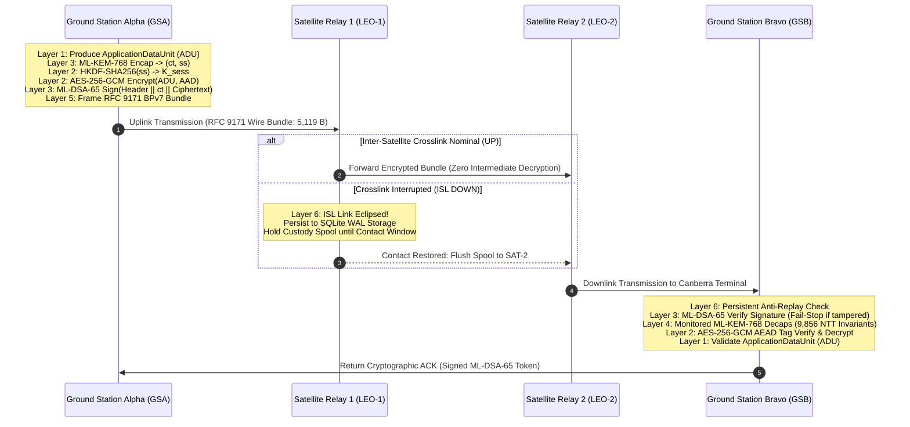
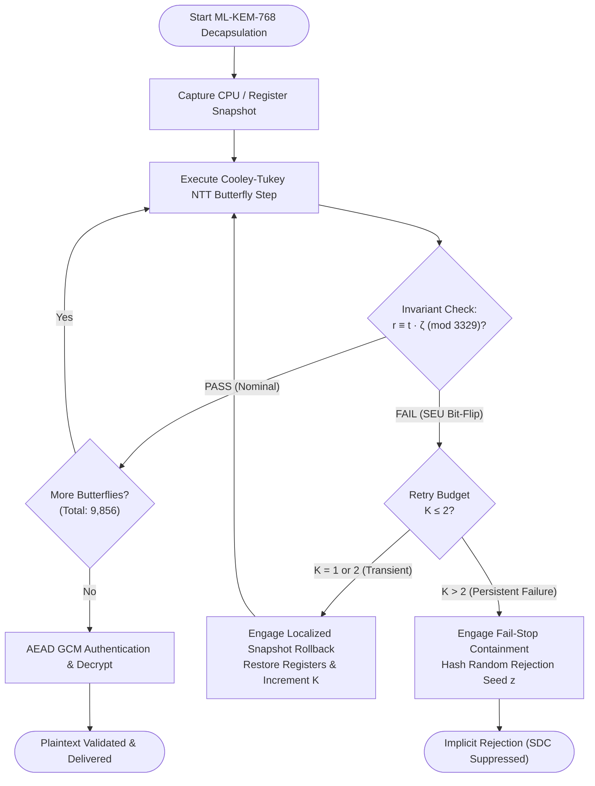

# ASTRA-Sec: Adaptive and Secure Transmission with Resilient Authentication for Space Networks

[](https://opensource.org/licenses/MIT)
[](https://csrc.nist.gov/publications/fips)
[](https://www.rfc-editor.org/rfc/rfc9171)
[](https://www.python.org/downloads/)
[](https://en.wikipedia.org/wiki/C11_(C_standard_revision))
[]()

> **Permanent Research Title:**  
> *"Fault Resilience Analysis of Post-Quantum Cryptographic Implementations for Space Systems"*
>
> **Working Architecture Title:**  
> *"A Fault-Resilient Post-Quantum End-to-End Security Framework for Satellite Communication"*

---

## 1. Project Overview & Research Mission

**ASTRA-Sec** is an open-source, reproducible research testbed and software framework providing post-quantum authenticated end-to-end security, Single-Event Upset (SEU) fault resilience, and delay-tolerant messaging for space networks.

### 1.1 The Operational Problem
Modern satellite mega-constellations and deep-space communications operate in extreme physical and electromagnetic environments:
1. **High Latency & Intermittent Connectivity**: Satellite-to-ground and inter-satellite crosslinks (ISL) suffer orbital occultations, high packet delay, and frequent link disruptions requiring Delay-Tolerant Networking (DTN).
2. **Quantum Threat (Store-Now, Decrypt-Later)**: Adversaries intercepting satellite downlinks today can store encrypted payloads until cryptanalytically relevant quantum computers (CRQCs) can break classical asymmetric cryptography (RSA, ECDH, ECDSA). Spacecraft with 10–20 year operational lifespans must deploy Post-Quantum Cryptography (PQC) today.
3. **Space Radiation & Single-Event Upsets (SEUs)**: Cosmic rays, solar energetic particles, and trapped radiation belt protons induce bit-flips in spacecraft SRAM and registers. In lattice-based post-quantum algorithms like ML-KEM, an unmitigated bit-flip in the Number Theoretic Transform (NTT) twiddle factors or butterfly computations induces **Silent Data Corruption (SDC)** or catastrophic decapsulation failure.

### 1.2 What ASTRA-Sec Demonstrates
ASTRA-Sec answers these challenges with a unified 7-layer aerospace protocol architecture that integrates:
- **NIST FIPS 203 ML-KEM-768** key encapsulation for post-quantum forward secrecy.
- **NIST FIPS 204 ML-DSA-65** lattice-based digital signatures for authentic telemetry and command validation.
- **Dual-Transform NTT Butterfly Invariant Checking ($r \equiv t \cdot \zeta \pmod q$)**: Monitoring 9,856 mathematical butterfly invariants per decapsulation to detect ionizing radiation faults mid-execution.
- **Localized Register Snapshot Rollback ($K \le 2$)**: Recovering from transient SEUs without re-transmitting across long-delay space links.
- **Fail-Stop Implicit Rejection**: Suppressing SDC by hashing pseudo-random rejection seeds upon persistent hardware failure.
- **RFC 9171 Bundle Protocol v7 (BPv7) with Persistent SQLite WAL Spooling**: Guaranteeing zero bundle loss during orbital crosslink eclipses.
- **NASA Open MCT-Inspired 3D Mission Control**: Real-time astrodynamics with CelesTrak SGP4 orbital propagation, high-fidelity 3D spacecraft models, and deep cryptographic observability.

> [!IMPORTANT]
> **Research Testbed Scope**: ASTRA-Sec is a software engineering and experimental research testbed. It operates real post-quantum cryptography, real C mathematical invariant checkers, real persistent transactional spools, and real SGP4 orbital propagation algorithms. It does **not** claim physical radio frequency (RF) spacecraft flight or direct orbital hardware deployment.

---

## 2. Key Capabilities & Implementation Status Matrix

Every capability listed below is backed by operational source code and automated tests:

| Subsystem | Architectural Capability | Standard / Spec | Status |
| :--- | :--- | :--- | :--- |
| **Post-Quantum Cryptography** | ML-KEM-768 Key Encapsulation (FIPS 203) | NIST FIPS 203 | **IMPLEMENTED & VERIFIED** |
| | ML-DSA-65 Digital Signatures (FIPS 204) | NIST FIPS 204 | **IMPLEMENTED & VERIFIED** |
| | HKDF-SHA256 Session Key Expansion | RFC 5869 | **IMPLEMENTED & VERIFIED** |
| | AES-256-GCM Bulk Envelope AEAD | NIST SP 800-38D | **IMPLEMENTED & VERIFIED** |
| | Deterministic Canonical AAD Header Binding | ASTRA L2 Spec | **IMPLEMENTED & VERIFIED** |
| **Fault Resilience (L4)** | Dual-Domain Twiddle Invariant Checking ($r \equiv t\zeta$) | Kyber $q=3329$ | **IMPLEMENTED & VERIFIED** |
| | 9,856 Butterfly Invariant Executions / Decaps | 11 layers $\times$ 128 | **IMPLEMENTED & VERIFIED** |
| | Localized Register Rollback ($K \le 2$) | TFIB-Ref Spec | **IMPLEMENTED & VERIFIED** |
| | Fail-Stop Implicit Rejection Suppression | FIPS 203 Sec 7.3 | **IMPLEMENTED & VERIFIED** |
| **DTN Transport (L5/L6)** | RFC 9171 Bundle Protocol v7 (BPv7) Framing | RFC 9171 | **IMPLEMENTED & VERIFIED** |
| | RFC 9172 BPSec Block Integrity Block (BIB) | RFC 9172 | **IMPLEMENTED & VERIFIED** |
| | Persistent SQLite WAL Transactional Spooling | ACID WAL Mode | **IMPLEMENTED & VERIFIED** |
| | Replay Attack Filter (Monotonic Sequence Filter)| ASTRA L6 Spec | **IMPLEMENTED & VERIFIED** |
| | Out-of-Order Delivery & Custody Transfer | ASTRA L6 Spec | **IMPLEMENTED & VERIFIED** |
| **Network Testbed** | 4-Node Space Constellation (GSA-SAT1-SAT2-GSB)| Multi-Hop DTN | **IMPLEMENTED & VERIFIED** |
| | Dynamic Inter-Satellite Crosslink (ISL) Outages| Contact Graph | **IMPLEMENTED & VERIFIED** |
| | Zero-Decryption Space Relay Routing | L5 Transit Only | **IMPLEMENTED & VERIFIED** |
| **Astrodynamics & 3D** | Real Public TLE Ephemerides (CelesTrak) | SGP4 Revised 2006 | **IMPLEMENTED & VERIFIED** |
| | 100% Offline Air-Gapped TLE Cache Fallback | ASTRA L7 Spec | **IMPLEMENTED & VERIFIED** |
| | High-Fidelity 3D Spacecraft & Radome Models | Three.js Procedural| **IMPLEMENTED & VERIFIED** |
| | Real-Time SGP4 Velocity & 3D ISL Range Tracking| Keplerian Math | **IMPLEMENTED & VERIFIED** |
| **Observability & FDIR**| 14-Dimension Real-Time Telemetry Engine | NASA Open MCT | **IMPLEMENTED & VERIFIED** |
| | Microsecond Monotonic Latency Timestamping | POSIX Monotonic | **IMPLEMENTED & VERIFIED** |
| | WebSocket Live Broadcast & JSONL Audit Journal | RFC 6455 | **IMPLEMENTED & VERIFIED** |
| | Low-Overhead Verification ($0.81\% < 1.0\%$ bound)| Real-Time Guard | **IMPLEMENTED & VERIFIED** |

---

## 3. End-to-End System Architecture

ASTRA-Sec enforces a strict **7-Layer Separation of Concerns**. Intermediate space relays (SAT-1 and SAT-2) route DTN bundles at Layer 5/6, but **never possess cryptographic keys to decrypt Layer 2 application payloads**.



---

## 4. Cryptographic Security Architecture

ASTRA-Sec implements hybrid-resistant post-quantum security conforming to international standards:

### 4.1 FIPS 203 ML-KEM-768 (Key Encapsulation)
- **Role**: Post-quantum key agreement. ML-KEM establishes shared symmetric key material; it does **not** encrypt the bulk application payload directly.
- **Parameters**: Modulus $q = 3329$, degree $k = 3$, $n = 256$, ciphertext length $= 1,088$ bytes, public key $= 1,184$ bytes, secret key $= 2,400$ bytes, shared secret $= 32$ bytes.
- **Standards & Provenance**: C reference implementation clean-room integrated from `mlkem-native` (commit `fc269bc2d106`), verified against NIST FIPS 203 Known Answer Tests (KATs).

### 4.2 FIPS 204 ML-DSA-65 (Digital Signatures)
- **Role**: Origin authentication, integrity, and non-repudiation.
- **Parameters**: Modulus $q = 8380417$, matrix dimension $k=6, l=5$, public key $= 1,952$ bytes, signature length $= 3,309$ bytes.
- **Standards & Provenance**: Integrated from `mldsa-native` (commit `88a5369bb911`), verified against NIST FIPS 204 KAT vectors.

### 4.3 Symmetric Bulk AEAD & Envelope Derivation
- **HKDF-SHA256 (RFC 5869)**: Expands the 32-byte decapsulated KEM shared secret with domain salt `"astra-sec-salt-v1"` and info `"astra-sec-payload-v1"` into a 256-bit symmetric key.
- **AES-256-GCM (NIST SP 800-38D)**: Provides authenticated encryption with associated data (AEAD). Encrypts the application plaintext with a unique 12-byte random nonce and produces a 16-byte authentication tag.
- **Canonical AAD Binding**: The authenticated associated data binds the message header deterministically:
  $$\text{AAD} = \text{EID}_{\text{src}} \parallel \text{EID}_{\text{dst}} \parallel \text{SequenceID} \parallel \text{Timestamp} \parallel \text{TTL}$$
  Any tampering with header fields causes immediate GCM tag authentication failure before plaintext exposure.

---

## 5. Software-Level Fault Resilience (NTT Invariant Monitoring)

In orbital radiation environments, a single bit-flip during the Number Theoretic Transform (NTT) produces catastrophic decapsulation failure or Silent Data Corruption (SDC). ASTRA-Sec deploys **Two-Factor Invariant Butterfly Monitoring (TFIB-Ref)**.



### Invariant Rules
- **Mathematical Invariant**: During polynomial multiplication in $\mathbb{Z}_q[X]/(X^{256} + 1)$, every butterfly intermediate satisfies $r \equiv t \cdot \zeta \pmod{3329}$.
- **Verified Coverage**: Exactly **9,856 butterfly invariants** are evaluated per decapsulation ($11 \text{ transforms} \times 128 \text{ butterfly pairs}$).
- **Rollback Budget**: Localized retry budget is bounded by $K \le 2$. Upon second failure, the system triggers fail-stop implicit rejection, generating a pseudo-random seed that prevents key recovery attacks.

---

## 6. Delay-Tolerant Networking (DTN) Architecture

```
+-----------------------------------------------------------------------------------+
|                        RFC 9171 BUNDLE PROTOCOL v7 (BPv7)                         |
+-----------------------------------------------------------------------------------+
|  Primary Block:                                                                   |
|    - Version: 7 | Bundle Processing Flags (Custody, Storage, Delivery Reports)    |
|    - Source EID: dtn://gsa/app | Destination EID: dtn://gsb/app                   |
|    - Creation Timestamp: (DTN Epoch Sec, Sequence Number) | Lifetime: 86400s      |
+-----------------------------------------------------------------------------------+
|  BPSec Block Integrity Block (BIB - RFC 9172):                                    |
|    - Target: Payload Block | Cipher Suite: ML-DSA-65 (NIST FIPS 204)              |
|    - Signature: 3,309 bytes canonical wire signature                              |
+-----------------------------------------------------------------------------------+
|  Payload Block:                                                                   |
|    - PQC Key Encapsulation: ML-KEM-768 Ciphertext (1,088 bytes)                   |
|    - Initialization Vector: AES-GCM Nonce (12 bytes)                              |
|    - Ciphertext Payload: AES-256-GCM Encrypted Application Data                   |
|    - Authentication Tag: AES-GCM Tag (16 bytes)                                   |
+-----------------------------------------------------------------------------------+
```

- **Persistent Spool (SQLite WAL)**: Satellite relays store bundles in transactional SQLite tables with Write-Ahead Logging (`PRAGMA journal_mode=WAL; PRAGMA synchronous=NORMAL;`).
- **Zero Loss Under Outage**: If an inter-satellite link is interrupted, bundles remain safely spooled in non-volatile storage until contact restoration.
- **Anti-Replay Security**: Destination nodes maintain persistent monotonically increasing sequence filters; replayed bundles are rejected without decrypting payload data.

---

## 7. Repository Directory Structure

```
pqc-research/
├── Makefile                       # Top-level developer command interface
├── pyproject.toml                 # Python project configuration & dependencies
├── .env.example                   # Environment configuration template
├── README.md                      # This master technical specification
├── RELEASE_HANDOVER.md            # Quick-start onboarding guide for new contributors
├── CONTRIBUTING.md                # Engineering standards & contribution protocols
│
├── algorithms/                    # C Cryptographic baseline implementations
│   ├── ml-kem/                    # Path A LibOQS ML-KEM harness
│   ├── ml-dsa/                    # Path A LibOQS ML-DSA harness
│   └── source_ref/                # Path B Native C99 reference implementations
│       ├── mlkem/                 # Clean FIPS 203 ML-KEM-768 native source
│       └── mldsa/                 # Clean FIPS 204 ML-DSA-65 native source
│
├── astra_sec/                     # ASTRA-Sec Python core production framework
│   ├── core/                      # Configuration, exceptions, logging, telemetry engine
│   ├── crypto/                    # Adapters for ML-KEM, ML-DSA, AES-GCM, HKDF
│   ├── network/                   # Routing, BPv7 framing, relay spool, simulation
│   ├── schema/                    # Pydantic v2 envelope, network, telemetry, orbital models
│   ├── service/                   # Ground station services, orbital propagation service
│   ├── security/                  # Trust store, verifier, authorization policy
│   └── dashboard/                 # NASA Open MCT flight operations interface (FastAPI)
│       └── static/                # HTML, CSS, 3D Globe.gl, textures, Three.js assets
│
├── data/                          # Runtime data, TLE ephemerides, telemetry journals
│   ├── orbital/                   # Cached public TLE datasets (CelesTrak)
│   └── telemetry/                 # Live JSONL telemetry logs (live_events.jsonl)
│
├── docs/                          # Detailed engineering documentation
│   ├── ARCHITECTURE.md            # 7-layer architecture, invariants, and trust model
│   ├── DEVELOPMENT_SETUP.md       # Step-by-step developer environment setup
│   ├── RESEARCH_METHODOLOGY.md    # Hypotheses, experiment design, metrics
│   ├── EXPERIMENT_REPRODUCTION.md # Commands to reproduce empirical campaigns
│   ├── DASHBOARD_GUIDE.md         # NASA Open MCT UI navigation & operating manual
│   ├── API_REFERENCE.md           # REST API routes and WebSocket telemetry schemas
│   ├── CRYPTOGRAPHIC_IMPLEMENTATION.md # C/Python cryptographic specifications
│   ├── FAULT_RESILIENCE.md        # Mathematical NTT twiddle invariant analysis
│   ├── DTN_IMPLEMENTATION.md      # Bundle Protocol v7, CBOR, SQLite WAL storage
│   ├── KNOWN_LIMITATIONS.md       # Honest boundary enumeration & future work
│   └── phases/                    # 1080p Playwright verification screenshots
│
├── experiments/                   # Fault injection campaigns & statistical scripts
├── research/                      # Phased research acceptance reports (Phase 1 to 7)
├── results/                       # Empirical trial datasets (JSON, CSV)
├── scripts/                       # Experimental lab runners & reproduction tools
├── src/                           # Native C-Python bridge (astra_crypto_bridge.c)
├── tests/                         # Complete unit, integration, and KAT test suites
└── tfib_implementation/           # Two-Factor Invariant Butterfly (TFIB) C library
```

---

## 8. Prerequisites & Compatibility

### Verified Development Environments
- **macOS**: macOS 14.x / 15.x (Apple Silicon M1/M2/M3/M4 and Intel x86_64) with Xcode Command Line Tools.
- **Linux**: Ubuntu 22.04 LTS / 24.04 LTS, Debian 12, RHEL 9 (`gcc` or `clang`, `make`, `python3-dev`).

### Required Toolchains
- **Python**: Version 3.9 or higher (tested on 3.9, 3.10, 3.11, 3.12).
- **C Compiler**: Clang (LLVM 14+) or GCC (version 10+) supporting C99/C11 standards.
- **Build System**: GNU Make 3.81+.
- **Database**: SQLite 3.35+ (bundled with standard Python).
- **Web Browser**: Chrome, Edge, Safari, or Firefox with WebGL enabled for 3D Globe visualization.
- **Optional Native Library**: `liboqs` 0.10+ (optional for comparative testing; system includes self-contained native C99 implementations).

---

## 9. Clean Installation Guide (Step-by-Step)

Follow these exact commands to configure ASTRA-Sec from a clean repository clone:

```bash
# 1. Clone the repository on branch astra-sec
git clone --branch astra-sec --single-branch https://github.com/dhairyajain/pqc-research.git
cd pqc-research

# 2. Create and activate a virtual environment
python3 -m venv .venv
source .venv/bin/activate

# 3. Upgrade pip and install Python dependencies
pip install --upgrade pip
pip install -r requirements/dev.txt
pip install -e .

# 4. Copy the environment template
cp .env.example .env

# 5. Build native C cryptographic libraries and harnesses
make build

# 6. Verify system diagnostic health
make health-check
```

Upon executing `make health-check`, you should see:
```text
=========================================================================
 ASTRA-Sec System Diagnostic Health Report — Version 0.1.0
=========================================================================
 Node EID:        dtn://gsa/app
 Node Role:       originator
 Overall Status:  OK
 Component Breakdown:
   [PASS] configuration      : PASS
   [PASS] storage            : PASS
   [PASS] c_crypto_engine    : PASS
=========================================================================
```

---

## 10. Running the System & Mission Control Dashboard

ASTRA-Sec features an interactive, NASA Open MCT-inspired flight operations dashboard:

```bash
# Start the Mission Control backend on http://127.0.0.1:8000
make dashboard
```

Open your browser to:
**`http://127.0.0.1:8000`**

### What You Can Do in Mission Control:
1. **Interactive 3D Earth & Spacecraft**:
   - Inspect Ground Station Alpha (Svalbard), Ground Station Bravo (Canberra), SAT-1, SAT-2, and the real ISS reference orbit.
   - Click any satellite to view real-time SGP4 velocity ($7.59\ \text{km/s}$), altitude ($550\ \text{km}$), and sub-satellite coordinates.
2. **Execute Dispatch Scenarios**:
   - **Nominal E2E Transmission**: Transmits a $5,119\ \text{B}$ post-quantum bundle across GSA $\rightarrow$ SAT-1 $\rightarrow$ SAT-2 $\rightarrow$ GSB.
   - **ISL Outage & Spooling**: Severs the crosslink; observe the packet halt at SAT-1 and persist in SQLite WAL storage.
   - **NTT Transient SEU**: Injects a twiddle factor bit-flip; observe the L4 invariant alert and $K=1$ register rollback recovery.
   - **Persistent Fault Fail-Stop**: Injects recurring SEUs; observe fail-stop implicit rejection suppression after retry budget ($K > 2$) exhaustion.
   - **Anti-Replay Attack**: Injects a duplicate bundle; observe immediate rejection by the persistent sequence filter.
   - **Tampered Signature**: Corrupts 1 bit of the ML-DSA-65 signature; observe immediate L3 rejection.
3. **Camera Views**:
   - Quickly switch views using `🌐 Orbit View`, `🛰️ SAT-1`, `🛰️ SAT-2`, `📡 GSA`, `🏢 GSB`, or `🛰️ ISS Ref`.

---

## 11. Testing & Quality Assurance

ASTRA-Sec maintains automated test suites across C, Python, and multi-node network simulations:

```bash
# 1. Run all Python unit and integration tests (59 test cases)
make test-python

# 2. Run C Known Answer Tests (KATs) and fault injection campaigns
make test-c

# 3. Comprehensive verification (both C & Python)
make test

# 4. Check system diagnostic health
make health-check

# 5. Run Python syntax validation
make lint
```

---

## 12. Reproducing Published Empirical Experiments

To reproduce the statistical benchmarks and experimental campaigns documented in research reports:

```bash
# 1. Validate all experiment configuration files
make lab-validate

# 2. Execute a fast pilot validation campaign
make lab-pilot

# 3. Execute the full empirical laboratory suite (Groups A, B, D, E, G, J)
make lab-campaign

# 4. Run cryptographic micro-benchmarks
python3 benchmarks/micro_benchmarks.py
```

Results are saved to `results/` in structured JSON and CSV formats with confidence intervals and sample standard deviations.

---

## 13. Research Boundaries & Limitations

ASTRA-Sec maintains strict research honesty. Contributors must understand the following physical and architectural boundaries:

1. **Simulation vs Physical Hardware**: The 4-node space constellation is evaluated via multi-process asynchronous networking and SGP4 orbital propagation. It is not deployed on physical orbiting satellites.
2. **Software Fault Injection vs Physical Radiation**: Bit-flips are injected into memory-mapped coefficient registers and butterfly functions via controlled C hooks. While mathematically identical to single-bit Single-Event Upsets (SEU), this does not measure total ionizing dose (TID) or latch-up effects.
3. **DTN Implementation**: ASTRA-Sec implements RFC 9171 BPv7 framing and persistent SQLite WAL custody transfer. While interoperable in format, it is a specialized lightweight implementation, not native NASA/JPL ION-DTN.
4. **Bulk Encryption**: ML-KEM-768 is exclusively a key encapsulation mechanism. Bulk payloads are encrypted using symmetric AES-256-GCM.

---

## 14. License & Acknowledgements

ASTRA-Sec is licensed under the **MIT License**. See [`LICENSE`](file:///Users/dhairyajain/Desktop/pqc%20research/LICENSE) for details.

### Third-Party Projects & Acknowledgements
- **`mlkem-native` & `mldsa-native`**: High-assurance clean-room C implementations of FIPS 203 and FIPS 204.
- **NASA Open MCT**: Visual composition and telemetry layout patterns.
- **Globe.gl & Three.js**: Open-source 3D geospatial rendering engine (MIT License).
- **`satellite.js`**: SGP4 satellite propagation library (MIT License).
- **CelesTrak**: Public orbital Two-Line Element (TLE) ephemeris data.
