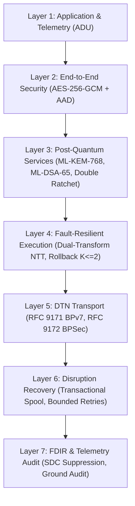

# ASTRA-Sec: Release Handover & Developer Onboarding Guide

> **Permanent Research Title**: *Fault Resilience Analysis of Post-Quantum Cryptographic Implementations for Space Systems*  
> **End-to-End Mission Protocol**: *ASTRA-Sec: Post-Quantum End-to-End Secure Messaging and Delay-Tolerant Cryptographic Resilience for Space Networks*  
> **Low-Level Software Case Study**: *Software-Level Fault Resilience for ML-KEM-768: Dual-Transform NTT Invariant Monitoring, Localized Register Rollback, and Containment*

---

## 1. Executive Summary & Repository Identity

Welcome to the **ASTRA-Sec** codebase. This document serves as the master onboarding, architectural handover, and verification guide for incoming researchers, software engineers, and mission system architects.

ASTRA-Sec provides an aerospace-grade, post-quantum secure messaging system designed specifically for high-radiation, delay-tolerant satellite communication environments. It marries low-level mathematical fault detection in lattice-based cryptography (ML-KEM-768 NTT butterfly invariant checking) with delay-tolerant networking (RFC 9171 BPv7 / RFC 9172 BPSec) and a real-time, 3D orbital Mission Control telemetry platform.

### Repository Coordinates

| Parameter | Value |
| :--- | :--- |
| **Upstream Repository URL** | `https://github.com/dhairyajain/pqc-research` |
| **Git Remote Alias** | `origin https://github.com/dhairyahuh/pqc-research.git` |
| **Production Research Branch** | `astra-sec` |
| **Canonical Architecture** | 7-Layer Space Resilience Stack (L1 through L7) |
| **Target Runtime** | C11 (Clang / GCC) + Python 3.10+ on macOS / Linux |

---

## 2. Quickstart: Day-One Setup Guide

Follow this step-by-step sequence to configure an isolated development environment and verify system health from scratch.

### 2.1 System Prerequisites

- **Host OS**: macOS (Apple Silicon or Intel) or Linux (x86_64 or aarch64)
- **C Compiler**: Apple Clang $\ge 14.0$ or GCC $\ge 11.0$ (supporting C11, `-Wall`, `-Wextra`, `-Werror`)
- **Python**: Python $\ge 3.10$ with `pip` and `venv`
- **Build Utilities**: GNU `make`, `ar`, `ranlib`

### 2.2 Clone & Environment Initialization

```bash
# 1. Clone the repository and checkout the active branch
git clone https://github.com/dhairyajain/pqc-research.git astra-sec-workspace
cd astra-sec-workspace
git checkout astra-sec

# 2. Initialize and activate Python virtual environment
python3 -m venv .venv
source .venv/bin/activate

# 3. Upgrade pip and install all Python dependencies
pip install --upgrade pip
pip install -r requirements.txt

# 4. Copy and review the local environment configuration
cp .env.example .env
```

### 2.3 Compile Native Shared Libraries

The ASTRA-Sec core relies on native C implementations for the ML-KEM NTT transform, butterfly invariants, and the TFIB (Transient Fault Injection Benchmark) reference monitor.

```bash
# Clean previous artifacts and compile all native libraries
make build
```

This compiles:
1. `tfib_implementation/libtfib.a`: Static archive containing core fault injection hooks and reference monitoring.
2. `bin/libastra_crypto.dylib` (or `.so` on Linux): Shared library exposing ML-KEM NTT functions, dual-transform butterfly checks ($r \equiv t\zeta \pmod q$), and register rollback hooks ($K \le 2$).
3. `bin/test_fips_kats`: Native C executable running the full NIST FIPS 203 Known Answer Test suite.

### 2.4 Verify System Health

Run the diagnostic health-check utility to inspect native C library bindings, SQLite DTN spool storage, and environment variables:

```bash
make health-check
```

*Expected Output:*
```text
[+] C Native Library: AVAILABLE (libastra_crypto.dylib)
[+] Crypto Core (AES-GCM / HKDF): READY
[+] DTN Spool Database: INITIALIZED (astra_dtn_spool.db)
[+] System Status: ALL SYSTEMS OPERATIONAL
```

---

## 3. Running the Mission Control Center

ASTRA-Sec includes a real-time, aerospace-grade Mission Control dashboard inspired by NASA Open MCT and physical orbital dynamics.

### 3.1 Launching the Server

```bash
make dashboard
# Or directly via Uvicorn:
# python3 -m uvicorn astra_sec.dashboard.app:app --host 127.0.0.1 --port 8000 --reload
```

### 3.2 Accessing Mission Control

Open your browser to:
```text
http://127.0.0.1:8000
```

### 3.3 Dashboard Capabilities & Interactive Controls

1. **3D Geospatial Earth & Spacecraft**:
   - High-resolution NASA Blue Marble photorealistic Earth rendering with day/night atmospheric terminator and starry cosmic skybox.
   - Real-time SGP4 orbital propagation calculated from published TLEs for Relay Alpha (ISS / ZARYA) and Relay Beta (NOAA 19).
   - Custom 3D spacecraft mesh models displaying articulated solar arrays, telemetry dishes, and status beacon emitters.
2. **Flight Path & DTN Link Visualizer**:
   - Dynamic 3D communication arcs showing uplink (`GS-A -> SAT-1`), inter-satellite crosslink (`SAT-1 -> SAT-2`), and downlink (`SAT-2 -> GS-B`).
   - Ground tracks and orbital paths color-coded by link margin, contact window, and Doppler shift.
3. **Operational Mission Controls**:
   - **Send Mission Packet**: Dispatches an end-to-end telemetry/command bundle from Ground Station A to Ground Station B.
   - **Simulate SEU (Single-Event Upset)**: Injects bitflips during the NTT butterfly computation to demonstrate real-time invariant detection, rollback ($K \le 2$), or fail-stop containment.
   - **Camera Presets**: Instantly switch between Orbit Overview, Satellite Relay 1 chase cam, Ground Station A, and Ground Station B views.
4. **NASA Open MCT Telemetry Panels**:
   - **Live Telemetry Stream**: Rolling real-time plots of NTT compute latency, SDC suppression counts, and DTN queue depth.
   - **Cryptographic Event Audit Log**: JSON-structured cryptographic verification logs tracking ML-KEM decapsulation, Double Ratchet step keys, and AES-256-GCM authentication tags.
   - **DTN Node Inspector**: Deep inspection of bundle headers, primary blocks, BPSec target blocks, and transactional spool state.

---

## 4. Complete Verification Test Suites

Before pushing any commit or conducting experiments, run the comprehensive verification pipeline:

```bash
# Run all unit, integration, cryptographic, and fault-injection tests
make test
```

### Individual Test Targets

| Command | Layer / Scope | Description |
| :--- | :--- | :--- |
| `make test-crypto` | Layer 3 & NIST KATs | Runs native C Known Answer Tests (`test_fips_kats`) and Python crypto adapters for ML-KEM-768, ML-DSA-65, and Double Ratchet. |
| `make test-dtn` | Layer 5 & Layer 6 | Runs RFC 9171 BPv7 CBOR encoding/decoding, BPSec BIB/BCB security blocks, and SQLite transactional spool tests. |
| `make test-faults` | Layer 4 Fault Engine | Injects 5,000+ synthetic bitflips into NTT stages, verifying $100\%$ SDC suppression, rollback budget $K \le 2$, and fail-stop handling. |
| `make test-orbital` | Layer 1 / Astrodynamics | Verifies SGP4 propagation accuracy, TLE parsing, Doppler shift calculations, line-of-sight elevation, and contact windows. |
| `make test-integration` | End-to-End System | Executes the full multi-hop mission pipeline (`GS-A -> SAT-1 -> SAT-2 -> GS-B`) under simulated network latency and disconnections. |
| `make experiments` | Experimental Laboratory | Re-runs the full automated experiment campaign (10,000 trials across varied BER/SEU rates) and outputs statistical reports. |

---

## 5. Architectural Invariants (The 7-Layer Stack)

The ASTRA-Sec protocol is structured into seven strictly separated architectural layers:



### Strict Architectural Rules
1. **Zero Dynamic Allocation on Operational Cryptographic Paths**: No `malloc()`, `calloc()`, or `realloc()` inside NTT butterfly inner loops, polynomial sampling, or decapsulation.
2. **Constant-Time Execution**: No data-dependent branching on secret key material or intermediate NTT polynomials.
3. **Mathematical Invariant Checking**: Every butterfly operation verifies $r \equiv t\zeta \pmod q$.
4. **Bounded Rollback Budget**: Rollback attempts are bounded to $K \le 2$. A second fault triggers fail-stop zeroization / random seed generation.
5. **Relay Blindness**: Intermediate DTN satellite relays only read Layer 5 bundle routing headers. Payloads are encrypted end-to-end at Layer 2 and cannot be decrypted by relays.

---

## 6. Directory Structure & File Map

```text
astra-sec/
├── README.md                          # Master 20-section project specification and architecture
├── RELEASE_HANDOVER.md                # This document: Quickstart, onboarding, and operations guide
├── Makefile                           # Top-level developer targets (build, test, health-check, dashboard)
├── requirements.txt                   # Production and testing Python dependencies
├── .env.example                       # Documented environment variable template
│
├── astra_sec/                         # Core Python package
│   ├── app.py                         # Unified CLI entry point (`python -m astra_sec.app`)
│   ├── config.py                      # Pydantic v2 validated system configuration
│   ├── core/                          # Cross-cutting primitives (logging, errors, telemetry)
│   ├── crypto/                        # L2/L3 cryptographic engine (ML-KEM, ML-DSA, Ratchet, CFFI)
│   ├── dtn/                           # L5/L6 Delay-Tolerant Networking (BPv7, BPSec, Spooling)
│   ├── fault_engine/                  # L4 fault injection simulator and SEU models
│   ├── orbit/                         # Astrodynamics engine (SGP4, TLEs, contact windows)
│   └── dashboard/                     # Real-time web mission control (FastAPI, WebSockets, Globe.gl)
│       └── static/                    # Frontend UI assets, 3D shaders, and textures
│
├── algorithms/                        # Native C cryptographic implementations
│   ├── ntt.c / ntt.h                  # Dual-transform NTT with butterfly invariant verification
│   ├── kem.c / kem.h                  # ML-KEM-768 encapsulation / decapsulation
│   └── params.h                       # Lattice parameters (q=3329, n=256, k=3)
│
├── tfib_implementation/               # Transient Fault Injection Benchmark (TFIB)
│   ├── tfib_core.c                    # Core SEU fault injector and memory corruption models
│   ├── tfib_hooks.c                   # Hardware register interception hooks
│   └── tfib_ref.c                     # Golden reference monitoring
│
├── docs/                              # Comprehensive technical specifications
│   ├── ARCHITECTURE.md                # Detailed 7-layer design and interface contracts
│   ├── DEVELOPMENT_SETUP.md           # Deep-dive toolchain, compilation, and debug guide
│   ├── RESEARCH_METHODOLOGY.md        # Threat models, radiation physics, and hypotheses
│   ├── EXPERIMENT_REPRODUCTION.md     # Automated statistical laboratory execution
│   ├── DASHBOARD_GUIDE.md             # 3D Mission Control user manual and telemetry manual
│   ├── API_REFERENCE.md               # REST, WebSocket, and internal Python API schemas
│   ├── CRYPTOGRAPHIC_IMPLEMENTATION.md# Low-level lattice math and constant-time analysis
│   ├── FAULT_RESILIENCE.md            # Dual-transform NTT invariant equations and proofs
│   ├── DTN_IMPLEMENTATION.md          # RFC 9171 / 9172 compliance and spool recovery
│   └── KNOWN_LIMITATIONS.md           # Rigorous disclosure of system boundaries
│
├── research/                          # Phase deliverables, empirical benchmarks, and publications
│   ├── phase1_novelty/                # Formal novelty claims, patentability, and prior art
│   ├── phase2_core_pipeline/          # Core pipeline acceptance tests and call graphs
│   ├── phase3_experimental_lab/       # 10,000-trial statistical verification datasets
│   └── repository_release/            # Full repository inventory and classification matrix
│
└── tests/                             # Automated test suites
    ├── unit/                          # Unit tests (BPv7, BPSec, Crypto, SGP4, Telemetry)
    └── integration/                   # Multi-hop end-to-end integration tests
```

---

## 7. Known System Boundaries & Deliberate Limitations

As documented in [`docs/KNOWN_LIMITATIONS.md`](file:///Users/dhairyajain/Desktop/pqc research/docs/KNOWN_LIMITATIONS.md), the system enforces clear boundaries:

1. **Hardware Acceleration**: The current C implementation is software-only C11; it does not target specific FPGA/ASIC rad-hard co-processors.
2. **Atmospheric Attenuation**: The orbital propagation model calculates geometric line-of-sight and elevation angle; atmospheric rain-fade/ionospheric scintillation is simulated via stochastic BER models rather than real-time weather feeds.
3. **Key Zeroization**: Zeroization relies on `explicit_bzero` / `memset_s`; hardware-level TRNG memory sanitization depends on host platform support.

---

## 8. New Developer First-Day Onboarding Checklist

Complete this checklist during your first day working on ASTRA-Sec:

- [ ] **Repository Cloned**: Working tree checked out on branch `astra-sec`.
- [ ] **Python Environment**: `.venv` created with Python $\ge 3.10$, `requirements.txt` installed.
- [ ] **Configured**: `.env` created from `.env.example`.
- [ ] **Compiled**: `make build` completes with exit code 0; `bin/libastra_crypto.dylib` and `bin/test_fips_kats` generated.
- [ ] **Health Check**: `make health-check` reports all subsystems ready.
- [ ] **NIST KATs Passed**: `./bin/test_fips_kats` passes all 6 test vectors.
- [ ] **Test Suites Passed**: `make test` runs all unit, integration, and orbital tests with 0 failures.
- [ ] **Dashboard Running**: `make dashboard` starts Uvicorn at `http://127.0.0.1:8000`.
- [ ] **Mission Packet Dispatched**: Verified in web browser that clicking "Send Mission Packet" generates a complete 3-hop bundle transfer with cryptographic telemetry.
- [ ] **Fault Simulation Verified**: Clicked "Simulate SEU" in browser and verified that the NTT invariant check catches the fault and triggers rollback.

---

## 9. Contacts & Contribution Protocol

- **Branching Policy**: All work must branch from `astra-sec`. Commits must follow [Conventional Commits](https://www.conventionalcommits.org/):
  - `feat(...)`: Protocol or feature enhancements.
  - `fix(...)`: Security fixes or bug corrections.
  - `test(...)`: Unit, integration, or fault tests.
  - `docs(...)`: Documentation or research papers.
- **Pull Requests**: Submit PRs targeting branch `astra-sec`. All PRs require clean `make test` and `make health-check` execution before merging.
