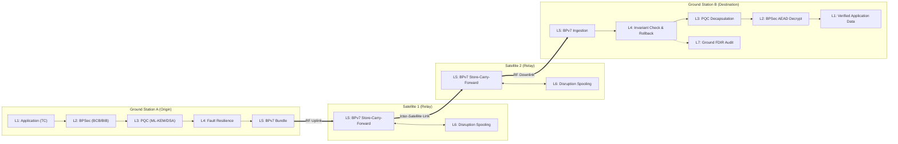
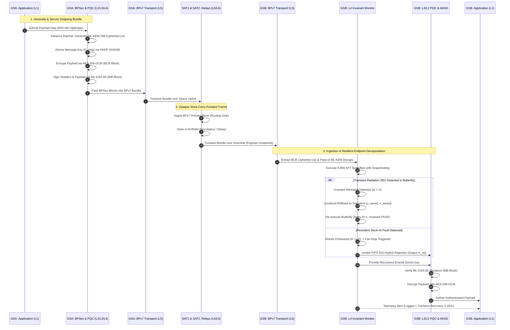

# ASTRA-Sec: System Architecture Specification
## Multi-Layer End-to-End Post-Quantum Resilient Space Communications Framework

**Author:** ASTRA-Sec Development Agent  
**Date:** November 2026  
**Status:** Architecture Proposal (Review Gated)  
**Standard References:** NIST FIPS 203 (ML-KEM), NIST FIPS 204 (ML-DSA), IETF RFC 9171 (BPv7), IETF RFC 9172 (BPSec), CCSDS 355.0-B-1 (SDLS)

---

## 1. System Overview

ASTRA-Sec is an end-to-end, post-quantum cryptographic security framework designed specifically for high-reliability, disruption-tolerant satellite communication networks. It bridges modern lattice-based cryptography, Delay-Tolerant Networking (DTN / Bundle Protocol v7), and sub-word computational fault resilience to secure satellite communications against both quantum adversaries and radiation-induced Single-Event Effects (SEEs).

### 1.1 Core Objectives
1. **End-to-End Security Across Untrusted Relays:** Encrypt and authenticate application bundles at the originating node (e.g., Ground Station A), ensuring intermediate satellite relays forward data without decrypting payload blocks.
2. **Post-Quantum Security Margin:** Deploy NIST FIPS 203 ML-KEM-768 (Category 3) and NIST FIPS 204 ML-DSA-65, preventing "Harvest-Now, Decrypt-Later" eavesdropping.
3. **Continuous Asynchronous Key Ratcheting:** Advance key states monotonically across intermittent, high-delay space links without requiring lockstep synchronous two-way round trips.
4. **Endpoint Radiation Fault Resilience:** Integrate lightweight, division-free algebraic invariant monitoring directly on CPU registers during polynomial arithmetic, recovering transient bit-flips in-place ($R_{max}=2$) and containing persistent faults via FIPS 203 implicit rejection with an empirical SDC bound of $\le 0.49\%$.
5. **Zero-Heap Determinism:** Implement all cryptographic layers in pure C99 without dynamic memory allocation (`malloc`/`free`), ensuring bounded execution latency and stack determinism.

---

## 2. Seven-Layer Architectural Stack

ASTRA-Sec organizes all space communications and cryptographic services into seven strictly decoupled layers, coordinated by a cross-cutting control plane:

```
+----------------------------------------------------------------------------------------------------+
| L1: APPLICATION & MESSAGE GENERATION                                                               |
| Telecommand (TC), Telemetry (TM), Science Payloads, Emergency Beacons, Mission Tasking            |
+----------------------------------------------------------------------------------------------------+
                                                  │
                                                  ▼
+----------------------------------------------------------------------------------------------------+
| L2: END-TO-END MESSAGE SECURITY (BPSec RFC 9172)                                                   |
| Block Confidentiality Blocks (BCB), Block Integrity Blocks (BIB), AES-256-GCM AEAD, PQ-DR Ratchet  |
+----------------------------------------------------------------------------------------------------+
                                                  │
                                                  ▼
+----------------------------------------------------------------------------------------------------+
| L3: POST-QUANTUM CRYPTOGRAPHIC SERVICES                                                            |
| NIST FIPS 203 ML-KEM-768 Encaps/Decaps, NIST FIPS 204 ML-DSA-65 Sign/Verify, HKDF-SHA256 (RFC 5869)|
+----------------------------------------------------------------------------------------------------+
                                                  │
                                                  ▼
+----------------------------------------------------------------------------------------------------+
| L4: FAULT-RESILIENT CRYPTOGRAPHIC EXECUTION                                                        |
| NTT Invariant Monitors (CT/GS), Register Snapshots (u_saved, v_saved), Local Rollback (R_max=2),   |
| Twiddle Factor Integrity Binding (TFIB-Ref), Persistent Fail-Stop to Implicit Rejection (K_rej)   |
+----------------------------------------------------------------------------------------------------+
                                                  │
                                                  ▼
+----------------------------------------------------------------------------------------------------+
| L5: DTN & SPACE-NETWORK TRANSPORT (BPv7 RFC 9171)                                                  |
| Primary Bundle Framing, Extension Block Parsing, EID Addressing (dtn://...), Convergence Layers    |
+----------------------------------------------------------------------------------------------------+
                                                  │
                                                  ▼
+----------------------------------------------------------------------------------------------------+
| L6: DISRUPTION & RECOVERY MANAGEMENT                                                               |
| Non-Volatile Bundle Storage, Asynchronous Retries, Bloom Filter Anti-Replay, State Desync Recovery |
+----------------------------------------------------------------------------------------------------+
                                                  │
                                                  ▼
+----------------------------------------------------------------------------------------------------+
| L7: GROUND-STATION VERIFICATION & AUDIT                                                            |
| FDIR Telemetry Bridge, Invariant Mismatch Logs, Bit-Flip Anomaly Counting, Verification Ledger     |
+----------------------------------------------------------------------------------------------------+
                                                  │
  ==================================================================================================
  CROSS-CUTTING CONTROL PLANE: Identity, Key Lifecycle, Security Policies, FDIR Telemetry, Config
  ==================================================================================================
```

---

## 3. Layer Specifications

### L1: Application and Message Generation
- **Function:** Originates mission data payloads, telecommands (TC), spacecraft housekeeping telemetry (TM), and science files.
- **Data Unit:** Raw Application Data Unit (ADU) with explicit schema identifier, generation timestamp, priority flag, and destination Endpoint Identifier (EID).

### L2: End-to-End Message Security (BPSec Engine)
- **Function:** Implements RFC 9172 Bundle Protocol Security. Wraps target payload blocks in Block Confidentiality Blocks (BCB) and Block Integrity Blocks (BIB).
- **Cipher Suite:** Authenticated Encryption with Associated Data (AEAD) using AES-256-GCM (NIST SP 800-38D).
- **Continuous Ratchet (PQ-DR):** Derives fresh message keys per bundle using an asynchronous Post-Quantum Double Ratchet state machine. Ephemeral ML-KEM ciphertexts are placed in the BCB security parameters.

### L3: Post-Quantum Cryptographic Services
- **Function:** Provides high-assurance, quantum-safe cryptographic primitives:
  - **Asymmetric Key Encapsulation:** NIST FIPS 203 ML-KEM-768 (`crypto_kem_enc`, `crypto_kem_dec`).
  - **Asymmetric Digital Signatures:** NIST FIPS 204 ML-DSA-65 (`crypto_sign_signature`, `crypto_sign_verify`).
  - **Key Derivation:** HKDF-SHA256 (RFC 5869) for symmetric ratchet key expansion and chaining.
- **Constraints:** Strict constant-time execution; zero dynamic memory allocation.

### L4: Fault-Resilient Cryptographic Execution
- **Function:** Protects L3 cryptographic execution against radiation-induced SEUs and SETs:
  - **Sub-word Invariant Monitoring:** Evaluates division-free algebraic invariants across all 9,856 NTT Cooley-Tukey ($u'+v' \equiv 2u$) and Gentleman-Sande butterflies.
  - **Register Snapshotting:** Holds clean operand copies in compiler-mapped CPU registers (`u_saved, v_saved`) prior to butterfly arithmetic execution.
  - **Localized In-Place Rollback:** Restores snapshots and retries faulted butterflies up to $R_{max}=2$ attempts without unwinding call stacks.
  - **Twiddle Factor Integrity Binding (TFIB):** Compares operational twiddles against an independent reference table (`tfib_zetas_ref[128]`) to close Theorem 1 twiddle scalar blindness.
  - **Persistent Fail-Stop:** Bounded retry exhaustion increments persistent error counters, triggering FIPS 203 implicit rejection ($K_{rej}$) to eliminate Silent Data Corruption.

### L5: DTN and Space-Network Transport (BPv7)
- **Function:** Implements IETF RFC 9171 Bundle Protocol Version 7.
- **Addressing:** Uniform Resource Identifier (URI) Endpoint Identifiers: `dtn://<node-name>/<service-name>`.
- **Relay Processing:** Intermediate relay nodes examine only the primary block and routing headers. BPSec security blocks are treated as opaque pass-through data, precluding intermediate decryption.
- **Convergence Layer Adapters (CLA):** Supports TCP/UDP convergence layers (for local process development) and CCSDS Space Packet Protocol / AOS frames (for flight deployment).

### L6: Disruption and Recovery Management
- **Function:** Handles long propagation delays, orbital occultation, and unexpected endpoint reboots:
  - **Persistent Non-Volatile Spooling:** Stores outgoing and in-transit bundles to non-volatile flash memory (NVRAM) with atomic journaling.
  - **Sliding-Window Bloom Filter:** Rejects duplicate bundles resulting from multi-path relaying without unbounded memory growth.
  - **Crash-Consistent Key State:** Ratchet states are committed to non-volatile storage before bundle dispatch, preventing key re-use vulnerabilities across node restarts.

### L7: Ground-Station Verification and Audit
- **Function:** Telemetry ingestion, cryptographic verification, and operational health logging.
- **FDIR Telemetry Bridge:** Extracts arithmetic error counters from L4 (`astra_pqc_telemetry_t`), logs bit-flip frequencies, and alerts operators to physical radiation degradation in orbit.
- **Forensic Verification Ledger:** Correlates received bundle signatures, ratchet indices, and fail-stop occurrences into an append-only audit trail.

---

## 4. Multi-Hop Reference Scenario

The baseline reference deployment models an end-to-end multi-hop space network:

$$\textbf{Ground Station A (GSA)} \longrightarrow \textbf{Satellite 1 (SAT1)} \longrightarrow \textbf{Satellite 2 (SAT2)} \longrightarrow \textbf{Ground Station B (GSB)}$$

- **GSA (`dtn://gsa/app`):** Originator of command or data bundle. Encrypts payload with L2/L3/L4.
- **SAT1 (`dtn://sat1/relay`):** Low Earth Orbit relay satellite. Operates strictly at L5 (store-carry-forward). Payload remains encrypted.
- **SAT2 (`dtn://sat2/relay`):** Intersatellite crosslink relay. Forwards bundle over inter-satellite link. Payload remains encrypted.
- **GSB (`dtn://gsb/app`):** Terminating destination. Decapsulates ML-KEM key with L4 fault resilience, verifies ML-DSA signature, and decrypts payload.



---

## 5. End-to-End Cryptographic Sequence

The sequence diagram below illustrates bundle generation, multi-hop relaying, localized fault recovery, and termination:



---

## 6. Zero-Heap Inter-Layer Data Passing

To guarantee deterministic execution and preclude memory leaks on spaceborne microcontrollers, all data exchanged between layers adheres to fixed, stack-allocated C structures:

```c
/* L2 / L5 Fixed Cryptographic Envelope Buffer */
typedef struct {
    uint8_t  magic[4];               /* 'A', 'S', 'T', 'R' */
    uint32_t protocol_version;       /* 1 */
    uint64_t bundle_sequence_id;     /* Monotonic counter */
    uint64_t ratchet_step;           /* Ratchet sequence index */
    uint8_t  mlkem_ciphertext[1088]; /* NIST FIPS 203 ML-KEM-768 ciphertext */
    uint8_t  gcm_iv[12];             /* Deterministic 96-bit IV */
    uint32_t payload_length;         /* Bounded to ASTRA_MAX_PAYLOAD */
    uint8_t  payload_ciphertext[4096];/* Encrypted payload buffer */
    uint8_t  gcm_tag[16];            /* 128-bit authentication tag */
    uint8_t  mldsa_signature[2420];  /* NIST FIPS 204 ML-DSA-65 signature */
} astra_crypto_envelope_t;
```
All buffers are static or stack-allocated within the 64 KB SRAM limit of standard aerospace microcontrollers.
