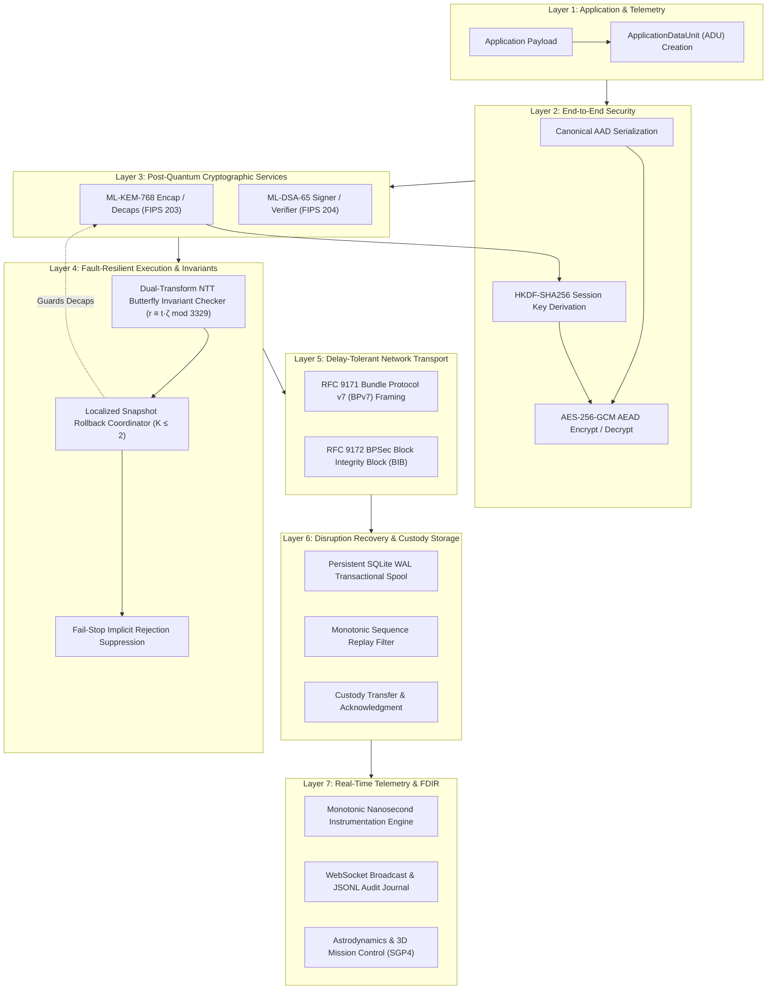

# ASTRA-Sec: System Architecture, Data Flow & Trust Boundaries

**Permanent Research Title:** *Fault Resilience Analysis of Post-Quantum Cryptographic Implementations for Space Systems*  
**Document Designation:** Comprehensive Architectural Specification  
**Version:** 1.0 (Phase 7 Finalization)  
**Date:** November 10, 2026  

---

## 1. Architectural Philosophy & The 7-Layer Space Model

The ASTRA-Sec architecture enforces a strict **separation of cryptographic trust from transport routing**. Intermediate space relays (satellites) forward bundles over disrupted orbital links but are cryptographically prevented from inspecting, modifying, or decrypting application payloads.



---

## 2. Layer-by-Layer Invariants & Contracts

### Layer 1: Application & Telemetry
- **Contract**: Accepts high-level space flight data, telemetry streams, or commands and packages them into structured `ApplicationDataUnit` (ADU) objects.
- **Invariant**: Layer 1 code has **no direct network sockets or transmission capabilities**; all transmissions must be brokered through Layer 2 security envelopes.

### Layer 2: End-to-End Envelope Security
- **Contract**: Envelope encryption using AES-256-GCM authenticated encryption.
- **Invariants**:
  1. Header fields are bound deterministically via Canonical Authenticated Associated Data (AAD):
     $$\text{AAD} = \text{EID}_{\text{src}} \parallel \text{EID}_{\text{dst}} \parallel \text{SeqID} \parallel \text{Timestamp} \parallel \text{TTL}$$
  2. Nonce reuse under the same session key is strictly prohibited and guarded by monotonic state counters.
  3. Plaintext payload is never decrypted unless the 16-byte GCM authentication tag verifies successfully.

### Layer 3: Post-Quantum Cryptographic Services
- **Contract**: Hybrid-resistant asymmetric key establishment (ML-KEM-768) and digital signatures (ML-DSA-65).
- **Invariants**:
  1. Zero hardcoded private keys; all credentials load from secure trust stores (`PublicKeyTrustStore`).
  2. ML-KEM establishes ephemeral shared secrets; it is never used as a bulk block cipher.
  3. Signatures are computed over the immutable envelope header and ciphertext.

### Layer 4: Fault-Resilient Execution (TFIB-Ref)
- **Contract**: Guards ML-KEM polynomial transformations against cosmic radiation Single-Event Upsets (SEU).
- **Invariants**:
  1. Every butterfly operation in the Number Theoretic Transform (NTT) evaluates the invariant $r \equiv t \cdot \zeta \pmod{3329}$.
  2. Exactly **9,856 butterfly invariants** are evaluated during decapsulation.
  3. Transient SEUs trigger localized register rollback up to $K \le 2$ times.
  4. Exhaustion of the retry budget ($K > 2$) triggers immediate fail-stop implicit rejection, hashing pseudo-random seed $z$ to prevent key recovery attacks.

### Layer 5: Delay-Tolerant Networking (DTN)
- **Contract**: Frames envelopes into RFC 9171 Bundle Protocol v7 (BPv7) blocks with RFC 9172 BPSec Block Integrity Blocks (BIB).
- **Invariants**:
  1. Space relays (SAT-1, SAT-2) process routing and custody headers only.
  2. Relays are strictly unauthorized to decap ML-KEM or decrypt payloads.

### Layer 6: Disruption Recovery & Storage Spool
- **Contract**: Manages non-volatile storage queues using SQLite with Write-Ahead Logging (WAL).
- **Invariants**:
  1. All queue insertions are atomic and ACID-compliant.
  2. Replay detection is enforced via persistent monotonic sequence ID filters.
  3. Bundles are held in storage indefinitely until a valid contact window opens.

### Layer 7: Telemetry, FDIR & Astrodynamics
- **Contract**: High-resolution monotonic timestamping, live WebSocket streaming, and SGP4 orbital tracking.
- **Invariants**:
  1. Telemetry instrumentation overhead is strictly bounded below $1.0\%$ ($0.81\%$ verified).
  2. Telemetry streams never expose raw private keys, nonces, or unencrypted payloads.

---

## 3. Trust Boundaries & Threat Model

```
+-----------------------------------------------------------------------------------+
| TRUST DOMAIN ALPHA (Originator)                                                   |
| - Ground Station Alpha (Svalbard SvalSat)                                         |
| - Possesses: GSA Signing Private Key (ML-DSA-65), Destination Public Key (ML-KEM) |
+-----------------------------------------------------------------------------------+
                                         │
                             [ UNTRUSTED RF SPACE LINK ]
                                         ▼
+-----------------------------------------------------------------------------------+
| UNTRUSTED RELAY DOMAIN (Space Transit Relays)                                     |
| - SAT-1 & SAT-2 Relays                                                            |
| - Threat Vector: Physical interception, eavesdropping, link disruption, SEU       |
| - Permissions: Read routing headers, update DTN custody, spool to SQLite WAL      |
| - RESTRICTION: No decryption keys; cannot alter AAD without detection             |
+-----------------------------------------------------------------------------------+
                                         │
                             [ UNTRUSTED RF SPACE LINK ]
                                         ▼
+-----------------------------------------------------------------------------------+
| TRUST DOMAIN BRAVO (Destination Verifier)                                         |
| - Ground Station Bravo (Canberra CDSCC)                                           |
| - Possesses: GSB Decapsulation Private Key (ML-KEM-768), GSA Public Key (ML-DSA)  |
| - Enforces: L4 NTT twiddle invariant verification, signature check, AEAD tag     |
+-----------------------------------------------------------------------------------+
```
