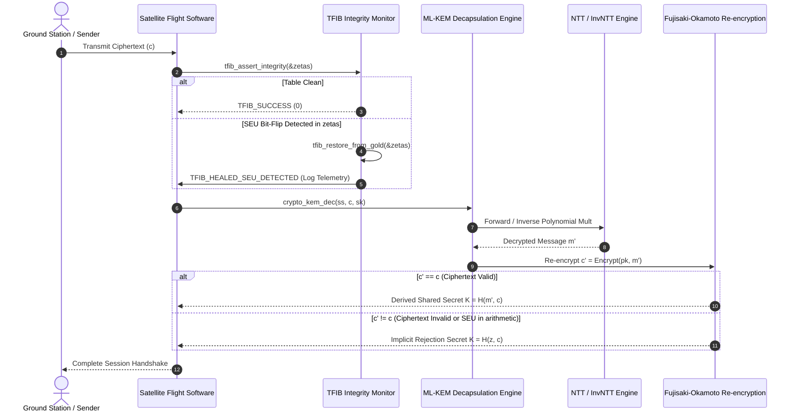

# Cryptographic Execution Flow

This document details the exact execution pipeline for NIST FIPS 203 ML-KEM-768 decapsulation augmented with TFIB (Twiddle Factor Integrity Binding).

## 1. Sequence Diagram: Decapsulation with TFIB Pre-Assertion

## 2. Stage Breakdown

### Stage 1: Pre-Assertion Gate
Before initiating any polynomial transformations, `tfib_assert_integrity` computes a fast bounded hash/checksum of the 128 active 16-bit twiddle factor coefficients in SRAM. The result is compared against the immutable reference value. If an SEU bit-flip is detected, the self-healing subroutine copies the gold table from write-protected storage and logs an SEU telemetry event.

### Stage 2: In-Place Butterfly Operations
The Decapsulation routine executes NTT and inverse-NTT passes over 256-element polynomials in $\mathbb{Z}_q[X]/(X^{256}+1)$ with $q=3329$. Montgomery reduction ensures intermediate 16-bit multiplications remain strictly bounded within $[0, 2q)$.

### Stage 3: Fujisaki-Okamoto Transform (Implicit Rejection)
In ML-KEM decapsulation, after recovering candidate message $m'$, the engine re-encrypts $m'$ using the public key $pk$ to produce $c'$. It performs a constant-time comparison `verify(c, c')`. If the comparison fails (due to invalid input or transient arithmetic faults), it returns $K = \text{SHAKE256}(z \| c)$, deterministically rejecting the input without disclosing whether rejection stemmed from authentication failure or bit errors.

