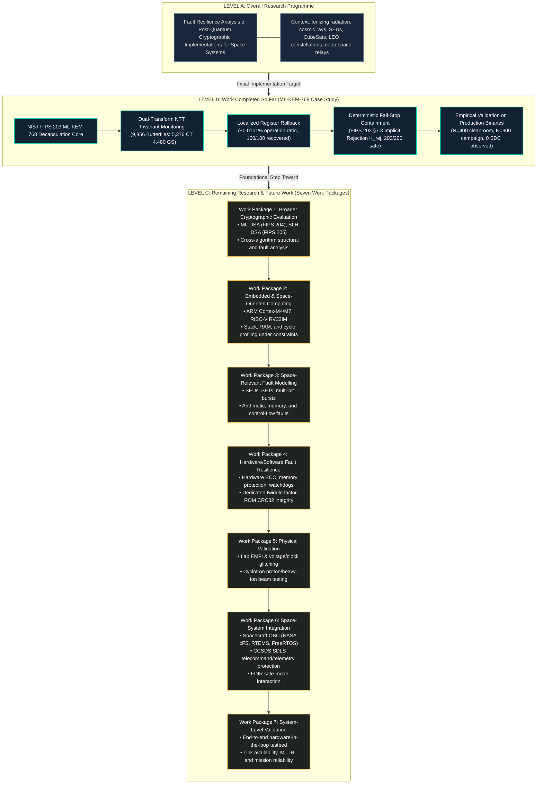

# FAULT RESILIENCE ANALYSIS OF POST-QUANTUM CRYPTOGRAPHIC IMPLEMENTATIONS FOR SPACE SYSTEMS
## Research Architecture & Evolution Framework

**Primary Research Title:**  
# FAULT RESILIENCE ANALYSIS OF POST-QUANTUM CRYPTOGRAPHIC IMPLEMENTATIONS FOR SPACE SYSTEMS

**Current Implementation Focus:**  
*Software-Level Fault Resilience for ML-KEM-768: Dual-Transform NTT Invariant Monitoring, Localized Register Rollback, and Containment*

---

## 1. Authoritative Research Narrative & Identity

> "The research, titled 'Fault Resilience Analysis of Post-Quantum Cryptographic Implementations for Space Systems', investigates the reliability and fault resilience of post-quantum cryptographic implementations in space-system environments.
> 
> As part of the initial implementation and experimental evaluation, the project has focused on ML-KEM-768, a standardized post-quantum key-encapsulation mechanism under NIST FIPS 203.
> 
> This implementation-level study investigates NTT arithmetic fault detection through dual-transform algebraic invariant monitoring, localized rollback and retry, and fail-stop containment using the Fujisaki–Okamoto implicit rejection mechanism.
> 
> The experimental results obtained so far provide an initial technical foundation for the broader research. However, the overall research objective extends beyond this implementation and includes additional cryptographic implementations, embedded processor evaluation, representative space-relevant fault models, hardware/software co-design, physical fault testing, and eventual spacecraft-level integration and validation."

---

## 2. The Three-Level Research Structure

```text
+---------------------------------------------------------------------------------------------------------+
| LEVEL A — OVERALL RESEARCH PROGRAMME (PERMANENT TITLE)                                                  |
| "Fault Resilience Analysis of Post-Quantum Cryptographic Implementations for Space Systems"             |
| The complete research agenda: evaluating and improving PQC reliability under space radiation, SEUs,    |
| hardware resource constraints, and orbital operational environments.                                    |
+---------------------------------------------------------------------------------------------------------+
                                                     │
                                                     ▼
+---------------------------------------------------------------------------------------------------------+
| LEVEL B — WORK COMPLETED SO FAR (INITIAL IMPLEMENTATION CASE STUDY)                                     |
| "Software-Level Fault Resilience for ML-KEM-768"                                                        |
| • Standardized primitive: NIST FIPS 203 ML-KEM-768 (Kyber)                                              |
| • Micro-level invariant monitoring across all 9,856 NTT butterflies (5,376 CT + 4,480 GS)                |
| • Localized single-butterfly register rollback (~0.0101% operation-count retry ratio, 100/100 recovered)|
| • Deterministic fail-stop containment via FIPS 203 Section 7.3 implicit rejection (200/200 safe stops) |
| • Cleanroom & canonical validation: 0 SDC across 300 production trials & 750 campaign trials            |
| • Apple Silicon ARM64 benchmark: +16.9% decapsulation latency overhead under -O3; 0 dynamic heap bytes  |
| • Disclosed limitation: Theorem 1 twiddle-factor blindness of local monitors                           |
+---------------------------------------------------------------------------------------------------------+
                                                     │
                                                     ▼
+---------------------------------------------------------------------------------------------------------+
| LEVEL C — REMAINING RESEARCH & FUTURE WORK (SEVEN BROAD WORK PACKAGES)                                  |
| • WP1: Broader Cryptographic Evaluation (ML-DSA, SLH-DSA, stateful hash signatures, cross-algorithm)     |
| • WP2: Embedded & Space-Oriented Computing (ARM Cortex-M4, RISC-V RV32IM, memory/stack/cycles)          |
| • WP3: Space-Relevant Fault Modelling (SEUs, SETs, multi-bit bursts, memory, control flow)              |
| • WP4: Hardware/Software Fault Resilience (hardware ECC, memory protection, twiddle CRC32 binding)     |
| • WP5: Physical Validation (laboratory EMFI, voltage/clock glitching, cyclotron beam irradiation)       |
| • WP6: Space-System Integration (spacecraft OBC, NASA cFS, RTEMS, CCSDS SDLS, FDIR safe-mode)          |
| • WP7: System-Level Validation (hardware-in-the-loop testbed, mission availability & link reliability) |
+---------------------------------------------------------------------------------------------------------+
```

---

## 3. Comprehensive Research Evolution Diagram



---

## 4. Explicit Boundaries and Disclosures

To preserve academic integrity, the following boundaries govern all project documentation:

1. **Software-Level Scope:** The current implementation is an algorithmic, software-level defense implemented in standard C99.
2. **Simulated Register Operands:** Faults were injected into register-modeled arithmetic operands via software hooks; physical radiation testing (heavy ions, protons, neutrons) has not been performed.
3. **Desktop Benchmarking:** Baseline and monitored latency benchmarks were recorded on an Apple Silicon ARM64 processor (Apple M3 Pro). Embedded microcontroller and radiation-hardened processor validation is future work (Work Package 2).
4. **Twiddle Factor Blindness:** Local invariants are algebraically blind to shared twiddle factor table corruption (Theorem 1). Downstream FO validation was demonstrated on an exploratory pilot (N=16) on a single reference vector; broader validation and dedicated hardware-level twiddle integrity mechanisms are planned for Work Packages 3 and 4.
5. **No Flight Claims:** The current implementation has not been tested in orbit, on a satellite payload, or on flight-qualified hardware. It serves as an experimental building block for the long-term space-systems program.

---

*Document approved as the definitive architectural evolution mapping for the PQC research repository.*
