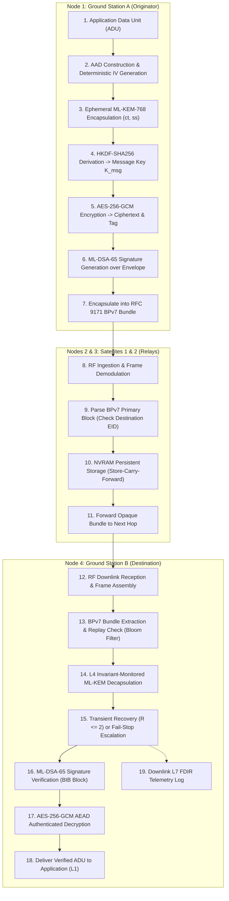

# ASTRA-Sec: Data Flow & State Transition Specification
## Step-by-Step Data Transformations, Buffer Lifecycles, and Multi-Hop Ingestion

**Author:** ASTRA-Sec Development Agent  
**Date:** November 2026  
**Status:** Complete  
**Scope:** Data transformation pipeline across Ground Station A $\to$ Satellite 1 $\to$ Satellite 2 $\to$ Ground Station B.

---

## 1. End-to-End Data Transformation Pipeline

The diagram below traces the end-to-end data transformation pipeline from application origination to verified destination delivery:



---

## 2. Detailed Transformation Stages

### Stage 1: Origin Outgoing Pipeline (Ground Station A)
1. **L1 Input:** The application generates payload bytes $M$ (e.g., a spacecraft telecommand vector: `0x01, 0x4A, ...`).
2. **L2 Envelope Header Formulation:** Formulates header with `Magic = "ASTR"`, monotonic `Sequence_ID`, current `Ratchet_Step`, UTC timestamp, and EIDs.
3. **L3/L4 Ephemeral Encapsulation:** Invokes `crypto_kem_enc(ct, ss, pk_dest)`.
   - Generates 1,088-byte ciphertext `ct` and 32-byte shared secret `ss`.
4. **Key Expansion:** Computes $K_{msg} = \text{HKDF-Expand}(ss, \text{"astra-msg-v1"}, 32)$.
5. **Authenticated Encryption:** Invokes `aes_gcm_encrypt(K_msg, iv, aad, M, C, tag)`.
   - Produces ciphertext $C$ and 16-byte authentication tag.
6. **L3 Signing:** Invokes `crypto_sign_signature(sig, envelope_header || C || tag, sk_sender)`.
   - Generates 2,420-byte digital signature.
7. **L5 Transport Packaging:** Serializes into BPv7 Bundle format:
   - Primary Block (Bundle flags, CRC, EIDs, Creation Timestamp, Lifetime).
   - BCB Extension Block (Holds `ct`, `iv`, `tag`, and security context parameters).
   - BIB Extension Block (Holds `sig`).
   - Payload Block (Holds ciphertext $C$).

---

### Stage 2: Intermediate Store-Carry-Forward (Satellites 1 & 2)
1. **Convergence Layer Reception:** The satellite convergence layer (e.g., CCSDS Space Packet Protocol or UDP) receives raw bytes and passes them to the BPv7 daemon.
2. **Primary Block Validation:** Inspects `Destination_EID` (`dtn://gsb/app`). Confirms the bundle is not addressed to the local node.
3. **Zero Payload Inspection:** The BCB and BIB extension blocks and the payload block remain completely opaque. No cryptographic keys are held or required on the relay.
4. **Disruption Spooling (L6):** If the next-hop link (Satellite 2 or Ground Station B) is occulted, the bundle is written to the onboard flash file system.
5. **Transmission:** When the orbital contact window opens, the bundle is forwarded unaltered.

---

### Stage 3: Destination Ingestion & Resilient Termination (Ground Station B)
1. **Replay & Freshness Gating:**
   - Checks `Current_Time <= Creation_Time + TTL`.
   - Evaluates `BloomFilter_Contains(Bundle_ID)`. If present, discard immediately.
2. **L4 Monitored Key Decapsulation:**
   - Extracts `ct` (1,088 bytes) and passes to `crypto_kem_dec(ss, ct, sk_dest)`.
   - **Internal Execution:** L4 actively monitors all 9,856 NTT butterfly operations:
     ```c
     // poly.c line 393: Register Snapshotting
     int16_t u_saved = r[j];
     int16_t v_saved = r[j + len];

     // mlkem_fault_hooks.c line 623: Algebraic Invariant Check
     diff_c = (*r_j - *r_j_len - 2 * t_check) % 3329;
     sum_c  = (*r_j + *r_j_len - 2 * u_saved) % 3329;
     ```
   - **Branch A (Nominal):** Invariant holds; decapsulation succeeds.
   - **Branch B (Transient SEU):** Invariant mismatch detected $\implies$ restores `u_saved, v_saved` and retries ($R \le 2$). Recomputation passes cleanly; increments `recovered_count`.
   - **Branch C (Persistent Fault):** Retries exhausted ($R \ge 2$) $\implies$ increments `persistent_count` and triggers fail-stop. Decapsulation forces $K_{rej}$ via FIPS 203 implicit rejection.
3. **L3 Signature Verification:**
   - Invokes `crypto_sign_verify(sig, envelope_header || C || tag, pk_sender)`.
   - If invalid, bundle is rejected as unauthorized.
4. **L2 Authenticated Decryption:**
   - Derives $K_{msg}$ from $ss$ via HKDF-SHA256.
   - Invokes `aes_gcm_decrypt(K_msg, iv, aad, C, tag, Plaintext)`.
   - If fail-stop occurred in Step 2, $K_{msg}$ derived from $K_{rej}$ is pseudorandom, causing GCM tag mismatch and safe rejection.
5. **L1 Application Delivery:** Plaintext telecommand or telemetry is delivered to the flight controller.
6. **L7 FDIR Logging:** Telemetry state (`astra_pqc_telemetry_t`) is committed to the mission audit log.

---

## 3. Buffer Lifecycle & Zero-Copy Management

To maximize efficiency and avoid stack fragmentation, data buffers follow strict zero-copy semantics:

```
[ Ingested RF Frame ]
       │
       ▼ (Direct DMA into Memory Ring Buffer)
[ Ingest Buffer: 8,192 bytes ]
       ├── Offset 0x000: BPv7 Primary Block (Parsed in-place)
       ├── Offset 0x080: BCB Block (Pointer passed to L3/L4)
       ├── Offset 0x500: BIB Block (Pointer passed to L3)
       └── Offset 0xEC0: Payload Block (Encrypted ciphertext C)
                               │
                               ▼ (Decrypted in-place into Output Buffer)
[ Verified Application Payload Buffer: 4,096 bytes ]
```
Zero heap memory allocations are executed throughout the entire ingestion and cryptographic termination sequence.
