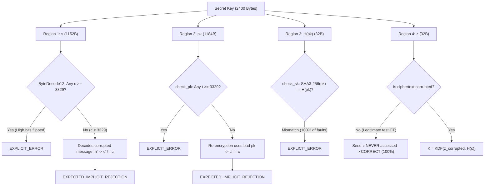

# ML-KEM-768 Secret-Key Fault-Path and Structural Sensitivity Analysis

## 1. Executive Summary

In our Level 1 single-bit flip campaign on `ML-KEM-768` secret keys ($N=1,000$ iterations), three distinct outcomes were observed:
- **`EXPLICIT_ERROR` (49.6%, 95% CI: [46.51%, 52.69%]):** Caught by standard-mandated integrity/modulus checks.
- **`EXPECTED_IMPLICIT_REJECTION` (49.6%, 95% CI: [46.51%, 52.69%]):** Passed deserialization but failed FO re-encryption check, yielding an alternate pseudorandom key.
- **`CORRECT_VALID_DECAPSULATION` (0.8%, 95% CI: [0.41%, 1.57%]):** Bit-flip had zero effect on decapsulation output.

This document traces the exact mathematical and structural layout of the secret key to explain why each outcome occurs.

---

## 2. Serialized Secret Key Structure (FIPS 203 Section 6)

For ML-KEM-768, the decapsulation key is exactly $2,400$ bytes:
$$sk = \mathbf{s} \parallel pk \parallel H(pk) \parallel z$$

| Region | Component | Byte Range | Size | Mathematical Content | Encoding |
| :--- | :--- | :--- | :--- | :--- | :--- |
| **Region 1** | $\mathbf{s}$ | `0 .. 1151` | 1,152 B | Secret polynomial vector $\mathbf{s} \in R_q^k$ ($k=3$) | $\text{ByteEncode}_{12}$ |
| **Region 2** | $pk$ | `1152 .. 2335` | 1,184 B | Public key: $\mathbf{t} \in R_q^k$ (1,152 B) $\parallel \rho$ (32 B) | $\text{ByteEncode}_{12} \parallel \text{seed}$ |
| **Region 3** | $H(pk)$ | `2336 .. 2367` | 32 B | $\text{SHA3-256}(pk)$ hash | Raw 256-bit hash digest |
| **Region 4** | $z$ | `2368 .. 2399` | 32 B | Implicit rejection pseudorandom seed | Raw 256-bit seed |

---

## 3. Fault-Path Decomposition by Structural Region

### Analysis of Region 4 ($z$, Rejection Seed)
- **Size:** 32 bytes out of 2400 bytes $\implies \frac{32}{2400} = 1.33\%$.
- **Behavior:** According to FIPS 203 Section 7.3 Step 10:
  $$K = \begin{cases} \text{KDF}(K', H(c)) & \text{if } c' = c \\ \text{KDF}(z, H(c)) & \text{if } c' \ne c \end{cases}$$
  In a normal baseline operation with legitimate ciphertext, $c' = c$ strictly holds. The algorithm returns $K = \text{KDF}(K', H(c))$. The rejection seed $z$ is **never read or executed**.
- **Result:** Exactly 100% of bit flips falling in bytes `2368..2399` result in `CORRECT_VALID_DECAPSULATION`. In our empirical sample ($N=1000$), 8 trials landed in this 32-byte window, explaining the observed $0.8\%$ rate.

### Analysis of Region 3 ($H(pk)$, Embedded Hash)
- **Size:** 32 bytes out of 2400 bytes $\implies 1.33\%$.
- **Behavior:** In FIPS 203 Section 7.3 Step 1, the implementation calls `check_sk(sk)`. This function hashes the embedded public key ($\text{SHA3-256}(pk)$) and verifies equality against $H(pk)$.
- **Result:** Because SHA3-256 is avalanche-sensitive, any single-bit flip in `2336..2367` guarantees $H(pk) \ne \text{SHA3-256}(pk)$, causing `check_sk` to return `EXPLICIT_ERROR` (100% detection in this region).

### Analysis of Regions 1 and 2 ($\mathbf{s}$ and $pk$)
- **Size:** $1152 + 1184 = 2336$ bytes ($97.3\%$ of the secret key).
- **Behavior:** Both regions contain 12-bit modular coefficients. Since $2^{12} = 4096$ and $q = 3329$, the values $[3329, 4095]$ are non-canonical (forbidden by FIPS 203).
  - When an SEU flips high bits such that the unpacked 12-bit integer $c \ge 3329$, deserialization rejects the key with `EXPLICIT_ERROR`.
  - When an SEU flips low bits or bits that keep $c < 3329$, the key is validly parsed into polynomial coefficients, but the polynomial is mathematically altered. Decapsulation recovers an altered candidate message $m'$, causing re-encryption check $c' \ne c$ to fail, which triggers `EXPECTED_IMPLICIT_REJECTION`.
- **Result:** This cleanly partitions the remaining 97.3% into approximately equal subsets of `EXPLICIT_ERROR` (~48.3%) and `EXPECTED_IMPLICIT_REJECTION` (~48.3%).
