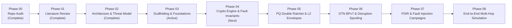

# ASTRA-Sec: Phased Implementation Roadmap

This document outlines the systematic engineering milestones for implementing and validating **ASTRA-Sec** (Post-Quantum End-to-End Secure Messaging and Delay-Tolerant Cryptographic Resilience for Space Networks) within the overarching research framework:
*"Fault Resilience Analysis of Post-Quantum Cryptographic Implementations for Space Systems"*.

---

## Roadmap Overview

---

## Detailed Milestone Breakdown

### Phase 00 — Existing Repository Audit & Preservation *(Status: Completed)*
- **Objective:** Audit local environment, host toolchains (Clang, Python, Make, Git), and preserve existing ML-KEM-768 NTT invariant monitoring, TFIB-Ref, and fault-injection campaigns without regressions.
- **Key Deliverables:** [`docs/phase-reports/phase-00-environment.md`](file:///Users/dhairyajain/Desktop/pqc research/docs/phase-reports/phase-00-environment.md), [`docs/phase-reports/phase-00-existing-implementation.md`](file:///Users/dhairyajain/Desktop/pqc research/docs/phase-reports/phase-00-existing-implementation.md).

### Phase 01 — Comprehensive Literature Review & Novelty Audit *(Status: Completed)*
- **Objective:** Establish the state-of-the-art across 17 literature areas and 9 mandatory systems (E2EQSS, SDLS, ION-DTN, RFC 9171/9172, NIST FIPS 203/204).
- **Key Deliverables:** [`docs/literature-review.md`](file:///Users/dhairyajain/Desktop/pqc research/docs/literature-review.md), [`docs/novelty-matrix.md`](file:///Users/dhairyajain/Desktop/pqc research/docs/novelty-matrix.md), [`docs/research-gap-analysis.md`](file:///Users/dhairyajain/Desktop/pqc research/docs/research-gap-analysis.md), [`manuscript/references.bib`](file:///Users/dhairyajain/Desktop/pqc research/manuscript/references.bib).

### Phase 02 — ASTRA-Sec Architecture & Threat Model *(Status: Completed)*
- **Objective:** Design the complete 7-layer architecture (L1 to L7) and 4-node reference scenario (`GSA -> SAT1 -> SAT2 -> GSB`).
- **Key Deliverables:** [`docs/architecture.md`](file:///Users/dhairyajain/Desktop/pqc research/docs/architecture.md), [`docs/threat-model.md`](file:///Users/dhairyajain/Desktop/pqc research/docs/threat-model.md), [`docs/security-requirements.md`](file:///Users/dhairyajain/Desktop/pqc research/docs/security-requirements.md), [`docs/protocol-specification.md`](file:///Users/dhairyajain/Desktop/pqc research/docs/protocol-specification.md), [`docs/data-flow.md`](file:///Users/dhairyajain/Desktop/pqc research/docs/data-flow.md), [`docs/trust-boundaries.md`](file:///Users/dhairyajain/Desktop/pqc research/docs/trust-boundaries.md).

### Phase 03 — Repository Scaffolding & Application Foundations *(Status: Active / Finalizing)*
- **Objective:** Establish modular application architecture, configuration parsing, Pydantic schemas, health checking, testing framework, CI workflow, and build integration.
- **Key Deliverables:**
  - `astra_sec/` core package (`core/`, `schema/`, `service/`, `app.py`).
  - Unit and integration test suites in `tests/`.
  - Build automation in `Makefile` and `pyproject.toml`.
  - CI automation in `.github/workflows/ci.yml`.
  - Deployment assets in `Dockerfile` and `docker-compose.yml`.
  - Contributor standards in `AGENTS.md`.
  - Milestone report in [`docs/phase-reports/phase-03-scaffolding.md`](file:///Users/dhairyajain/Desktop/pqc research/docs/phase-reports/phase-03-scaffolding.md).

### Phase 04 — Cryptographic Services & Fault-Resilient Execution (L3 & L4) *(Target: Phase 04)*
- **Objective:** Bridge Python service layer with C fault-resilient cryptographic engines (`mlkem-native` and `mldsa-native`).
- **Work Items:**
  1. ctypes/C-FFI wrapper for ML-KEM-768 keygen, encaps, and monitored decaps.
  2. ctypes/C-FFI wrapper for ML-DSA-65 keygen, sign, and verify.
  3. Formal integration of Dual-Transform NTT butterfly invariant monitoring ($r \equiv t\zeta \pmod q$).
  4. Integration of localized register snapshot rollback mechanism ($K \le 2$).
  5. Constant-time fail-stop implicit rejection verification under single-event upsets.

### Phase 05 — End-to-End Secure Messaging & PQ Double Ratchet (L2) *(Target: Phase 05)*
- **Objective:** Implement message-level confidentiality, integrity, and authenticated ratcheting.
- **Work Items:**
  1. Envelope encryption via AES-256-GCM with canonical 162-byte AAD binding.
  2. Post-Quantum Double Ratchet: KDF chain combined with ML-KEM-768 asymmetric ratchet step.
  3. Out-of-order message key skipping buffer with cryptographic timeout bounds.
  4. Strict anti-replay window management.

### Phase 06 — Delay-Tolerant Space Transport & Disruption Recovery (L5 & L6) *(Target: Phase 06)*
- **Objective:** Integrate space-network delay-tolerant transport and transactional spooling.
- **Work Items:**
  1. RFC 9171 Bundle Protocol v7 wire encoding / decoding.
  2. RFC 9172 BPSec hop-by-hop integrity context binding.
  3. Transactional atomic spool directory management for disrupted contact windows.
  4. Dynamic orbital contact schedule simulator with packet loss, jitter, and link outages.

### Phase 07 — Spacecraft FDIR, Telemetry, & Fault Injection Campaigns (L7) *(Target: Phase 07)*
- **Objective:** Implement real-time fault telemetry and automated resilience verification campaigns.
- **Work Items:**
  1. Spacecraft FDIR status report generation (`FdirTelemetryReport`).
  2. Automated transient register fault injection harness ($N \ge 1,000$ trials).
  3. Persistent twiddle factor fault injection and TFIB-Ref containment evaluation.
  4. SDC (Silent Data Corruption) suppression rate validation (targeting 100% containment).

### Phase 08 — Multi-Hop Space Network Simulation & Flight-Readiness Evaluation *(Target: Phase 08)*
- **Objective:** Full multi-process / containerized evaluation of the 4-node topology (`GSA -> SAT1 -> SAT2 -> GSB`).
- **Work Items:**
  1. Distributed inter-process communications over TCP/UDP/Unix sockets.
  2. End-to-end telemetry and command validation across compromised intermediate relays.
  3. Performance benchmarking (throughput, encapsulation overhead, memory footprint, recovery latency).
  4. Flight-readiness audit report and experimental publication data consolidation.
