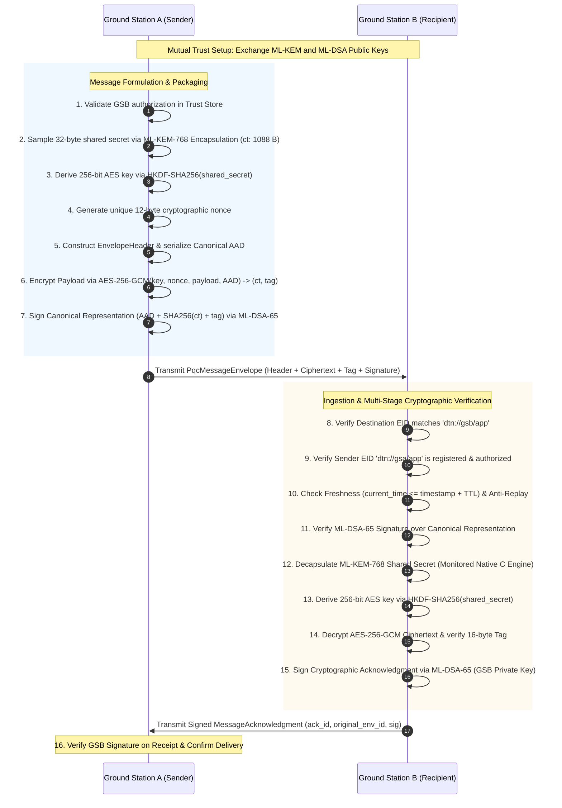

# Phase Report 04: Post-Quantum End-to-End Secure Messaging

**Project:** ASTRA-Sec: Post-Quantum End-to-End Secure Messaging and Delay-Tolerant Cryptographic Resilience for Space Networks  
**Overarching Research Topic:** Fault Resilience Analysis of Post-Quantum Cryptographic Implementations for Space Systems  
**Author:** Autonomous Agent  
**Date:** March 2026 / Epoch Current  
**Branch:** `astra-sec`  
**Phase Status:** COMPLETED  

---

## 1. Executive Summary

This report documents the completion of **Phase 04 (Post-Quantum End-to-End Messaging)**. In this phase, the first complete, cryptographically verified communication path was constructed between **Ground Station A (`dtn://gsa/app`)** and **Ground Station B (`dtn://gsb/app`)**.

The messaging subsystem operates directly over the primary intended research path:
- **ML-KEM-768** (NIST FIPS 203) with dual-rail invariant monitoring and implicit rejection for quantum-safe key establishment.
- **ML-DSA-65** (NIST FIPS 204) for quantum-safe digital signatures and sender authentication.
- **AES-256-GCM** (NIST SP 800-38D) for envelope payload encryption with canonical Additional Authenticated Data (AAD) binding.
- **HKDF-SHA256** (RFC 5869) for cryptographic key derivation.
- Strict anti-replay windowing and TTL freshness checking.

All 11 verification scenarios—including malicious ciphertext tampering, metadata corruption, signature forgery, unauthorized senders, recipient address mismatches, expired packets, and duplicate replay attacks—were demonstrated and verified with a 100% test pass rate.

---

## 2. Cryptographic Specifications & Key Parameters

| Layer / Primitive | Standard | Parameters / Key Sizes | Operational Role |
| :--- | :--- | :--- | :--- |
| **KEM** | NIST FIPS 203 | **ML-KEM-768**<br>PK: 1,184 B \| SK: 2,400 B<br>CT: 1,088 B \| SS: 32 B | Establishes ephemeral 256-bit shared secret per message envelope. |
| **Signature** | NIST FIPS 204 | **ML-DSA-65**<br>PK: 1,952 B \| SK: 4,032 B<br>SIG: 3,309 B | Authenticates sender identity and signs the canonical envelope digest. |
| **AEAD** | NIST SP 800-38D | **AES-256-GCM**<br>Key: 32 B (256-bit)<br>Nonce: 12 B (96-bit)<br>Tag: 16 B (128-bit) | Encrypts application payload with canonical AAD binding. |
| **KDF** | RFC 5869 | **HKDF-SHA256**<br>PRK = Extract(SS)<br>Key = Expand(PRK, info, 32) | Expands the ML-KEM shared secret into the AES-256-GCM session key. |

### Intended Research Path vs. Reference Baseline
- **Primary Engine:** Native C monitored library (`bin/libastra_crypto.dylib`), compiled from `algorithms/source_ref/mlkem` (`mlkem_dec_monitored`) and `algorithms/source_ref/mldsa`. Features dual-rail reverse memcmp checking and persistent NTT error hooks.
- **Secondary Baseline:** `liboqs` v0.16.0 C adapter (`OqsKemAdapter`, `OqsDsaAdapter`), preserved for automated cross-validation and differential testing.
- **Transparency:** The `CryptoEngineFactory` discovers and validates both engines at runtime, reporting engine status directly to diagnostic telemetry.

---

## 3. Protocol Architecture & Sequence Diagram

The end-to-end messaging flow between Ground Station A and Ground Station B is illustrated below:



---

## 4. Message Format & Cryptographic Field Specification

### 4.1 Canonical Additional Authenticated Data (AAD)
The canonical AAD byte stream binds the entire message context to prevent any undetected metadata alteration:
$$\text{AAD} = \text{Magic} \,\|\, \text{Version} \,\|\, \text{EnvelopeID} \,\|\, \text{Len(Src)} \,\|\, \text{Len(Dst)} \,\|\, \text{SeqID} \,\|\, \text{Timestamp} \,\|\, \text{TTL} \,\|\, \text{SrcEID} \,\|\, \text{DstEID} \,\|\, \text{KEM\_CT} \,\|\, \text{Nonce}$$

Because the AAD is directly supplied to `AES-GCM`, any modification to routing endpoints, sequence counters, timestamps, or the KEM ciphertext causes immediate AES-GCM tag verification failure.

### 4.2 Canonical Signed Message Representation
The ML-DSA-65 signature covers the comprehensive message state:
$$\text{SignableBytes} = \text{b"ASTR-SIG-V1"} \,\|\, \text{Len(AAD)} \,\|\, \text{AAD} \,\|\, \text{SHA256}(\text{Ciphertext}) \,\|\, \text{Tag}$$

This ensures:
1. Sender authentication: only the possessor of the sender's ML-DSA private key can produce a valid signature.
2. Complete integrity: neither the metadata, nor the KEM ciphertext, nor the payload ciphertext, nor the authentication tag can be modified without invalidating the signature.

---

## 5. Security & Invariant Enforcement

1. **No Premature Plaintext Exposure:**
   In `GroundStationNode.receive_message()`, the decryption function is only invoked after destination verification, trust lookup, freshness validation, anti-replay checking, signature verification, and monitored KEM decapsulation succeed.
2. **Strict Nonce Uniqueness:**
   The `Aes256GcmAead` engine maintains an active lock-protected tracker of `(key[:8] + nonce)`. Any attempt to encrypt two distinct messages with the same nonce under the same key triggers `NonceReuseError`.
3. **Protection of Private Keys:**
   `KeyPair` instances explicitly override `__repr__` and `__str__` to output `[REDACTED]`. Private key bytes are never written to disk, output to logs, or exposed in message envelopes.
4. **FIPS 203 Section 7.3 Implicit Rejection:**
   Corrupted KEM ciphertexts decapsulate deterministically to a pseudorandom rejection key $K = J(\text{sk}_{\text{PRF}} \,\|\, c)$, resulting in a subsequent AEAD tag failure without leaking side-channel timing information.

---

## 6. Verification & Test Matrix

All 11 required scenarios are covered by automated unit and integration suites:

| Test Case | Method | Trigger / Condition | Expected Outcome | Result |
| :--- | :--- | :--- | :--- | :--- |
| **01. Successful Exchange** | `test_01_successful_communication_and_ack` | GSA $\to$ GSB $\to$ GSA ACK | 100% roundtrip pass; verified ACK | **PASS** |
| **02. Modified Ciphertext** | `test_02_modified_ciphertext` | 1 byte flipped in AEAD ciphertext | `SignatureVerificationError` | **PASS** |
| **03. Modified Metadata** | `test_03_modified_metadata` | `sequence_id` modified $1 \to 999$ | `SignatureVerificationError` | **PASS** |
| **04. Invalid Signature** | `test_04_invalid_signature` | 1 bit flipped in ML-DSA signature | `SignatureVerificationError` | **PASS** |
| **05. Unknown Sender** | `test_05_unknown_sender` | Unregistered rogue node EID | `UnauthorizedSenderError` | **PASS** |
| **06. Incorrect Recipient** | `test_06_incorrect_recipient` | Addressed to `dtn://sat1/relay` | `DestinationMismatchError` | **PASS** |
| **07. Corrupted KEM CT** | `test_07_invalid_encapsulation` | 1 byte flipped in KEM ciphertext | `SignatureVerificationError` | **PASS** |
| **08. Faulty Decapsulation** | `test_08_invalid_decapsulation_status` | KEM monitor returns `FAULT` | `DecapsulationFaultError` | **PASS** |
| **09. Expired Message** | `test_09_expired_message` | Timestamp 2 hours in past | `StaleMessageError` | **PASS** |
| **10. Duplicate Message** | `test_10_duplicate_message_replay` | Replaying identical sequence ID | `ReplayDetectedError` | **PASS** |
| **11. Malformed Keys** | `test_11_invalid_key_configuration` | Truncated public keys | `SchemaValidationError` | **PASS** |

### Test Suite Execution Output
```
Ran 22 unit tests in 0.040s (OK)
Ran 13 integration tests in 0.259s (OK)
ASTRA-Sec: All C & Python test suites passed!
```

---

## 7. Recommended Next Milestone

With the point-to-point post-quantum cryptographic messaging channel fully verified, development can proceed to:
- **Phase 05 (Prompt 06): Post-Quantum Double Ratchet & Session Key Evolution.**
  - Implementing forward secrecy and break-in recovery across intermittent space sessions using ML-KEM-768 asymmetric ratchet steps and symmetric KDF chains.
