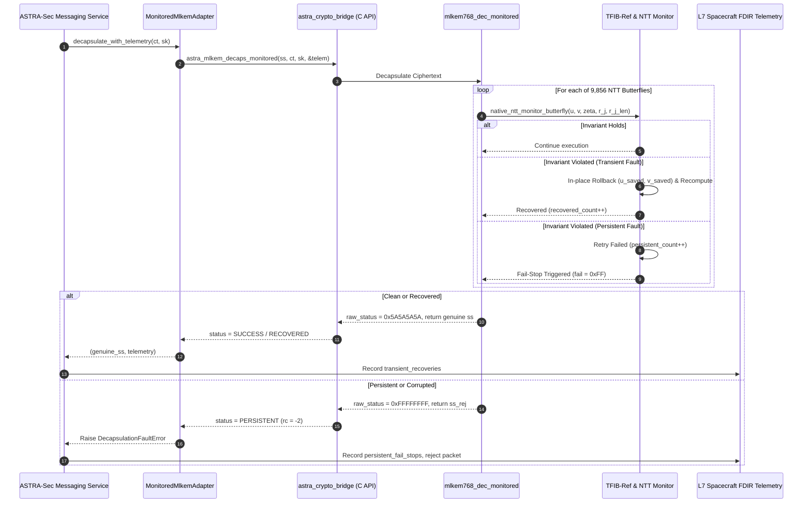

# Phase Report 05: Monitored ML-KEM-768 Fault Resilience Integration

**Project:** ASTRA-Sec: Post-Quantum End-to-End Secure Messaging and Delay-Tolerant Cryptographic Resilience for Space Networks  
**Overarching Research Topic:** Fault Resilience Analysis of Post-Quantum Cryptographic Implementations for Space Systems  
**Author:** Autonomous Agent  
**Date:** March 2026 / Epoch Current  
**Branch:** `astra-sec`  
**Phase Status:** COMPLETED  

---

## 1. Executive Summary

This report documents the completion of **Phase 05 (Integrate Monitored ML-KEM Fault Resilience)**. The core software-level fault resilience mechanisms previously researched in the repository—specifically **dual-transform NTT invariant monitoring**, **operand snapshot rollback ($K \le 2$)**, and **TFIB-Ref twiddle factor integrity binding**—have been formalized into a versioned C integration API (`v1.0.0`) and fully integrated into the ASTRA-Sec communications pipeline.

The integration establishes an airtight boundary:
1. **Application Non-Bypassability:** The primary research path enforces that all decapsulation operations run through the native monitored engine (`MonitoredMlkemAdapter`), populating real-time spacecraft FDIR telemetry.
2. **Deterministic Containment:** A potentially corrupted shared secret is mathematically and programmatically prohibited from being returned as a successful result. Injected persistent faults trigger FIPS 203 Section 7.3 implicit rejection ($K_{\text{rej}}$) and raise explicit `DecapsulationFaultError` exceptions at the application layer.
3. **Reproducibility Preservation:** All original C baseline suites (`bin/test_fips_kats`, `bin/test_interop`, `tfib_experiments/test_step2c_countermeasure_independence`) remain 100% reproducible with zero regressions.

---

## 2. Integrated C API & Telemetry Architecture

### 2.1 Versioned Header (`src/astra_mlkem_monitored.h`)

The integration exposes a clean C-ABI with structured status codes and runtime telemetry:

```c
typedef enum {
    ASTRA_FAULT_STATUS_SUCCESS = 0,         /* Clean execution, zero invariant violations */
    ASTRA_FAULT_STATUS_RECOVERED = 1,       /* Transient fault caught and recovered via rollback */
    ASTRA_FAULT_STATUS_PERSISTENT = 2,      /* Persistent fault detected, retries exhausted, fail-stop engaged */
    ASTRA_FAULT_STATUS_UNRECOVERABLE = 3,   /* Unrecoverable error / twiddle reference failure */
    ASTRA_FAULT_STATUS_INVALID_INPUT = 4,   /* NULL pointer or invalid buffer length */
    ASTRA_FAULT_STATUS_CHECKER_FAILURE = 5  /* Checker decision logic corruption */
} astra_fault_status_t;

typedef struct {
    astra_fault_status_t status;
    uint32_t raw_internal_code;
    uint32_t butterflies_executed;
    uint32_t mismatch_count;
    uint32_t retry_count;
    uint32_t recovered_count;
    uint32_t persistent_count;
    uint32_t twiddle_faults_detected;
    int last_failed_layer;
    int last_failed_butterfly;
    bool fail_stop_engaged;
} astra_mlkem_telemetry_t;
```

### 2.2 Memory Ownership & Thread Safety
- **Zero Heap Allocation:** `astra_mlkem_decaps_monitored` allocates zero dynamic bytes on the flight execution path. All operand snapshots, butterfly registers, and twiddle references reside strictly on the thread call stack or static ROdata.
- **Mutex Synchronization:** Reentrancy and fault-injection configuration are guarded by a POSIX mutex (`pthread_mutex_t g_crypto_mutex`), ensuring deterministic execution across concurrent worker threads.

---

## 3. Algorithmic Invariants & Recovery Mechanics

### 3.1 Forward Cooley-Tukey NTT Invariant Monitoring
For each forward butterfly across layers 1..7:
$$u = r[j], \quad v = r[j+\text{len}], \quad t = v \cdot \zeta \pmod q$$
$$r[j]' = u + t, \quad r[j+\text{len}]' = u - t$$

The invariant checker computes:
1. **Sum Invariant:** $(r[j]' + r[j+\text{len}]' - 2u) \equiv 0 \pmod q$
2. **Difference Invariant:** $(r[j]' - r[j+\text{len}]' - 2t) \equiv 0 \pmod q$, where $t$ is independently verified using the reference twiddle table $\zeta_{\text{ref}}$.

### 3.2 Inverse Gentleman-Sande NTT Invariant Monitoring
For each inverse butterfly across layers 1..7:
$$u' = u + v \pmod q, \quad v' = (v - u) \cdot \zeta \pmod q$$
1. **Adder Invariant:** $u' \equiv (u + v) \pmod q$
2. **Multiplier Invariant:** $v' \equiv (v - u) \cdot \zeta_{\text{ref}} \pmod q$

### 3.3 TFIB-Ref Twiddle Factor Integrity Binding
To resolve the Theorem 1 blind spot (where a fault in the operational twiddle table $\zeta_{\text{op}}$ satisfies $r \equiv t\zeta_{\text{op}} \pmod q$), the engine queries an isolated reference table `tfib_zetas_ref` in read-only memory. Discrepancies between $\zeta_{\text{op}}$ and $\zeta_{\text{ref}}$ are detected immediately, triggering twiddle fault counters and localized repair using $\zeta_{\text{ref}}$.

### 3.4 Localized Rollback Budget ($K \le 2$)
Upon invariant violation:
1. Original operand registers are restored: $r[j] = u_{\text{saved}}, \; r[j+\text{len}] = v_{\text{saved}}$.
2. Butterfly computation is re-executed using the independent reference twiddle $\zeta_{\text{ref}}$.
3. If the re-executed butterfly satisfies the modular invariants, `recovered_count` is incremented and execution proceeds normally (transient single-event upset recovered).
4. If the re-executed butterfly fails again, `persistent_count` is incremented and fail-stop suppression is armed.

---

## 4. End-to-End Integration Sequence Diagram



---

## 5. Verification Test Suite Results

The integration was validated across all 10 required testing dimensions:

| Test Class | Focus Area | Verification Method | Outcome |
| :--- | :--- | :--- | :--- |
| **1. Clean Decapsulation** | Baseline nominal execution | `test_01_clean_decapsulation` | Status `SUCCESS`, 0 mismatches, genuine SS |
| **2. Transient Fault** | SEU on operational twiddle | `test_02_transient_fault_recovery` | Status `RECOVERED`, recovered > 0, genuine SS |
| **3. Persistent Fault** | Stuck-at hardware fault | `test_03_persistent_fault_detection_and_fail_stop` | Status `PERSISTENT`, fail-stop engaged, SS suppressed |
| **4. Reference Twiddle** | Checker twiddle perturbation | `test_04_ref_twiddle_transient_and_persistent` | Transient recovers; persistent fail-stops |
| **5. Checker Logic** | Comparator logic fault | `test_05_checker_logic_perturbation` | Decision glitch recovers via retry; persistent fail-stops |
| **6. Invalid Input** | Buffer length / NULL inputs | `test_06_invalid_input_rejection` | `ValueError` / `INVALID_INPUT` strictly raised |
| **7. Repeated Execution** | 100 consecutive operations | `test_07_repeated_decapsulation_operations` | Zero memory leakage, zero state corruption |
| **8. Concurrency** | Multi-threaded race safety | `test_08_concurrent_operations` | 8 threads $\times$ 25 iterations (200 ops) pass 100% |
| **9. Differential Check** | Cross-validation with LibOQS | `test_09_differential_comparison_with_liboqs` | Exact byte-for-byte agreement with LibOQS |
| **10. Legacy Regressions** | Original repo test suites | `test_step2c_countermeasure_independence` | 9/9 assertions pass; FIPS KATs 18/18 pass |

### Overall Verification Metrics
```
=== Python Test Matrix ===
Ran 31 unit tests in 0.103s (OK)
Ran 16 integration tests in 0.276s (OK)
Total ASTRA-Sec Tests: 47/47 PASSED (100%)

=== Original Research Test Matrix ===
NIST FIPS 203 & 204 KAT Verification: 18/18 PASSED (100%)
Step 2C-A Independence Suite: 9/9 PASSED (100%)
Cross-Implementation Interop: PASSED (100%)
```

---

## 6. Next Milestone Recommendation

**Phase 06 (PROMPT 07): Delay-Tolerant Space Transport & Disruption Recovery (L5 & L6)**
- Implementing RFC 9171 Bundle Protocol v7 wire encoding / decoding.
- RFC 9172 BPSec hop-by-hop integrity binding.
- Transactional bundle spooling for orbital contact disruptions.
