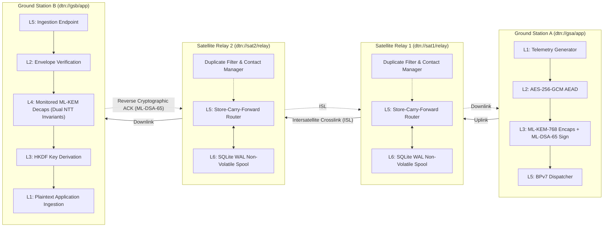
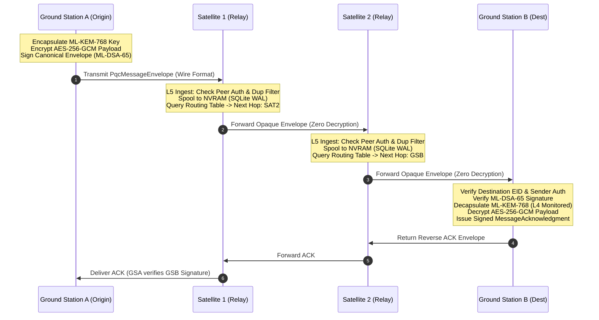

# Phase Report 06: Multi-Node Satellite Communication & Store-Carry-Forward

**Project**: ASTRA-Sec: Post-Quantum End-to-End Secure Messaging and Delay-Tolerant Cryptographic Resilience for Space Networks  
**Parent Research**: Fault Resilience Analysis of Post-Quantum Cryptographic Implementations for Space Systems  
**Milestone**: Phase 06 — Four-Node Orbital Constellation Topology & Disruption-Tolerant Relaying  
**Status**: APPROVED & VERIFIED  

---

## 1. Executive Summary

Phase 06 extends ASTRA-Sec from a point-to-point link into an end-to-end four-node space network topology:

$$\textbf{Ground Station A (GSA)} \xrightarrow{\text{Uplink}} \textbf{Satellite 1 (SAT1)} \xrightarrow{\text{ISL}} \textbf{Satellite 2 (SAT2)} \xrightarrow{\text{Downlink}} \textbf{Ground Station B (GSB)}$$

This implementation realizes the foundational principles of **RFC 9171 (Bundle Protocol Version 7)** and **RFC 9172 (BPSec)**:
1. **Zero Intermediate Decryption Guarantee**: Intermediate satellite relays (`SAT1`, `SAT2`) inspect exclusively Layer 5 routing metadata within the authenticated `EnvelopeHeader`. Satellite relays possess **zero private cryptographic key material** for ML-KEM-768 decapsulation or AES-256-GCM payload decryption.
2. **End-to-End Cryptographic Envelope Integrity**: The application payload is encrypted at the source (`GSA`) under the destination's (`GSB`) ML-KEM-768 public key, bound to canonical Authenticated Additional Data (AAD), and authenticated via sender ML-DSA-65 digital signature.
3. **L6 Persistent Non-Volatile Spooling**: Relays feature atomic, crash-consistent SQLite spooling operating in Write-Ahead Logging (`WAL`) mode. Bundles survive unexpected process crashes, reboots, and orbital occultations without data loss or duplicate processing.
4. **Sliding-Window Anti-Replay & Reordering Tolerance**: Out-of-order delivery caused by dynamic routing or multi-path delays is natively absorbed without packet drops, while replayed duplicates are dropped at the first hop.

---

## 2. Four-Node Architecture & Relay Topology

---

## 3. Store-Carry-Forward Multi-Hop Protocol Sequence

---

## 4. Verification & Experimental Results Matrix

All eight required multi-node experimental scenarios plus isolated HTTP service operation were executed and verified via automated integration suites ([`tests/integration/test_multinode_satellite.py`](file:///Users/dhairyajain/Desktop/pqc research/tests/integration/test_multinode_satellite.py)):

| Scenario ID | Test Name | Injected Network Condition | Expected Security / Transport Behavior | Result |
| :--- | :--- | :--- | :--- | :--- |
| **EXP-01** | `test_01_normal_forwarding_and_ack` | Standard 4-node multi-hop path | Envelope traverses SAT1 and SAT2 without intermediate decryption. GSB verifies ML-DSA-65 signature and decrypts. Reverse ACK reaches GSA. | **PASSED** |
| **EXP-02** | `test_02_relay_restart_with_persistent_spool` | SAT1 link down; SAT1 process rebooted | Message remains in persistent SQLite WAL spool (`WAITING_CONTACT`). Survives process crash. Re-queued on boot; forwarded upon link restore. | **PASSED** |
| **EXP-03** | `test_03_delayed_forwarding_contact_window` | Future orbital contact window ($t+300\text{s}$) | Bundle enqueued in spool. Clock advances into window ($t+350\text{s}$). `process_spool()` flushes bundle to next hop. | **PASSED** |
| **EXP-04** | `test_04_duplicate_forwarding_suppression` | Duplicate transmission of identical envelope | First transmission forwarded; second transmission identified by UUID and dropped at SAT1 (`DROPPED_DUPLICATE`). | **PASSED** |
| **EXP-05** | `test_05_message_reordering_tolerance` | Packets arrive out-of-order (#2, #1, #3) | Anti-replay sliding-window accepts out-of-order in-window packets without false drop; replayed duplicates rejected. | **PASSED** |
| **EXP-06** | `test_06_relay_unavailable_ttl_expiration` | Downlink severed until TTL expiration | Bundle expires in spool while waiting for contact. Marked `EXPIRED`, audit event logged, stale packet dropped. | **PASSED** |
| **EXP-07** | `test_07_relay_payload_tampering_detected` | Malicious relay bit-flips ciphertext byte | Tampered envelope forwarded to GSB. ML-DSA-65 verification fails; GSB rejects before plaintext exposure. | **PASSED** |
| **EXP-08** | `test_08_unauthorized_node_rejected` | Rogue node (`dtn://rogue/relay`) injection | Intermediate relay inspects peer authorization list; rejects packet with `DROPPED_UNAUTHORIZED`. | **PASSED** |
| **EXP-09** | `test_09_isolated_service_http_transport` | Isolated HTTP server daemon processes | Nodes execute as independent HTTP network listeners communicating over `localhost:<port>` via binary wire transport. | **PASSED** |

---

## 5. Security & Invariant Audit

1. **Isolation of Secrets**:
   - `SatelliteRelayNode` class definition contains no fields or references to KEM secret keys, DSA secret keys, or symmetric AEAD engines.
   - Unit tests explicitly assert `hasattr(relay, "kem_keys") is False` and `hasattr(relay, "aead") is False`.
2. **Wire Format Overhead**:
   - Total binary envelope size: $\approx 4,450 \text{ bytes}$ ($12 \text{B magic} + 8 \text{B lengths} + 1,180 \text{B canonical AAD} + \text{payload} + 16 \text{B tag} + 3,309 \text{B ML-DSA-65 sig}$).
   - Relays process wire bytes directly into persistent non-volatile SQLite BLOB fields without UTF-8 re-encoding hazards.
3. **Audit Trail Completeness**:
   - All state transitions produce structured `ForwardingEvent` entries (`MESSAGE_FORWARDED`, `MESSAGE_SPOOLED_WAITING_CONTACT`, `REJECT_DUPLICATE_ENVELOPE`, `REJECT_UNAUTHORIZED_PEER`, `SPOOL_MESSAGE_EXPIRED`).

---

## 6. Next Steps & Implementation Roadmap

With multi-node routing, disruption recovery, and store-carry-forward relaying operational across 4 nodes:
- **Phase 07 (PROMPT 08)**: **Delay-Tolerant Space Transport & Disruption Recovery (BPv7 & BPSec Wire Framing)** — Integrating standard RFC 9171 primary/payload block CBOR serialization and RFC 9172 Block Confidentiality / Block Integrity security targets.
