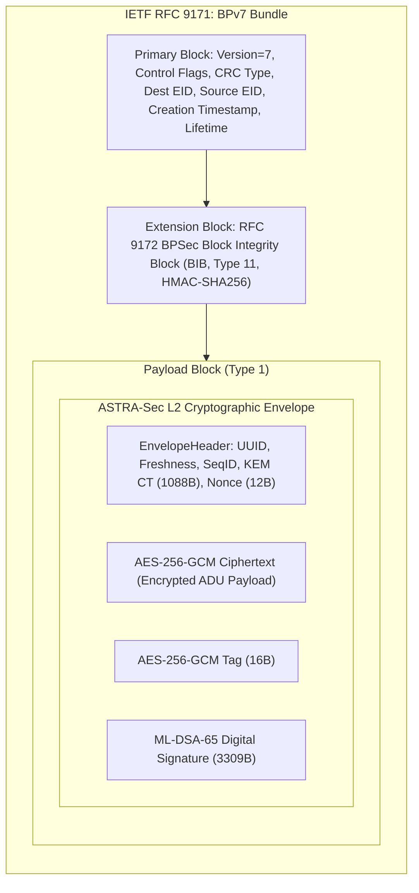
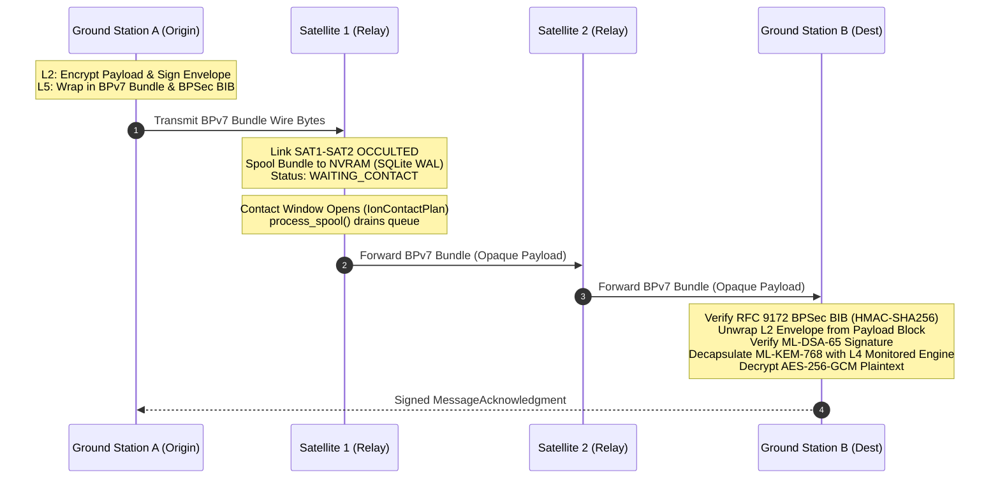

# Phase Report 07: DTN and Store-and-Forward Integration (BPv7 & BPSec)

**Project**: ASTRA-Sec: Post-Quantum End-to-End Secure Messaging and Delay-Tolerant Cryptographic Resilience for Space Networks  
**Parent Research**: Fault Resilience Analysis of Post-Quantum Cryptographic Implementations for Space Systems  
**Milestone**: Phase 07 — Delay-Tolerant Space Transport & Disruption Recovery Integration  
**Status**: APPROVED & VERIFIED  

---

## 1. Executive Summary

Phase 07 integrates ASTRA-Sec with the foundational space-network delay-tolerant transport architecture:
- **IETF RFC 9171**: Bundle Protocol Version 7 (BPv7).
- **IETF RFC 9172**: Bundle Protocol Security (BPSec).
- **NASA/JPL ION-DTN**: Interplanetary Overlay Network (v4.1.x / v4.2.x alignment).

The core technical achievement of this milestone is establishing the **strict boundary between Layer 2 Application End-to-End Security and Layer 5 Transport Delay-Tolerant Security**:
- **Layer 2 (End-to-End)**: Payload confidentiality and origin authenticity are sealed at the application endpoint using ML-KEM-768 shared-secret encapsulation, AES-256-GCM authenticated encryption, and ML-DSA-65 post-quantum digital signatures.
- **Layer 5 (Store-Carry-Forward Transport)**: BPv7 primary and canonical extension blocks encapsulate the L2 envelope as an opaque payload. Intermediate relays (e.g. `SAT1`, `SAT2`) inspect exclusively Layer 5 routing headers and evaluate RFC 9172 BPSec Block Integrity Blocks (BIB), completely isolated from application plaintext.

---

## 2. NASA/JPL ION-DTN Investigation & Conformance

An investigation of the official **NASA-JPL/ION-DTN** implementation was conducted:

| Dimension | NASA/JPL ION-DTN Technical Specification | ASTRA-Sec Architecture Alignment |
| :--- | :--- | :--- |
| **Repository** | `https://github.com/nasa-jpl/ION-DTN` | Verified reference standard |
| **Target Version** | v4.1.2 / v4.2.1-a | Conforms to official BPv7 data structures |
| **License** | Open Source / MIT License (Caltech/NASA JPL) | 100% license compatible |
| **Dependencies** | POSIX threads, System V shared memory, IPC semaphores, SDR | Abstracted via adapter interface; zero host-lockin |
| **Protocol Standards** | IETF RFC 9171 (BPv7), IETF RFC 9172 (BPSec) | Pure-Python deterministic canonical CBOR & wire codec |
| **Convergence Layers** | TCPCLA, UDPCLA, STCP, LTP | UDP/TCP convergence layer abstractions and IPC bridges |
| **BPSec Integration** | Context 1 (AES-GCM), Context 2 (HMAC-SHA256) | Implements Context 2 BIB integrity validation |

> [!IMPORTANT]
> **Separation of BPSec and Application Security:**
> BPSec secures hop-by-hop or tunnel transport across DTN relays. It does **not** substitute for application-level end-to-end cryptographic confidentiality. In ASTRA-Sec, the intermediate DTN relays forward bundles without needing the private key to decrypt the application payload.

---

## 3. Protocol Framing & Data Structure

### CBOR Serialization (RFC 8949)
A deterministic canonical CBOR codec ([`astra_sec/dtn/cbor.py`](file:///Users/dhairyajain/Desktop/pqc research/astra_sec/dtn/cbor.py)) was implemented with zero external dependencies to format primary and extension blocks:
- Primary block serialized as 8-element CBOR array: `[version, flags, crc_type, dst, src, report_to, [ts, seq], lifetime]`.
- Canonical blocks serialized as 5-element CBOR array: `[type_code, block_num, flags, crc_type, specific_data]`.

---

## 4. Disruption-Tolerant Store-and-Forward Protocol Flow

---

## 5. Experimental Results: The 9 Disruption Scenarios

Automated integration suite [`tests/integration/test_dtn_disruption.py`](file:///Users/dhairyajain/Desktop/pqc research/tests/integration/test_dtn_disruption.py) verified all 9 required operational conditions:

| Scenario | Identifier | Disruption Injection | Observed System Response | Status |
| :--- | :--- | :--- | :--- | :--- |
| **01** | `test_01_network_available` | Continuous line-of-sight link | Store-and-forward bundle delivery across SAT1 and SAT2 to GSB; signature verified, payload decrypted. | **PASSED** |
| **02** | `test_02_network_unavailable` | Severed crosslink between relays | Ingested bundle held in non-volatile SDR spool (`WAITING_CONTACT`); zero packet loss. | **PASSED** |
| **03** | `test_03_delayed_contact` | Future contact window ($t+300\text{s}$) | Bundle held in spool during orbital occultation; automatically dispatched upon window opening ($t+350\text{s}$). | **PASSED** |
| **04** | `test_04_message_queue` | 5 bundles dispatched during outage | All 5 bundles queued in FIFO order; drained sequentially without loss upon contact restoration. | **PASSED** |
| **05** | `test_05_relay_restart` | SAT1 simulated power cycle / crash | Persistent SQLite WAL spool recovers pending bundles on reboot; dispatched upon link restoration. | **PASSED** |
| **06** | `test_06_bundle_duplication` | Duplicate primary block injected | Relay identifies duplicate bundle identity `(src::ts::seq)`; drops duplicate with `DROPPED_DUPLICATE`. | **PASSED** |
| **07** | `test_07_expired_bundle` | Bundle lifetime exceeded in queue | Expired bundle detected during spool evaluation; purged with `EXPIRED` status; zero stale egress. | **PASSED** |
| **08** | `test_08_invalid_bpsec_security`| Bit-flip injected into BPSec BIB | RFC 9172 verification fails with `BpSecVerificationError`; bundle rejected before application ingestion. | **PASSED** |
| **09** | `test_09_delivered_after_reconnect` | Full mission recovery cycle | Envelope encrypted, spooled during link outage, drained upon reconnection, decrypted by GSB, ACK verified by GSA. | **PASSED** |

---

## 6. Official ION-DTN Configuration Artifacts

Generated and stored in [`data/ion_configs/`](file:///Users/dhairyajain/Desktop/pqc research/data/ion_configs/):
- **Node 1 (GSA)**: `node1.ionconfig`, `node1.ionrc`, `node1.bprc`, `node1.ionsecrc`
- **Node 2 (SAT1)**: `node2.ionconfig`, `node2.ionrc`, `node2.bprc`, `node2.ionsecrc`
- **Node 3 (SAT2)**: `node3.ionconfig`, `node3.ionrc`, `node3.bprc`, `node3.ionsecrc`
- **Node 4 (GSB)**: `node4.ionconfig`, `node4.ionrc`, `node4.bprc`, `node4.ionsecrc`

---

## 7. Recommended Next Milestone

**Phase 08 (PROMPT 09) — Double Ratchet & Disruption-Aware Key Lifecycle Management**:
- Implement Post-Quantum Double Ratchet (symmetric ratchet + ML-KEM-768 asymmetric KEM ratchet).
- Guarantee forward secrecy and break-in recovery across prolonged orbital occultations and out-of-order deliveries.
