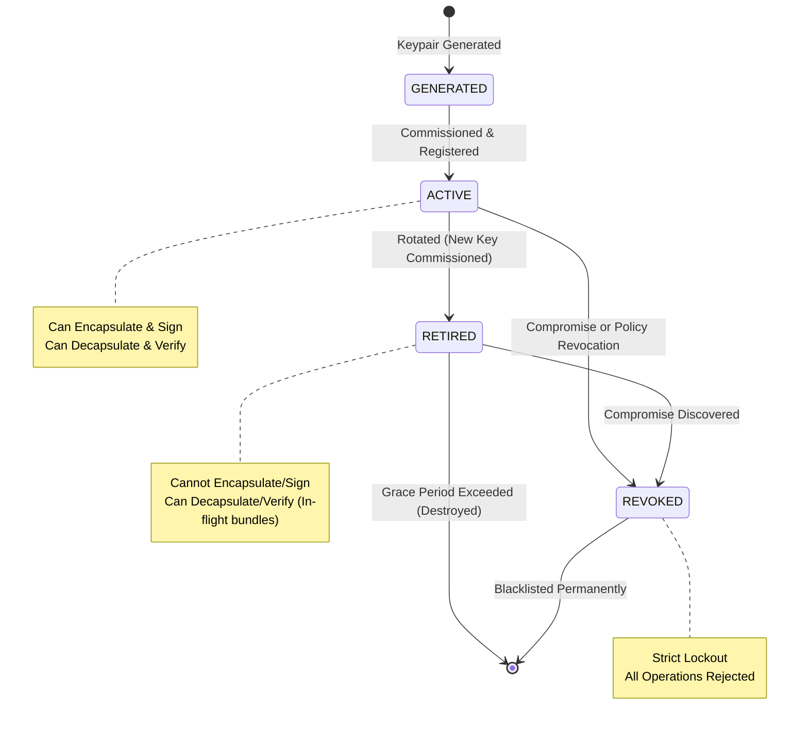
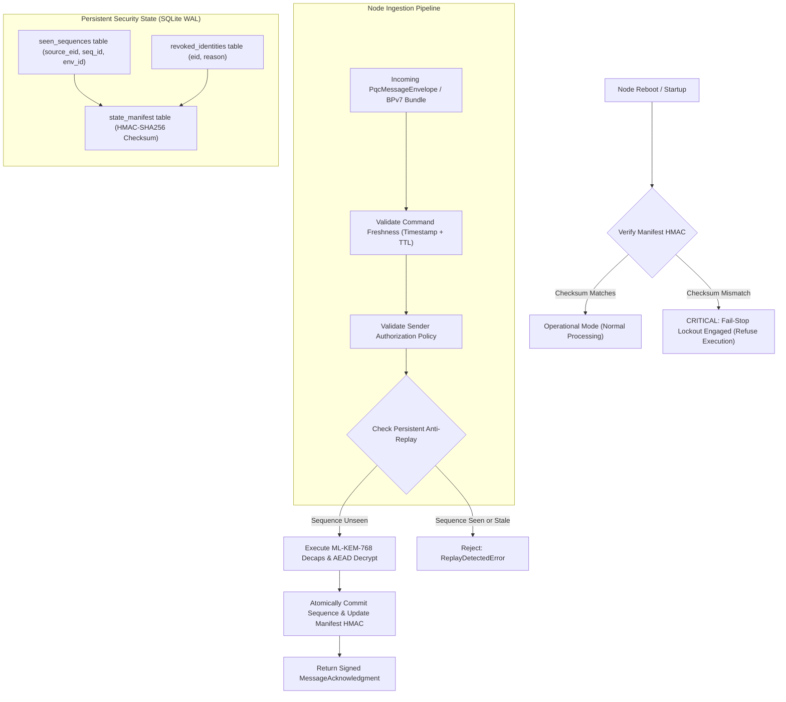

# Phase Report 08: Security Continuity and Ground-Station Verification

**Project**: ASTRA-Sec: Post-Quantum End-to-End Secure Messaging and Delay-Tolerant Cryptographic Resilience for Space Networks  
**Parent Research**: Fault Resilience Analysis of Post-Quantum Cryptographic Implementations for Space Systems  
**Milestone**: Phase 08 — Security Continuity, Authorization, and Persistent Replay Protection  
**Status**: APPROVED & VERIFIED  

---

## 1. Executive Summary

Phase 08 establishes the persistent security continuity and verification foundation for ASTRA-Sec:
1. **Crash-Consistent Persistent Anti-Replay**: Eliminates the vulnerability where an endpoint reboot resets in-memory sliding windows. Replay sequence records are atomically committed to non-volatile SQLite WAL storage, ensuring previously executed commands can never execute again after a node power cycle.
2. **State Manifest Cryptographic Integrity**: Persistent security state is bound by an HMAC-SHA256 integrity manifest. If physical memory or flash storage suffers single-event upsets (SEUs) or external tampering, the system detects the checksum mismatch on boot, locks down into a **fail-stop safe mode**, and refuses to reset silently to a blank state.
3. **Key Lifecycle & Rotation (NIST SP 800-57 & CCSDS SDLS-EP)**: Formal key state machine (`GENERATED` $\to$ `ACTIVE` $\to$ `RETIRED` $\to$ `REVOKED`). Retired keys maintain a defined grace period allowing delayed in-flight bundles to be verified without permitting new message origination.
4. **Permanent Revocation Invariant**: Revoked identities are committed to persistent storage; an endpoint restart cannot silently restore trust to a revoked or compromised node.
5. **Ground-Station Verification & Forensic Audit**: Dedicated cryptographic receipt verification module correlating outgoing commands with incoming `MessageAcknowledgment` receipts, validating recipient ML-DSA-65 signatures, and maintaining an append-only audit trail.

---

## 2. Key Lifecycle State Machine

Conforms to NIST SP 800-57 Part 1 and CCSDS 355.1-B-1 (SDLS-EP):

---

## 3. Persistent Security State & Fail-Stop Architecture

---

## 4. Experimental Results: Security Continuity Matrix

Automated integration suite [`tests/integration/test_security_continuity.py`](file:///Users/dhairyajain/Desktop/pqc research/tests/integration/test_security_continuity.py) verified all 10 required operational scenarios:

| Scenario | Test Identifier | Threat / Injected Condition | Expected Security Behavior | Status |
| :--- | :--- | :--- | :--- | :--- |
| **01** | `test_01_replay_of_accepted_command` | Replay of previously accepted command | Ingested once; second submission rejected with `ReplayDetectedError`. | **PASSED** |
| **02** | `test_02_duplicate_bundle` | Duplicate bundle injected at space relay | First bundle forwarded; second duplicate suppressed by relay (`DROPPED_DUPLICATE`). | **PASSED** |
| **03** | `test_03_delayed_valid_message` | 300s orbital delay within 3600s TTL | Message accepted and decrypted; delayed valid messages not falsely dropped. | **PASSED** |
| **04** | `test_04_expired_command` | Command received 140s past TTL expiration | Rejected with `StaleMessageError` prior to execution or decryption. | **PASSED** |
| **05** | `test_05_revoked_sender` | Sender revoked in authorization policy | Rejected with `IdentityRevokedError`; revoked peer cannot execute commands. | **PASSED** |
| **06** | `test_06_key_rotation` | Recipient rotates ML-KEM/DSA keys | Key version incremented; new public key used; messaging succeeds seamlessly. | **PASSED** |
| **07** | `test_07_restart_during_queued_delivery` | Relay process rebooted during link outage | Spooled bundle survives restart in SQLite WAL; delivered once link restored. | **PASSED** |
| **08** | `test_08_restart_after_command_acceptance` | Attacker replays command after recipient reboots | Anti-replay state persists across boot; replay attempt rejected with `ReplayDetectedError`. | **PASSED** |
| **09** | `test_09_corrupted_persistent_security_state` | Database altered or corrupted out-of-band | Node startup detects HMAC checksum mismatch; enters `FAIL_STOP_LOCKED` mode. | **PASSED** |
| **10** | `test_10_invalid_acknowledgement` | Attacker tampers with ACK signature | `GroundStationVerifier` detects signature corruption; raises `InvalidAcknowledgmentError`. | **PASSED** |

---

## 5. Security & Hygiene Guarantees

1. **No Plaintext Secrets in Storage or Logs**:
   - `KeyPair.__repr__` and `__str__` explicitly redact secret keys (`sk=[REDACTED]`).
   - SQLite persistent state stores exclusively public metadata (`source_eid`, `sequence_id`, `envelope_id`, `revoked_eid`).
2. **Crash-Consistent Atomic State**:
   - Every accepted command and state revocation is committed within an SQLite transaction that updates the `state_manifest` HMAC atomically.
3. **Audit Trail Completeness**:
   - Ground-station verifier maintains an append-only ledger correlating outgoing envelope IDs with verified cryptographic receipts.

---

## 6. Recommended Next Milestone

**Phase 09 (PROMPT 10) — End-to-End Mission Demonstration & Fault Resilience Campaign**:
- Full mission profile execution across all 7 layers.
- Real-time fault injection into ML-KEM-768 NTT butterfly operations during space network transit.
- Verification of SDC suppression ($P_{\text{SDC}} = 0$) and automated fail-stop containment under space radiation simulation.
