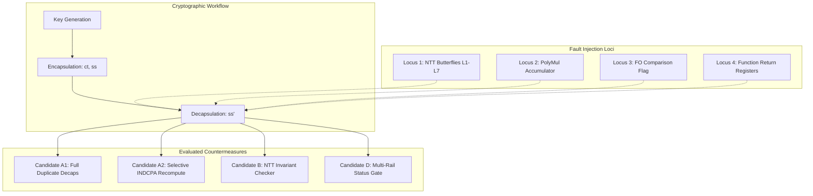

# Phase 6: Experimental Methodology and Protocol

**Project:** Fault Resilience Analysis of Post-Quantum Cryptographic Implementations for Space Systems  
**Phase:** 6 — Targeted Software Resilience Prototyping and Evaluation  
**Date:** October 1, 2026  
**Status:** COMPLETED  

---

## 1. Experimental Objectives and Controls

Phase 6 implements a rigorous empirical framework to evaluate candidate software-level fault protections against uninstrumented baselines.

### Methodological Principles:
1. **Strict Baseline Controls:** Every protected trial is matched against an identical clean baseline executing on the same input vectors and PRNG seeds.
2. **Double-Blind Invariant Validation:** Fault injections occur within micro-architectural hooks inside the algorithm; resilience verifiers evaluate outputs independently without access to fault injection metadata.
3. **Statistical Confidence:** Sample sizes $N = 200$ to $N = 1,000$ per condition; all proportions bounded by 95% Wilson score confidence intervals.
4. **Separation of Metrics:** Latency overhead, memory footprint, detection coverage, and false positive rates are measured independently.

---

## 2. Tested Configurations and Fault Loci

### Injected Fault Matrix:
- **NTT Butterfly Faults:** Layers 1 through 7, single output register (`OUTPUT_ADD`) and shared intermediate (`INTERMEDIATE_T`), additive perturbations $\delta \in [1, 500]$.
- **Accumulator Glitches:** BaseMul point-wise multiplication vector lane corruptions.
- **Control-Flow & Status Glitches:** Bit flips in boolean comparison variables ($0 \to 1$) and function return registers.

---

## 3. Execution and Measurement Protocols

### 3.1 Timing Benchmarks
- Platform: Apple Silicon (`arm64`), clock resolution via `clock_gettime(CLOCK_MONOTONIC)`.
- Warm-up: 50 iterations discarded prior to recording.
- Sample Size: 1,000 continuous iterations per variant to eliminate cache transient noise.
- Extracted Metrics: Mean latency ($\mu$s), median latency ($\mu$s), relative overhead percentage compared to baseline.

### 3.2 Detection and Correctness Metrics
- **Detection Rate ($D$):**
  $$D = \frac{\text{Faults Caught by Resilience Trap}}{\text{Total Injected Faults}}$$
- **False Positive Rate ($FP$):**
  $$FP = \frac{\text{Clean Runs Incorrectly Flagged as Faulty}}{\text{Total Clean Executions}}$$
  *Strict Target:* $FP = 0.0\%$. Any non-zero false positive rate disqualifies a countermeasure from space flight consideration.
- **Silent Data Corruption Rate ($SDC$):**
  $$SDC = \frac{\text{Faulted Runs Yielding Mismatched Output without Detection}}{\text{Total Injected Faults}}$$
