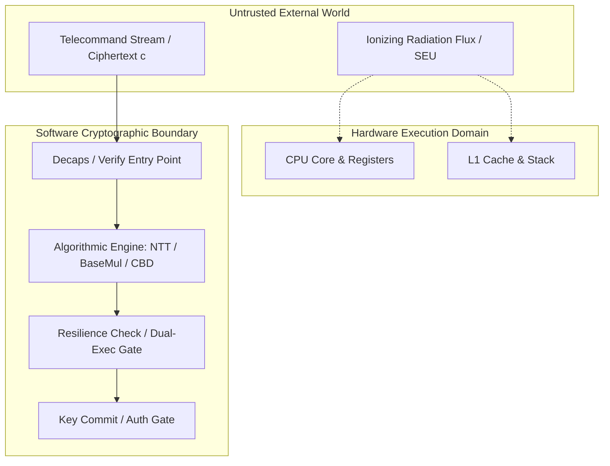

# Phase 6: Threat Model and Fault Assumptions

**Project:** Fault Resilience Analysis of Post-Quantum Cryptographic Implementations for Space Systems  
**Phase:** 6 — Targeted Software Resilience Prototyping and Evaluation  
**Date:** October 1, 2026  
**Status:** COMPLETED  

---

## 1. System Context and Operational Environment

This threat model targets post-quantum cryptographic software deployed in embedded space avionics (e.g., flight computers on LEO, MEO, GEO satellites, or deep-space probes) executing on radiation-tolerant processors (such as ARM Cortex-R52, Cobham Gaisler LEON4/SPARC, or Vorago Cortex-M4/M7).

The subsystem performs:
- **Session Key Exchange:** ML-KEM-768 decapsulation for telecommand uplink decryption.
- **Entity Authentication & Command Integrity:** ML-DSA-65 verification for telecommand execution authorization.

---

## 2. Fault Dimension Classification

### 2.1 Environmental / Accidental Fault Model (Space Radiation Primary)
- **Primary Mechanism:** Single Event Effects (SEEs) caused by Galactic Cosmic Rays (GCRs), solar particle events (SPEs), and trapped radiation belt protons.
- **Fault Types:**
  - **Single Event Upsets (SEUs):** Transient bit flips ($0 \to 1$ or $1 \to 0$) in CPU registers, ALU pipeline registers, or uncorrected SRAM/cache cells.
  - **Single Event Transients (SETs):** Voltage spikes in combinational logic latched into register states.
- **Temporal Profile:** Strictly **transient** (single-shot per operational epoch, lasting 1 clock cycle to 1 operational frame).
- **Multiplicity:** Dominated by single-bit flips ($k=1$); multi-bit upsets (MBUs) occur with lower probability (~1–5% of SEE events).
- **Spatial Distribution:** Spatially uncorrelated and uniformly distributed across silicon die area. The environment has **no intentional steering** to sensitive cryptographic gates.

### 2.2 Adversarial Fault Model (Ground Station / Lab Baseline Reference)
- **Primary Mechanism:** Targeted fault injection via Clock Glitching, Voltage Transients, or Focused Laser / Electromagnetic Fault Injection (EMFI).
- **Attacker Capabilities:**
  - *Location Control:* Precise timing synchronization to specific cryptographic subroutines (e.g., triggering a glitch exactly at the FO comparison or NTT layer 4).
  - *Repeatability:* Ability to replay inputs and induce identical faults across multiple executions.
  - *Observation:* Ability to measure response latencies and distinguish error codes or implicit rejection outcomes.
- **Attacker Restrictions:**
  - Attacker cannot read raw private key storage directly (secure boot / enclaved memory boundary).

---

## 3. Trust Boundary and Protection Architecture

### 3.1 Protection Trust Boundary Rules
1. **The Protection Mechanism is NOT Infallible:**
   - The memory holding the resilience check flags, intermediate hash values, or comparison branches is subject to the same radiation flux as the cryptographic algorithm.
   - Countermeasures must withstand single-bit corruptions within the protection logic itself.
2. **Input Immutability Assumption:**
   - The input ciphertext $c$ and secret key buffer $sk$ reside in read-only or integrity-protected memory (e.g. EDAC/SECDED protected RAM). Corruptions during transfer into registers are within scope; permanent destruction of $sk$ storage is an unrecoverable hardware failure.

---

## 4. In-Scope vs. Out-of-Scope Faults

| Fault Phenomenon | Scope Status | Rationale |
|:---|:---:|:---|
| **Transient register bit flip during NTT** | **IN SCOPE** | Dominant radiation effect causing silent session desync. |
| **Transient bit flip in FO comparison flag** | **IN SCOPE** | Vulnerability identified in Phase 2/4/5 causing key mismatch. |
| **Transient bit flip in ML-DSA verify return** | **IN SCOPE** | Vulnerability identified in Phase 3/5 causing local boolean override. |
| **Transient bit flip in candidate resilience check** | **IN SCOPE** | Must evaluate countermeasure self-integrity. |
| **Single-Event Latchup (SEL) / Permanent Burnout** | *OUT OF SCOPE* | Hardware-level power-cycling issue; software cannot restore silicon. |
| **Persistent stuck-at bit in ALU hardware** | *OUT OF SCOPE* | Requires hardware BIST (Built-In Self-Test) and core migration. |
| **Complete DRAM memory bus blackout** | *OUT OF SCOPE* | System-level watchdog reset required. |
| **Physical decapsulation / probe attacks** | *OUT OF SCOPE* | Addressed by physical tamper enclosures, not flight algorithms. |
