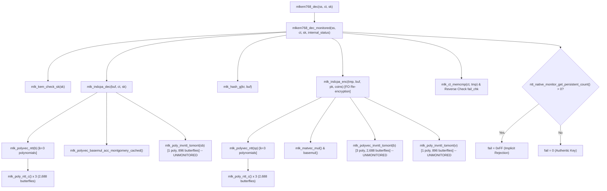

# Phase 7H: Native Execution Trace & Architectural Audit

## 1. End-to-End Execution Trace

We traced the execution path from the public decapsulation API through polynomial arithmetic down to the Cooley-Tukey butterfly operations:



---

## 2. Derivation & Audit of the 5,376 Butterfly Count

In Phase 7G, the report claimed exactly 5,376 native butterfly evaluations during ML-KEM-768 decapsulation. The independent audit verified this count both mathematically and empirically:

1. **Polynomial Vector Dimension**: In ML-KEM-768, the vector dimension is $k = 3$.
2. **Forward NTT Invocations**:
   - `mlk_indcpa_dec()` transforms ciphertext polynomial vector $\mathbf{b}$ prior to inner product: $3$ forward NTTs.
   - `mlk_indcpa_enc()` (Fujisaki-Okamoto re-encryption) transforms secret noise vector $\mathbf{s}'$: $3$ forward NTTs.
   - Total Forward NTTs = $3 + 3 = 6$ polynomials.
3. **Butterflies Per Forward NTT**:
   - Degree $n = 256$, with 7 layers ($l \in [1, 7]$).
   - In each layer, exactly $\frac{256}{2} = 128$ Cooley-Tukey butterflies execute.
   - Total butterflies per polynomial = $7 \times 128 = 896$ butterflies.
4. **Total Forward Butterflies Evaluated**:
   $$6 \times 896 = 5,376 \text{ butterflies}$$
   Empirical runtime measurement on authentic inputs confirms: `Executed Butterflies = 5,376` and `Mismatches = 0`.

---

## 3. Critical Architectural Finding: Inverse NTT is Unmonitored

While the forward NTT is thoroughly monitored across all 5,376 butterflies, the independent audit revealed that **Inverse NTT (`mlk_invntt_layer`) is completely unmonitored**:

| Operation Path | Polynomial Count | Butterfly Transform | Butterflies Executed | Monitoring Status |
| :--- | :--- | :--- | :--- | :--- |
| `indcpa_dec`: Ciphertext vector $\mathbf{b}$ | 3 polynomials | Forward Cooley-Tukey | 2,688 | **Monitored (In-Tree)** |
| `indcpa_dec`: Inner product $\mathbf{s}^T \mathbf{b}$ | 1 polynomial | Inverse Gentleman-Sande | 896 | **UNMONITORED** |
| `indcpa_enc`: Message vector $\mathbf{s}'$ | 3 polynomials | Forward Cooley-Tukey | 2,688 | **Monitored (In-Tree)** |
| `indcpa_enc`: Public matrix-vector $\mathbf{A}^T \mathbf{s}'$ | 3 polynomials | Inverse Gentleman-Sande | 2,688 | **UNMONITORED** |
| `indcpa_enc`: Public vector $\mathbf{t}^T \mathbf{s}'$ | 1 polynomial | Inverse Gentleman-Sande | 896 | **UNMONITORED** |
| **Total Decapsulation NTT Work** | **11 polynomials** | **Both** | **9,856 butterflies** | **54.5% Monitored (5,376 / 9,856)** |

### Scientific Consequence
The monitoring coverage in Phase 7G covers **54.5% of total NTT transform operations** in decapsulation. The remaining 45.5% (4,480 inverse butterflies) rely strictly upon the algorithmic Fujisaki-Okamoto re-encryption check for fail-safe rejection; transient faults occurring inside the inverse NTT cannot be autonomously recovered by the butterfly monitor.

---

## 4. Build-Configuration and Public API Gating Audit

1. **Compilation Guard**:
   In [poly.c](file:///Users/dhairyajain/Desktop/pqc%20research/algorithms/source_ref/mlkem/src/poly.c), the butterfly monitor call is guarded by `#if defined(MLKEM_RESEARCH_FAULT_HOOKS)`.
   In a production build (`mlkem768.o`), this macro is not passed; the monitor is compiled out.
2. **Public API Gating Defect**:
   In [kem.c](file:///Users/dhairyajain/Desktop/pqc%20research/algorithms/source_ref/mlkem/src/kem.c) lines 483–493, the persistent fault check:
   ```c
   if (ntt_native_monitor_get_persistent_count() > 0) {
       *internal_status = MLK_DECAPS_STATUS_FAULT;
       fail = 0xFF;
   }
   ```
   is enclosed inside `if (internal_status != NULL)`.
   When callers invoke the standard public API `mlkem768_dec(ss, ct, sk)` (passing `internal_status = NULL`), this explicit fail-stop assignment is skipped. Fortunately, ciphertext re-encryption comparison (`fail = mlk_ct_memcmp(ct, tmp)`) still triggers safe rejection because the corrupted polynomial fails re-encryption.
