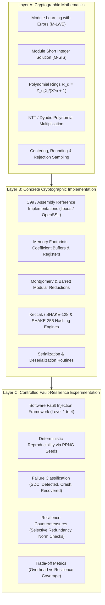

# Project Overview: Fault Resilience Analysis of Post-Quantum Cryptographic Implementations for Space Systems

## 1. Research Motivation

Spacecraft onboard computers, payload controllers, and inter-satellite communication links operate in hostile radiation environments. As satellite communications transition to post-quantum cryptographic (PQC) standards (such as NIST FIPS 203 ML-KEM and FIPS 204 ML-DSA) to counter quantum decryption risks, these systems must remain computationally dependable under cosmic ray and solar energetic particle flux.

Physical radiation imparts ionizing energy that causes **Single Event Effects (SEEs)**, principally:
- **Single Event Upsets (SEUs):** Bit flips in SRAM, registers, or Flash memory.
- **Single Event Transients (SETs):** Transient pulses in combinatorial logic producing altered arithmetic results.
- **Single Event Functional Interrupts (SEFI):** Control logic disruption causing instruction skips, premature loop terminations, or execution hangs.

While pre-quantum cryptography (e.g., RSA, ECC) relied on large integer modular exponentiation or elliptic curve group arithmetic, lattice-based PQC algorithms rely on:
- Modular polynomial arithmetic over rings $R_q = \mathbb{Z}_q[X]/(X^{256} + 1)$
- High-performance Number Theoretic Transforms (NTT) and inverse NTT (iNTT)
- Rejection sampling from centered binomial distributions or uniform ranges
- High-dimensional vector and matrix-by-vector polynomial multiplications
- Compression, rounding, and hint bit extraction

These distinctive mathematical structures create unique failure modes under faults:
1. **Silent Data Corruption (SDC):** An internal coefficient corruption alters the recovered shared secret or signature without triggering an exception.
2. **Rejection Loop Degradation:** Corrupting intermediate candidate vectors during rejection sampling can induce infinite or abnormally elongated loops.
3. **Decapsulation Failure / Implicit Rejection Disconnect:** ML-KEM relies on the Fujisaki-Okamoto transform. When faults disturb the ciphertext or intermediate polynomial vectors, decapsulation implicitly rejects the ciphertext, yielding an unpredictable pseudorandom shared secret. In a spacecraft context, this translates to silent session desynchronization.

---

## 2. Three-Layer Research Framework

---

## 3. High-Level System Architecture

The research platform consists of modular subsystems:
- **Baseline Implementations (`algorithms/`):** Standards-compliant, audited reference implementations of ML-KEM-512/768/1024 and ML-DSA-44/65/87.
- **Fault Injector (`fault_injection/`):** Multi-level injector with configurable fault types (SEU, multi-bit, burst, transient, persistent), targets (inputs, memory buffers, intermediate NTT states), and deterministic PRNG scheduling.
- **Resilience Engine (`resilience/`):** Lightweight fault detection, checksumming, norm checks, and selective redundancy modules.
- **Experimental Harness (`experiments/`):** Automated orchestration scripts running controlled parametric sweeps across fault locations and rates.
- **Results & Diagnostics (`results/`, `scripts/`):** Data serialization (JSON/CSV), statistical significance testing, confidence interval computations, and publication-ready visualization.
