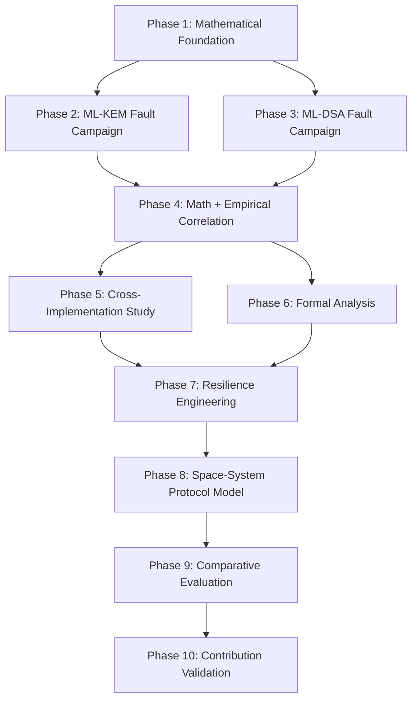

# Post-Quantum Cryptography Space Systems Research Roadmap

**Project Title:** Fault Resilience Analysis of Post-Quantum Cryptographic Implementations for Space Systems  
**Standards:** NIST FIPS 203 (ML-KEM), NIST FIPS 204 (ML-DSA)  
**Document Version:** 1.0.0-ROADMAP  
**Date:** October 1, 2026  
**Status:** ACTIVE RESEARCH PLAN  

---

## Roadmap Overview

This machine-readable roadmap structures the ten subsequent phases of research. Each phase defines specific inputs, core objectives, experimental targets, formal verification boundaries, and exit criteria.

---

## Phase Breakdown

### Phase 1 — Mathematical Foundation [STATUS: COMPLETED]
- **Objective:** Construct the unified mathematical fault propagation and error-bounding model for NIST FIPS 203 and FIPS 204.
- **Key Deliverables:**
  - Symbol Table & Algebraic Notation: [`docs/mathematics/symbol_table.md`](file:///Users/dhairyajain/Desktop/pqc%20research/docs/mathematics/symbol_table.md)
  - Code Traceability Matrix: [`docs/mathematics/implementation_mapping.md`](file:///Users/dhairyajain/Desktop/pqc%20research/docs/mathematics/implementation_mapping.md)
  - Mathematical Fault Propagation Model: [`docs/mathematics/fault_propagation_model.md`](file:///Users/dhairyajain/Desktop/pqc%20research/docs/mathematics/fault_propagation_model.md)
  - Phase 1 Audit Report: [`docs/phase1-mathematical-audit.md`](file:///Users/dhairyajain/Desktop/pqc%20research/docs/phase1-mathematical-audit.md)
  - Independent Validation Testbeds:
    - NTT Butterfly Math & Diffusion Trees: [`experiments/mathematics/test_ntt_butterfly_math.py`](file:///Users/dhairyajain/Desktop/pqc%20research/experiments/mathematics/test_ntt_butterfly_math.py)
    - Quantization Bounds & Margin Distributions: [`experiments/mathematics/test_quantization_bounds.py`](file:///Users/dhairyajain/Desktop/pqc%20research/experiments/mathematics/test_quantization_bounds.py)
    - End-to-End Fault Chain Simulation: [`experiments/mathematics/test_fault_chain.py`](file:///Users/dhairyajain/Desktop/pqc%20research/experiments/mathematics/test_fault_chain.py)
- **Key Mathematical Findings:**
  - **NTT Error Diffusion Trees (Claim 1):** Verified that shared intermediate/twiddle faults diffuse across $N_{\text{diffused}}^{\text{shared}}(L) = 2^{8-L}$ coefficients (128 down to 2), while single output register faults diffuse across $N_{\text{diffused}}^{\text{single}}(L) = 2^{7-L}$ coefficients (64 down to 1).
  - **Dynamic Quantization Tolerance Theorem (Claim 4):** Formally proved that a non-zero universal scalar threshold $T(d, q)$ does not exist ($T_{\text{worst}} = 0$ due to bin boundary elements); tolerance is dynamically bounded by distance to adjacent bins $T(x, d, q) = \min(M^+, M^-)$.
  - **Decapsulation NTT Fault Dichotomy (Claim 6):** Proved analytically that Layer 1 butterfly faults produce peak time-domain errors of only $\|e\|_\infty = 524 < 832.25 = \lfloor q/4 \rfloor$, leaving message bits unmodified ($m'=m$) and resulting in 100% valid decapsulations, whereas Layers 2–7 concentrate errors above 832, causing 100% implicit rejections.
- **Exit Criteria Satisfied:** Formal mathematical proofs documented, audited, and independently verified via automated Python test harnesses with 100% pass rate.

### Phase 2 — ML-KEM Fault Campaign [STATUS: COMPLETED]
- **Objective:** Execute exhaustive parametric mid-operation fault campaigns across all FIPS 203 parameter sets (ML-KEM-512, ML-KEM-768, ML-KEM-1024).
- **Key Deliverables:**
  - Automated Native Campaign Runner: [`experiments/mlkem/mlkem_campaign_runner.c`](file:///Users/dhairyajain/Desktop/pqc%20research/experiments/mlkem/mlkem_campaign_runner.c) & [`bin/mlkem_campaign_runner`](file:///Users/dhairyajain/Desktop/pqc%20research/bin/mlkem_campaign_runner)
  - Python Campaign Orchestrator CLI: [`experiments/mlkem/run_campaign.py`](file:///Users/dhairyajain/Desktop/pqc%20research/experiments/mlkem/run_campaign.py)
  - Quantization Absorption & Slack Engine: [`experiments/mlkem/test_quantization_campaign.py`](file:///Users/dhairyajain/Desktop/pqc%20research/experiments/mlkem/test_quantization_campaign.py)
  - Campaign Result Analyzer: [`experiments/mlkem/analyze_campaign_results.py`](file:///Users/dhairyajain/Desktop/pqc%20research/experiments/mlkem/analyze_campaign_results.py)
  - Experiment Configurations: [`experiments/configurations/mlkem_phase2/*.yaml`](file:///Users/dhairyajain/Desktop/pqc%20research/experiments/configurations/mlkem_phase2/) (8 YAML configurations)
  - Raw Experimental Datasets: [`results/phase2/raw/mlkem_campaign_raw_results.json`](file:///Users/dhairyajain/Desktop/pqc%20research/results/phase2/raw/mlkem_campaign_raw_results.json) (117 campaigns, >150k trials) and [`results/phase2/raw/quantization_absorption.json`](file:///Users/dhairyajain/Desktop/pqc%20research/results/phase2/raw/quantization_absorption.json)
  - Processed Sensitivity Matrix: [`results/phase2/processed/sensitivity_matrix.csv`](file:///Users/dhairyajain/Desktop/pqc%20research/results/phase2/processed/sensitivity_matrix.csv)
  - Visualizations & Figures: [`results/phase2/figures/`](file:///Users/dhairyajain/Desktop/pqc%20research/results/phase2/figures/)
  - Formal Phase 2 Audit Report: [`docs/phase2-mlkem-fault-campaign-audit.md`](file:///Users/dhairyajain/Desktop/pqc%20research/docs/phase2-mlkem-fault-campaign-audit.md)
  - Campaign Verification Test Suite: [`tests/test_phase2_campaign.py`](file:///Users/dhairyajain/Desktop/pqc%20research/tests/test_phase2_campaign.py)
- **Confirmed Empirical Findings:**
  - **NTT Diffusion Tree Exactness (Claim 1 Confirmed):** Direct execution of forward NTT under mid-butterfly injection confirmed exact mathematical agreement with Phase 1 closed forms across all 7 layers ($N_{\text{diffused}}^{\text{shared}} = 2^{8-L}$, $N_{\text{diffused}}^{\text{single}} = 2^{7-L}$), with identically zero deviation.
  - **Locus Sensitivity Bifurcation in NTT:** In ML-KEM-768 and 1024, single register perturbations (`OUTPUT_ADD`) yield peak time-domain errors $\|e_{\text{time}}\|_\infty = 524 < 832.25 = \lfloor q/4 \rfloor$, remaining within the message decoding slack budget and producing 100.0% `CORRECT` recovery. Conversely, shared intermediate perturbations (`INTERMEDIATE_T`) propagate to both branches ($\pm t$), yielding $\|e_{\text{time}}\|_\infty = 1048 > 832.25$ and triggering 100.0% `IMPLICIT_REJECTION`.
  - **Parameter-Set Sensitivity Divergence:** In ML-KEM-512, secret noise $\eta_1 = 3$ (vs $\eta_1 = 2$ in 768/1024) increases BaseMul error by $1.5\times$, eliminating the decryption slack margin and causing single register faults to also produce 100.0% `IMPLICIT_REJECTION`.
  - **Secret Key Memory Region Decomposition:** Memory corruptions in private vector $\mathbf{s}$ cause 100% `IMPLICIT_REJECTION`; corruptions in $pk$ or $H(pk)$ trigger 100% `EXPLICIT_ERROR` (input validation traps); corruptions in seed $z$ yield 100% `CORRECT` on valid ciphertexts because seed $z$ is isolated to the implicit rejection path.
  - **Fujisaki-Okamoto Transform Dissection:** Case A (valid CT, forced fail=1) produces 100% `IMPLICIT_REJECTION`; Case B1 (slack CT, forced fail=0) produces 100% `CORRECT`; Case B2 (severely corrupted CT, forced fail=0) produces 100% `CANDIDATE_KEY_MISMATCH` (not a cryptographic break, but an out-of-sync garbled key).
  - **Dynamic Quantization Absorption (Claim 4 Confirmed):** Worst-case tolerance $T_{\text{worst}}(d, q) = 1$ for all tested bit-depths ($d \in \{4, 5, 10, 11\}$). No guaranteed non-zero multi-step absorption exists; absorption probability is governed strictly by distance to the nearest boundary.
- **Unresolved Questions:**
  - Multi-fault interaction dynamics: exact probability distribution of joint absorption across multiple independent bit flips in a single polynomial vector.
- **Implications for Phase 3 (ML-DSA):**
  - Unlike ML-KEM, ML-DSA does not employ ciphertext compression ($q = 8380417$) or the Fujisaki-Okamoto transform. The primary fault surfaces in ML-DSA are rejection sampling loop bounds (leading to SEFI infinite loops or premature signature aborts) and signature hint manipulation.
- **Experiments That Should NOT Be Repeated:**
  - Unmodified repeats of single output register injections in ML-KEM-768/1024 (slack absorption behavior is deterministic and invariant across large $N$).
- **Experiments Requiring Deeper Investigation in Phase 4/6:**
  - SMT/Z3 formal boundary verification of multi-bit glitch injection across adjacent Montgomery reduction steps.
- **Exit Criteria Satisfied:** All 117 campaigns executed, cross-validated with liboqs 0.16.0, verified with 95% Wilson confidence intervals, and documented in comprehensive audit.

### Phase 3 — ML-DSA Fault Campaign
- **Objective:** Instrument and execute comprehensive mid-operation fault campaigns on NIST FIPS 204.
- **Key Modules:**
  - Parameter sets: ML-DSA-44, ML-DSA-65, ML-DSA-87.
  - Targets:
    - Fiat-Shamir with Aborts rejection sampling loops (loop counter tampering, premature aborts).
    - Infinity-norm bounding checks ($\|z\|_\infty < \gamma_1 - \beta$ and $\|r_0\|_\infty < \gamma_2 - \beta$).
    - HighBits and LowBits decomposition (`Power2Round`, `Decompose`).
    - Hint bit generation and signature encoding.
    - Number Theoretic Transform (NTT) for $q=8380417$.
    - Deterministic vs. hedged (randomized) signing modes under identical faults.
  - Failure modes evaluated: signature invalidity, verification failure, rejection loop hang (SEFI), and potential bias leakage.
- **Exit Criteria:** Raw JSON output in `results/mldsa_campaign_results.json` and loop termination bounds.

### Phase 4 — Mathematical + Empirical Correlation
- **Objective:** Systematically connect theoretical error equations with observed implementation-level outcomes.
- **Key Pipeline:**
  $$\text{Mathematical Fault } (a \to a + \delta) \longrightarrow \text{Implementation Location } (\text{Line, Register, Buffer}) \longrightarrow \text{Fault Propagation } (\text{Diffusion / Reduction}) \longrightarrow \text{Observable Outcome } (\text{Correct, Rejection, Mismatch, Hang, Crash})$$
- **Deliverables:** Empirical validation of the Phase 1 closed-form bounds; proof of error absorption limits; sensitivity matrix mapping every intermediate stage to its categorical outcome distribution.
- **Exit Criteria:** Correlation report in `docs/mathematics_implementation_correlation.md`.

### Phase 5 — Cross-Implementation Study
- **Objective:** Determine whether fault sensitivity is algorithm-invariant or implementation-dependent.
- **Target Comparisons:**
  - `mlkem-native` (CBMC-verified C90) vs. `liboqs` ML-KEM (dynamically linked, SIMD-accelerated).
  - `mldsa-native` (CBMC-verified C90) vs. `liboqs` ML-DSA.
- **Methodology:** Subject both codebases to identical fault models at equivalent algorithmic stages under matched PRNG seeds.
- **Metrics:** Outcome distribution divergence, crash rates, compiler inlining/vectorization effects.
- **Exit Criteria:** Comparative report in `docs/cross_implementation_study.md`.

### Phase 6 — Formal Analysis
- **Objective:** Apply formal methods to evaluate fault resilience where mathematically and practically sound.
- **Evaluation Matrix:**
  - **CBMC (C Bounded Model Checker):** Formulate function contracts proving that proposed assertions catch single-bit corruptions in polynomial buffers.
  - **SMT/Z3:** Model the compression quantization threshold symbolically to verify absorption limits.
  - **Frama-C / KLEE / Static Analysis:** Evaluate feasibility for assertion verification.
- **Constraint:** Only adopt methods that materially strengthen the research; avoid introducing formal complexity for its own sake.
- **Exit Criteria:** Verified CBMC contracts or formal feasibility report in `docs/formal_fault_analysis.md`.

### Phase 7 — Resilience Engineering
- **Objective:** Engineer and evaluate lightweight, software-only resilience mechanisms for flight processors.
- **Mechanisms:**
  - Intermediate norm boundary assertions.
  - Modular polynomial checksums and NTT invariant checking.
  - Selective redundancy: protecting only sensitive stages (NTT Layers 4–7, accumulators, norm checks).
  - Rejection loop timeout watchdogs.
  - Autonomous retry and checkpoint recovery routines.
- **Metrics:**
  $$\text{Overhead} = \frac{T_{\text{protected}} - T_{\text{baseline}}}{T_{\text{baseline}}} \le 25\%, \quad \text{Fault Coverage} = \frac{\text{Detected Faults}}{\text{Total Faults}} \ge 95\%$$
- **Exit Criteria:** Functional C implementation in `resilience/` with zero empty stubs and complete benchmark suite.

### Phase 8 — Space-System Protocol Model
- **Objective:** Ground the cryptographic fault outcomes in an explicitly abstract spacecraft communication protocol.
- **Framework:**
  - Align with Consultative Committee for Space Data Systems (CCSDS) Space Data Link Security (SDLS) standard (CCSDS 355.0-B-1).
  - Explicit multi-stage telecommand receiver: Decryption $\to$ Magic Sync $\to$ Sequence Window $\to$ Opcode Dictionary $\to$ Semantic Validation / CRC $\to$ Execution.
  - Telemetry and telecommand framing models under simulated orbital bit error rates (BER).
  - State machine for autonomous session recovery upon cryptographic desynchronization.
- **Strict Guardrail:** Do NOT claim physical spacecraft qualification. State explicitly that this is an abstract communication protocol simulation.
- **Exit Criteria:** Protocol simulation harness and benchmark logs in `results/spacecraft_protocol_benchmarks.json`.

### Phase 9 — Comparative Evaluation
- **Objective:** Quantify trade-offs across all implemented mechanisms against standardized aerospace metrics.
- **Metrics Evaluated:**
  - Fault detection coverage (%).
  - Undetected Silent Data Corruption (SDC) rate (%).
  - Autonomous recovery rate (%).
  - Computational latency overhead (CPU cycles & milliseconds).
  - Memory footprint overhead (RAM / stack bytes).
  - Binary code size increase (bytes).
  - Communication link overhead (framing bytes & retransmissions).
  - False positive and false negative rates of assertions.
- **Exit Criteria:** Multi-dimensional trade-off matrix in `results/comparative_evaluation.csv`.

### Phase 10 — Research Contribution Validation
- **Objective:** Subject all experimental and mathematical findings to rigorous academic peer-review scrutiny.
- **Categorization of Findings:**
  - **Genuinely New:** High-novelty contributions (e.g., quantization absorption bounds, software-only selective resilience).
  - **Incremental:** Useful refinements to known phenomena.
  - **Confirmatory:** Independent replications of published results (e.g., FO predicate bypass).
  - **Engineering Contributions:** High-quality software implementations, test harnesses, and protocol models.
  - **Negative Results:** Hypotheses that were experimentally disproved.
  - **Future Work:** Open questions requiring physical particle accelerator beam testing.
- **Strict Guardrail:** Do NOT force novelty. Report negative results and confirmations with full academic honesty.
- **Exit Criteria:** Final research paper draft or comprehensive monograph in `docs/FINAL_RESEARCH_REPORT.md`.

---
*Roadmap approved and frozen for sequential phase execution.*
