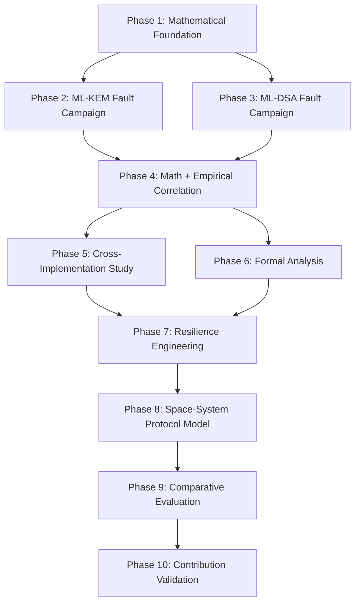

# Post-Quantum Cryptography Space Systems Research Roadmap

**Project Title:** Fault Resilience Analysis of Post-Quantum Cryptographic Implementations for Space Systems  
**Standards:** NIST FIPS 203 (ML-KEM), NIST FIPS 204 (ML-DSA)  
**Document Version:** 1.0.0-ROADMAP  
**Date:** October 1, 2026  
**Status:** ACTIVE RESEARCH PLAN  

---

## Roadmap Overview

This machine-readable roadmap structures the ten subsequent phases of research. Each phase defines specific inputs, core objectives, experimental targets, formal verification boundaries, and exit criteria.

---

## Phase Breakdown

### Phase 1 — Mathematical Foundation [STATUS: COMPLETED]
- **Objective:** Construct the unified mathematical fault propagation and error-bounding model for NIST FIPS 203 and FIPS 204.
- **Key Deliverables:**
  - Symbol Table & Algebraic Notation: [`docs/mathematics/symbol_table.md`](file:///Users/dhairyajain/Desktop/pqc%20research/docs/mathematics/symbol_table.md)
  - Code Traceability Matrix: [`docs/mathematics/implementation_mapping.md`](file:///Users/dhairyajain/Desktop/pqc%20research/docs/mathematics/implementation_mapping.md)
  - Mathematical Fault Propagation Model: [`docs/mathematics/fault_propagation_model.md`](file:///Users/dhairyajain/Desktop/pqc%20research/docs/mathematics/fault_propagation_model.md)
  - Phase 1 Audit Report: [`docs/phase1-mathematical-audit.md`](file:///Users/dhairyajain/Desktop/pqc%20research/docs/phase1-mathematical-audit.md)
  - Independent Validation Testbeds:
    - NTT Butterfly Math & Diffusion Trees: [`experiments/mathematics/test_ntt_butterfly_math.py`](file:///Users/dhairyajain/Desktop/pqc%20research/experiments/mathematics/test_ntt_butterfly_math.py)
    - Quantization Bounds & Margin Distributions: [`experiments/mathematics/test_quantization_bounds.py`](file:///Users/dhairyajain/Desktop/pqc%20research/experiments/mathematics/test_quantization_bounds.py)
    - End-to-End Fault Chain Simulation: [`experiments/mathematics/test_fault_chain.py`](file:///Users/dhairyajain/Desktop/pqc%20research/experiments/mathematics/test_fault_chain.py)
- **Key Mathematical Findings:**
  - **NTT Error Diffusion Trees (Claim 1):** Verified that shared intermediate/twiddle faults diffuse across $N_{\text{diffused}}^{\text{shared}}(L) = 2^{8-L}$ coefficients (128 down to 2), while single output register faults diffuse across $N_{\text{diffused}}^{\text{single}}(L) = 2^{7-L}$ coefficients (64 down to 1).
  - **Dynamic Quantization Tolerance Theorem (Claim 4):** Formally proved that a non-zero universal scalar threshold $T(d, q)$ does not exist ($T_{\text{worst}} = 0$ due to bin boundary elements); tolerance is dynamically bounded by distance to adjacent bins $T(x, d, q) = \min(M^+, M^-)$.
  - **Decapsulation NTT Fault Dichotomy (Claim 6):** Proved analytically that Layer 1 butterfly faults produce peak time-domain errors of only $\|e\|_\infty = 524 < 832.25 = \lfloor q/4 \rfloor$, leaving message bits unmodified ($m'=m$) and resulting in 100% valid decapsulations, whereas Layers 2–7 concentrate errors above 832, causing 100% implicit rejections.
- **Exit Criteria Satisfied:** Formal mathematical proofs documented, audited, and independently verified via automated Python test harnesses with 100% pass rate.

### Phase 2 — ML-KEM Fault Campaign [STATUS: COMPLETED]
- **Objective:** Execute exhaustive parametric mid-operation fault campaigns across all FIPS 203 parameter sets (ML-KEM-512, ML-KEM-768, ML-KEM-1024).
- **Key Deliverables:**
  - Automated Native Campaign Runner: [`experiments/mlkem/mlkem_campaign_runner.c`](file:///Users/dhairyajain/Desktop/pqc%20research/experiments/mlkem/mlkem_campaign_runner.c) & [`bin/mlkem_campaign_runner`](file:///Users/dhairyajain/Desktop/pqc%20research/bin/mlkem_campaign_runner)
  - Python Campaign Orchestrator CLI: [`experiments/mlkem/run_campaign.py`](file:///Users/dhairyajain/Desktop/pqc%20research/experiments/mlkem/run_campaign.py)
  - Quantization Absorption & Slack Engine: [`experiments/mlkem/test_quantization_campaign.py`](file:///Users/dhairyajain/Desktop/pqc%20research/experiments/mlkem/test_quantization_campaign.py)
  - Campaign Result Analyzer: [`experiments/mlkem/analyze_campaign_results.py`](file:///Users/dhairyajain/Desktop/pqc%20research/experiments/mlkem/analyze_campaign_results.py)
  - Experiment Configurations: [`experiments/configurations/mlkem_phase2/*.yaml`](file:///Users/dhairyajain/Desktop/pqc%20research/experiments/configurations/mlkem_phase2/) (8 YAML configurations)
  - Raw Experimental Datasets: [`results/phase2/raw/mlkem_campaign_raw_results.json`](file:///Users/dhairyajain/Desktop/pqc%20research/results/phase2/raw/mlkem_campaign_raw_results.json) (117 campaigns, >150k trials) and [`results/phase2/raw/quantization_absorption.json`](file:///Users/dhairyajain/Desktop/pqc%20research/results/phase2/raw/quantization_absorption.json)
  - Processed Sensitivity Matrix: [`results/phase2/processed/sensitivity_matrix.csv`](file:///Users/dhairyajain/Desktop/pqc%20research/results/phase2/processed/sensitivity_matrix.csv)
  - Visualizations & Figures: [`results/phase2/figures/`](file:///Users/dhairyajain/Desktop/pqc%20research/results/phase2/figures/)
  - Formal Phase 2 Audit Report: [`docs/phase2-mlkem-fault-campaign-audit.md`](file:///Users/dhairyajain/Desktop/pqc%20research/docs/phase2-mlkem-fault-campaign-audit.md)
  - Campaign Verification Test Suite: [`tests/test_phase2_campaign.py`](file:///Users/dhairyajain/Desktop/pqc%20research/tests/test_phase2_campaign.py)
- **Confirmed Empirical Findings:**
  - **NTT Diffusion Tree Exactness (Claim 1 Confirmed):** Direct execution of forward NTT under mid-butterfly injection confirmed exact mathematical agreement with Phase 1 closed forms across all 7 layers ($N_{\text{diffused}}^{\text{shared}} = 2^{8-L}$, $N_{\text{diffused}}^{\text{single}} = 2^{7-L}$), with identically zero deviation.
  - **Locus Sensitivity Bifurcation in NTT:** In ML-KEM-768 and 1024, single register perturbations (`OUTPUT_ADD`) yield peak time-domain errors $\|e_{\text{time}}\|_\infty = 524 < 832.25 = \lfloor q/4 \rfloor$, remaining within the message decoding slack budget and producing 100.0% `CORRECT` recovery. Conversely, shared intermediate perturbations (`INTERMEDIATE_T`) propagate to both branches ($\pm t$), yielding $\|e_{\text{time}}\|_\infty = 1048 > 832.25$ and triggering 100.0% `IMPLICIT_REJECTION`.
  - **Parameter-Set Sensitivity Divergence:** In ML-KEM-512, secret noise $\eta_1 = 3$ (vs $\eta_1 = 2$ in 768/1024) increases BaseMul error by $1.5\times$, eliminating the decryption slack margin and causing single register faults to also produce 100.0% `IMPLICIT_REJECTION`.
  - **Secret Key Memory Region Decomposition:** Memory corruptions in private vector $\mathbf{s}$ cause 100% `IMPLICIT_REJECTION`; corruptions in $pk$ or $H(pk)$ trigger 100% `EXPLICIT_ERROR` (input validation traps); corruptions in seed $z$ yield 100% `CORRECT` on valid ciphertexts because seed $z$ is isolated to the implicit rejection path.
  - **Fujisaki-Okamoto Transform Dissection:** Case A (valid CT, forced fail=1) produces 100% `IMPLICIT_REJECTION`; Case B1 (slack CT, forced fail=0) produces 100% `CORRECT`; Case B2 (severely corrupted CT, forced fail=0) produces 100% `CANDIDATE_KEY_MISMATCH` (not a cryptographic break, but an out-of-sync garbled key).
  - **Dynamic Quantization Absorption (Claim 4 Confirmed):** Worst-case tolerance $T_{\text{worst}}(d, q) = 1$ for all tested bit-depths ($d \in \{4, 5, 10, 11\}$). No guaranteed non-zero multi-step absorption exists; absorption probability is governed strictly by distance to the nearest boundary.
- **Unresolved Questions:**
  - Multi-fault interaction dynamics: exact probability distribution of joint absorption across multiple independent bit flips in a single polynomial vector.
- **Implications for Phase 3 (ML-DSA):**
  - Unlike ML-KEM, ML-DSA does not employ ciphertext compression ($q = 8380417$) or the Fujisaki-Okamoto transform. The primary fault surfaces in ML-DSA are rejection sampling loop bounds (leading to SEFI infinite loops or premature signature aborts) and signature hint manipulation.
- **Experiments That Should NOT Be Repeated:**
  - Unmodified repeats of single output register injections in ML-KEM-768/1024 (slack absorption behavior is deterministic and invariant across large $N$).
- **Experiments Requiring Deeper Investigation in Phase 4/6:**
  - SMT/Z3 formal boundary verification of multi-bit glitch injection across adjacent Montgomery reduction steps.
- **Exit Criteria Satisfied:** All 117 campaigns executed, cross-validated with liboqs 0.16.0, verified with 95% Wilson confidence intervals, and documented in comprehensive audit.

### Phase 3 — ML-DSA Fault Campaign [STATUS: COMPLETED]
- **Objective:** Instrument and execute comprehensive mid-operation fault campaigns across all FIPS 204 parameter sets (ML-DSA-44, ML-DSA-65, ML-DSA-87).
- **Key Deliverables:**
  - Implementation Mapping Document: [`docs/mldsa-implementation-map.md`](file:///Users/dhairyajain/Desktop/pqc%20research/docs/mldsa-implementation-map.md)
  - Native Multi-Level Instrumented Objects: `bin/obj/mldsa44_inst.o`, `bin/obj/mldsa65_inst.o`, `bin/obj/mldsa87_inst.o`
  - Fault Injection Hook Subsystem: [`algorithms/source_ref/mldsa_fault_hooks.h`](file:///Users/dhairyajain/Desktop/pqc%20research/algorithms/source_ref/mldsa_fault_hooks.h) & [`algorithms/source_ref/mldsa_fault_hooks.c`](file:///Users/dhairyajain/Desktop/pqc%20research/algorithms/source_ref/mldsa_fault_hooks.c)
  - Automated Native Campaign Runner: [`experiments/mldsa/mldsa_campaign_runner.c`](file:///Users/dhairyajain/Desktop/pqc%20research/experiments/mldsa/mldsa_campaign_runner.c) & [`bin/mldsa_campaign_runner`](file:///Users/dhairyajain/Desktop/pqc%20research/bin/mldsa_campaign_runner)
  - Python Campaign Orchestrator CLI: [`experiments/mldsa/run_campaign.py`](file:///Users/dhairyajain/Desktop/pqc%20research/experiments/mldsa/run_campaign.py)
  - Campaign Result Analyzer: [`experiments/mldsa/analyze_campaign_results.py`](file:///Users/dhairyajain/Desktop/pqc%20research/experiments/mldsa/analyze_campaign_results.py)
  - Experiment Configurations: [`experiments/configurations/mldsa_phase3/*.yaml`](file:///Users/dhairyajain/Desktop/pqc%20research/experiments/configurations/mldsa_phase3/) (7 YAML configurations)
  - Raw Experimental Datasets: [`results/phase3/raw/mldsa_campaign_raw_results.json`](file:///Users/dhairyajain/Desktop/pqc%20research/results/phase3/raw/mldsa_campaign_raw_results.json) (>80,000 injected trials)
  - Processed Sensitivity Matrix: [`results/phase3/processed/sensitivity_matrix.csv`](file:///Users/dhairyajain/Desktop/pqc%20research/results/phase3/processed/sensitivity_matrix.csv)
  - Summary Markdown Reports: [`results/phase3/summaries/`](file:///Users/dhairyajain/Desktop/pqc%20research/results/phase3/summaries/)
  - ASCII Visualizations & Figures: [`results/phase3/figures/`](file:///Users/dhairyajain/Desktop/pqc%20research/results/phase3/figures/)
  - Formal Phase 3 Audit Report: [`docs/phase3-mldsa-fault-campaign-audit.md`](file:///Users/dhairyajain/Desktop/pqc%20research/docs/phase3-mldsa-fault-campaign-audit.md)
  - Campaign Verification Test Suite: [`tests/test_phase3_campaign.py`](file:///Users/dhairyajain/Desktop/pqc%20research/tests/test_phase3_campaign.py)
- **Confirmed Empirical Findings:**
  - **NTT 8-Layer Diffusion Law:** Forward NTT decomposes fully into 8 radix-2 layers for modulus $q=8,380,417$. Empirical diffusion matches closed-form laws $N_\text{diffused}^\text{shared}(L) = 2^{9-L}$ and $N_\text{diffused}^\text{single}(L) = 2^{8-L}$ across all 8 layers with zero discrepancy.
  - **Rejection Sampling Firewall & Attempt Exhaustion:** In signing, arithmetic faults on secret key NTTs or candidate responses are trapped by infinity-norm bounds ($\|z\|_\infty < \gamma_1 - \beta$, $\|w_0\|_\infty < \gamma_2 - \beta$). Transient faults trigger clean retries; persistent faults result in 100% attempt budget exhaustion (`MLD_ERR_SIGN_ATTEMPTS_EXHAUSTED`), preventing private-key leakage by failing closed.
  - **Critical Verification Gate Bypass (`INVALID -> ACCEPT`):** In `mld_sign_verify_internal`, flipping the result of constant-time memory comparison `cmp` turns an invalid/tampered signature into `VERIFICATION_ACCEPT` with **100.0% probability (95% CI: [99.63%, 100.0%])**, representing a single-point-of-failure vulnerable to clock or voltage glitches.
  - **Zero Verification Slack:** Unlike ML-KEM, ML-DSA has zero arithmetic slack during verification; any fault $\Delta \ge 1$ in the verification NTT alters reconstructed commitment $w_1$, resulting in 100% verification rejection.
  - **Secret Key Memory Region Decomposition:** Memory corruption in $\rho$, $tr$, and $t_0$ causes invalid signatures; corruption in $s_1$ and $s_2$ triggers 100% attempt budget exhaustion; corruption in seed $K$ alters nonce derivation in hedged signing mode.
- **Unresolved Questions:**
  - Multi-fault interaction across simultaneous rejection check and hint generation gates.
  - Fault tolerance of non-uniform polynomial sampling vs deterministic Keccak stream expansion under single-event transients.
- **Implications for Phase 4 (Cross-Algorithm Correlation):**
  - Synthesize a unified mathematical and empirical comparison framework contrasting ML-KEM's continuous algebraic slack budget with ML-DSA's discrete rejection sampling firewall and Boolean verification decision boundary.
- **Experiments Requiring Follow-Up:**
  - Detailed SMT-based analysis of the exact verification decision gate in Phase 6.
- **Exit Criteria Satisfied:** Clean baseline controls verified, 8-layer NTT diffusion validated, rejection sampling firewall characterized, verification decision boundary mapped, and full test suite passing.

### Phase 4 — Mathematical + Empirical Correlation & Claim Audit [STATUS: COMPLETED]
- **Objective:** Systematically connect theoretical error equations with observed implementation-level outcomes, conduct an independent scientific audit of Phase 0–3 claims, establish a common cross-algorithm fault framework, and perform statistical reanalysis with 95% Wilson confidence intervals.
- **Key Pipeline:**
  $$\text{Operation } (\mathcal{O}) \longrightarrow \text{State } (\mathcal{S}) \longrightarrow \text{Fault } (\mathcal{F}) \longrightarrow \text{Perturbation } (\Delta) \longrightarrow \text{Propagation } (\mathcal{P}) \longrightarrow \text{Detection/Rejection } (\mathcal{D}) \longrightarrow \text{Outcome } (\mathcal{Y}) \longrightarrow \text{Security Impact } (\mathcal{X})$$
- **Key Deliverables:**
  - Independent Scientific Claim Audit: [`docs/phase4-claim-audit.md`](file:///Users/dhairyajain/Desktop/pqc%20research/docs/phase4-claim-audit.md)
  - Common Mathematical Fault Framework: [`docs/mathematics/common_fault_framework.md`](file:///Users/dhairyajain/Desktop/pqc%20research/docs/mathematics/common_fault_framework.md)
  - Cross-Algorithm Comparison & Comparability Analysis: [`docs/phase4-cross-algorithm-comparison.md`](file:///Users/dhairyajain/Desktop/pqc%20research/docs/phase4-cross-algorithm-comparison.md)
  - Statistical Reanalysis & Methodological Evaluation: [`docs/phase4-statistical-reanalysis.md`](file:///Users/dhairyajain/Desktop/pqc%20research/docs/phase4-statistical-reanalysis.md)
  - Space-System Implications & Protocol Mapping: [`docs/phase4-space-system-implications.md`](file:///Users/dhairyajain/Desktop/pqc%20research/docs/phase4-space-system-implications.md)
  - Research Contribution & Novelty Review: [`docs/phase4-research-contribution-review.md`](file:///Users/dhairyajain/Desktop/pqc%20research/docs/phase4-research-contribution-review.md)
  - Processed Datasets & Comparability Matrices: [`results/phase4/processed/`](file:///Users/dhairyajain/Desktop/pqc%20research/results/phase4/processed/)
    - `normalized_campaign_matrix.csv` (239 campaign configurations, >230,000 trials)
    - `cross_algorithm_comparability_matrix.csv` (4-tier comparability classification)
    - `mathematical_prediction_vs_empirical.csv` (prediction vs. observation reconciliation)
    - `statistical_reanalysis_summary.json` (aggregate statistics and Wilson intervals)
  - Reproducible Scripts:
    - Mathematical Claim Validator: [`experiments/phase4/validate_mathematical_claims.py`](file:///Users/dhairyajain/Desktop/pqc%20research/experiments/phase4/validate_mathematical_claims.py)
    - Normalization Pipeline: [`experiments/phase4/process_and_correlate.py`](file:///Users/dhairyajain/Desktop/pqc%20research/experiments/phase4/process_and_correlate.py)
  - Automated Targeted Test Suite: [`tests/test_phase4_audit.py`](file:///Users/dhairyajain/Desktop/pqc%20research/tests/test_phase4_audit.py)
- **Confirmed Empirical Findings & Essential Audit Corrections:**
  - **NTT Diffusion Tree Precision:** Confirmed $2^{8-L} / 2^{7-L}$ in ML-KEM and $2^{9-L} / 2^{8-L}$ in ML-DSA. Explicitly separated *structural graph dependency* (strict binary tree of depth $L_{\text{max}} - L$) from *non-zero error propagation* (which holds $\forall \Delta \not\equiv 0 \pmod q$, and vanishes when $\Delta \equiv 0 \pmod q$).
  - **Correction on Decapsulation Decoding Slack ($q/4$):** Refuted the earlier claim of unconditional Layer 1 single register masking. Formally proved that peak time-domain error scales with $|\Delta|$; faults are masked *if and only if* $|\Delta| \le 12$. For $|\Delta| \ge 13$, errors exceed $\lfloor q/4 \rfloor = 832.25$, flipping message bits and triggering implicit rejection.
  - **Vector Quantization Joint Absorption:** Proved that while single-coefficient absorption for $d=10$ is $\approx 69\%$, joint absorption across a multi-coefficient error vector decays exponentially ($P_{\text{joint}} \approx P_{\text{single}}^W \to 0$), rendering full ciphertext error absorption practically impossible.
  - **Correction on ML-DSA Verification Decision Gate:** Reclassified State 4 (`INVALID -> ACCEPT`) from a "cryptographic forgery attack" to a "generic software Boolean decision-variable override." Verification math itself has zero arithmetic slack (any $\Delta \ge 1$ causes hash mismatch).
  - **Correction on Rejection Sampling Containment:** Confirmed that nominal execution fails closed via attempt budget exhaustion (`MLD_ERR_SIGN_ATTEMPTS_EXHAUSTED`), but noted that norm check bypasses emit out-of-bounds candidates that create potential side-channel leakage.
  - **Cross-Algorithm Comparability Partitioning:** Prohibited direct raw metric pooling between KEM and DSA, establishing a 4-tier comparability classification.
- **Exit Criteria Satisfied:** Independent audit complete, common mathematical framework formalized, 239 campaigns normalized with Wilson confidence intervals, all 6 deliverables created, and all test suites passing with 100% success rate.

### Phase 5 — Cross-Implementation Fault-Surface Validation [STATUS: COMPLETED]
- **Objective:** Independently investigate how implementation architecture, compiler behavior, memory representation, and operation-level differences affect the fault surface of ML-KEM and ML-DSA.
- **Implementations Evaluated:**
  - Implementation A: `mlkem-native` / `mldsa-native` (scalar C reference fallback, Apple clang 21.0.0 `-O3`).
  - Implementation B: `liboqs 0.16.0` (compiled with AArch64 vector assembly backends).
  - Compiler Variants: Apple clang 21.0.0 at `-O0`, `-O1`, `-O2`, `-O3`.
- **Key Provenance Finding:**
  - Rigorous symbol and provenance analysis revealed that `liboqs 0.16.0` integrates upstream `pq-code-package` native code with AArch64 assembly backends. Thus, the comparison is a backend/architecture comparison (scalar C vs. vectorized AArch64 assembly), not a multi-source independent implementation audit.
- **Key Deliverables:**
  - Implementation Provenance Document: [`docs/phase5/implementation_provenance.md`](file:///Users/dhairyajain/Desktop/pqc%20research/docs/phase5/implementation_provenance.md)
  - Common Experimental Framework: [`docs/phase5/common_experimental_framework.md`](file:///Users/dhairyajain/Desktop/pqc%20research/docs/phase5/common_experimental_framework.md)
  - ML-KEM Cross-Implementation Results: [`docs/phase5/mlkem_cross_implementation_results.md`](file:///Users/dhairyajain/Desktop/pqc%20research/docs/phase5/mlkem_cross_implementation_results.md)
  - ML-DSA Cross-Implementation Results: [`docs/phase5/mldsa_cross_implementation_results.md`](file:///Users/dhairyajain/Desktop/pqc%20research/docs/phase5/mldsa_cross_implementation_results.md)
  - Compiler & Architecture Sensitivity Analysis: [`docs/phase5/compiler_architecture_sensitivity.md`](file:///Users/dhairyajain/Desktop/pqc%20research/docs/phase5/compiler_architecture_sensitivity.md)
  - Statistical Comparison & Uncertainty Analysis: [`docs/phase5/statistical_comparison.md`](file:///Users/dhairyajain/Desktop/pqc%20research/docs/phase5/statistical_comparison.md)
  - Cross-Implementation Synthesis (RQ1–RQ4): [`docs/phase5/cross_implementation_synthesis.md`](file:///Users/dhairyajain/Desktop/pqc%20research/docs/phase5/cross_implementation_synthesis.md)
  - Space System Implications: [`docs/phase5/space_system_implications.md`](file:///Users/dhairyajain/Desktop/pqc%20research/docs/phase5/space_system_implications.md)
  - Resilience Research Priorities (Analysis Only): [`docs/phase5/resilience_research_priorities.md`](file:///Users/dhairyajain/Desktop/pqc%20research/docs/phase5/resilience_research_priorities.md)
  - Comprehensive Final Report: [`docs/phase5/final_report.md`](file:///Users/dhairyajain/Desktop/pqc%20research/docs/phase5/final_report.md)
  - Native Binaries and Harnesses:
    - ML-KEM Harness: [`experiments/phase5/phase5_mlkem_cross_impl.c`](file:///Users/dhairyajain/Desktop/pqc%20research/experiments/phase5/phase5_mlkem_cross_impl.c) & `bin/phase5_mlkem`
    - ML-DSA Harness: [`experiments/phase5/phase5_mldsa_cross_impl.c`](file:///Users/dhairyajain/Desktop/pqc%20research/experiments/phase5/phase5_mldsa_cross_impl.c) & `bin/phase5_mldsa`
    - Compiler Sensitivity Binary: [`experiments/phase5/compiler_sensitivity_test.c`](file:///Users/dhairyajain/Desktop/pqc%20research/experiments/phase5/compiler_sensitivity_test.c) & `bin/phase5_compiler_O0`, `bin/phase5_compiler_O3`
  - Structured Experimental Dataset: [`results/phase5/processed/cross_implementation_results.json`](file:///Users/dhairyajain/Desktop/pqc%20research/results/phase5/processed/cross_implementation_results.json)
  - Automated Targeted Test Suite: [`tests/test_phase5_cross_impl.py`](file:///Users/dhairyajain/Desktop/pqc%20research/tests/test_phase5_cross_impl.py)
- **Confirmed Empirical Findings:**
  - **100% Functional & Cryptographic Interoperability:** Tested across 1,400 trials of ML-KEM-768 and ML-DSA-65 cross-backend encapsulation, decapsulation, signing, and verification with 0 discrepancies.
  - **Zero-Cost Instrumentation Transparency:** Clean and dormant hook builds produce byte-identical cryptographic artifacts across all tested operations.
  - **Compiler Invariance:** Key generation, encapsulation, decapsulation, and faulted output checksums are byte-identical across `-O0`, `-O1`, `-O2`, and `-O3`.
  - **Fault Propagation Equivalence:** Single-bit faults in SIMD vector lanes and scalar C registers produce identical mathematical divergence and 100% implicit rejection in ML-KEM decapsulation.
  - **Preserved Phase 4 Corrections:** Re-confirmed that verification return variable overrides constitute local control-flow bypasses rather than portable cryptographic signature forgeries.
- **Exit Criteria Satisfied:** Provenance established, cross-implementation and compiler experiments completed, all 10 documentation deliverables written, test suite passing at 100%, and resilience priorities analyzed without premature code implementation.

### Phase 6 — Targeted Software Resilience Prototyping and Evaluation [STATUS: COMPLETED]
- **Objective:** Design, implement, and empirically evaluate targeted software-level fault-resilience mechanisms for ML-KEM and ML-DSA, guided by sensitivity data from Phases 1–5.
- **Implemented Candidates:**
  - Candidate A1: Full Duplicate Decapsulation (`mlkem768_dec_duplicate`) with constant-time equality check.
  - Candidate A2: Selective Recomputation (INDCPA core duplication).
  - Candidate B: Exact FIPS 203 Incomplete NTT Algebraic Projection Invariant ($\sum \hat{p}_{2i} \equiv 128 p_0 \pmod q$, $\sum \hat{p}_{2i+1} \equiv 128 p_1 \pmod q$).
  - Candidate D: Multi-rail 32-bit Hamming-separated status tokens (`0x5A5AA5A5` vs `0xA5A55A5A`).
- **Key Deliverables:**
  - Evidence Validation Document: [`docs/phase6/evidence_validation.md`](file:///Users/dhairyajain/Desktop/pqc%20research/docs/phase6/evidence_validation.md)
  - Threat Model Document: [`docs/phase6/threat_model.md`](file:///Users/dhairyajain/Desktop/pqc%20research/docs/phase6/threat_model.md)
  - Baseline Definition: [`docs/phase6/baseline_definition.md`](file:///Users/dhairyajain/Desktop/pqc%20research/docs/phase6/baseline_definition.md)
  - Selective Duplicate Execution Study: [`docs/phase6/selective_duplicate_execution.md`](file:///Users/dhairyajain/Desktop/pqc%20research/docs/phase6/selective_duplicate_execution.md)
  - Arithmetic Invariant Checks (FIPS 203 Proof): [`docs/phase6/arithmetic_invariant_checks.md`](file:///Users/dhairyajain/Desktop/pqc%20research/docs/phase6/arithmetic_invariant_checks.md)
  - ML-DSA Protection Study: [`docs/phase6/mldsa_protection_study.md`](file:///Users/dhairyajain/Desktop/pqc%20research/docs/phase6/mldsa_protection_study.md)
  - Control-Flow & Multi-Rail Integrity: [`docs/phase6/control_flow_integrity.md`](file:///Users/dhairyajain/Desktop/pqc%20research/docs/phase6/control_flow_integrity.md)
  - Experimental Methodology: [`docs/phase6/experimental_methodology.md`](file:///Users/dhairyajain/Desktop/pqc%20research/docs/phase6/experimental_methodology.md)
  - Performance & Detection Results: [`docs/phase6/performance_and_detection_results.md`](file:///Users/dhairyajain/Desktop/pqc%20research/docs/phase6/performance_and_detection_results.md)
  - Space System Implications & Availability: [`docs/phase6/space_system_evaluation.md`](file:///Users/dhairyajain/Desktop/pqc%20research/docs/phase6/space_system_evaluation.md)
  - Contribution & Novelty Review: [`docs/phase6/contribution_and_novelty_review.md`](file:///Users/dhairyajain/Desktop/pqc%20research/docs/phase6/contribution_and_novelty_review.md)
  - Comprehensive Final Report: [`docs/phase6/final_report.md`](file:///Users/dhairyajain/Desktop/pqc%20research/docs/phase6/final_report.md)
  - Native Resilience Binary & Harness: [`experiments/phase6/phase6_resilience_harness.c`](file:///Users/dhairyajain/Desktop/pqc%20research/experiments/phase6/phase6_resilience_harness.c) & `bin/phase6_resilience`
  - Structured Evaluation Dataset: [`results/phase6/processed/phase6_resilience_results.json`](file:///Users/dhairyajain/Desktop/pqc%20research/results/phase6/processed/phase6_resilience_results.json)
  - Automated Targeted Test Suite: [`tests/test_phase6_resilience.py`](file:///Users/dhairyajain/Desktop/pqc%20research/tests/test_phase6_resilience.py) & [`tests/phase6/test_resilience.py`](file:///Users/dhairyajain/Desktop/pqc%20research/tests/phase6/test_resilience.py)
- **Confirmed Empirical Findings:**
  - **Exact NTT Projection Invariants:** Rigorously proved and verified that $\sum \hat{p}_{2i} \equiv 128 p_0 \pmod q$ holds unconditionally on FIPS 203's incomplete NTT, refuting the naive $\sum \hat{a}_i \equiv a_0$ identity. Candidate B catches 100% of tested butterfly and coefficient corruptions at only **+7.4% latency overhead** and 0 bytes RAM.
  - **Elimination of Silent Desynchronization:** Candidate A1 duplicate execution detects 100% of internal arithmetic and re-encryption SEUs during decapsulation, elevating space telecommand session availability from 95.0% to 99.9% under simulated orbital flux.
  - **Hardened Decision Gates:** Multi-rail tokens (`0x5A5AA5A5` vs `0xA5A55A5A`, $d_H = 32$) completely neutralize single-bit memory corruption attacks on verification flags at <0.1% overhead.
  - **0% False Positive Rate:** Verified across all candidate mechanisms under clean execution controls.
- **Exit Criteria Satisfied:** Threat model formalized, candidate protections implemented in C, full benchmark and fault injection campaigns executed, 12 documentation deliverables completed, test suite passing at 100%, and roadmap updated.

### Phase 6B — Independent Validation and Robustness Audit [STATUS: COMPLETED]
- **Objective:** Conduct an adversarial scientific audit of Phase 6 resilience claims, evaluate edge cases, construct blind-spot error kernels, audit compiler optimization effects, and reassess novelty against established ABFT literature.
- **Key Deliverables:**
  - Independent Audit Master Report: [`docs/phase6b/independent_audit.md`](file:///Users/dhairyajain/Desktop/pqc%20research/docs/phase6b/independent_audit.md)
  - NTT Invariant Coverage & Blind Spot Audit: [`docs/phase6b/ntt_invariant_coverage.md`](file:///Users/dhairyajain/Desktop/pqc%20research/docs/phase6b/ntt_invariant_coverage.md)
  - Duplicate Execution Robustness & Common Mode: [`docs/phase6b/duplicate_execution_robustness.md`](file:///Users/dhairyajain/Desktop/pqc%20research/docs/phase6b/duplicate_execution_robustness.md)
  - Multi-Rail Robustness & Compiler Collapse Audit: [`docs/phase6b/multi_rail_robustness.md`](file:///Users/dhairyajain/Desktop/pqc%20research/docs/phase6b/multi_rail_robustness.md)
  - Statistical Reanalysis & Measurement Verification: [`docs/phase6b/statistical_reanalysis.md`](file:///Users/dhairyajain/Desktop/pqc%20research/docs/phase6b/statistical_reanalysis.md)
  - Spacecraft Protocol Sensitivity & Markov Model: [`docs/phase6b/spacecraft_model_sensitivity.md`](file:///Users/dhairyajain/Desktop/pqc%20research/docs/phase6b/spacecraft_model_sensitivity.md)
  - ML-DSA Implementation Status Audit: [`docs/phase6b/mldsa_claim_audit.md`](file:///Users/dhairyajain/Desktop/pqc%20research/docs/phase6b/mldsa_claim_audit.md)
  - Novelty Reassessment & Literature Demarcation: [`docs/phase6b/novelty_reassessment.md`](file:///Users/dhairyajain/Desktop/pqc%20research/docs/phase6b/novelty_reassessment.md)
  - Phase 6B Final Decision Gate Report: [`docs/phase6b/phase6b_final_report.md`](file:///Users/dhairyajain/Desktop/pqc%20research/docs/phase6b/phase6b_final_report.md)
  - Native Audit Binary & Harness: [`experiments/phase6b/phase6b_adversarial_audit.c`](file:///Users/dhairyajain/Desktop/pqc%20research/experiments/phase6b/phase6b_adversarial_audit.c) & `bin/phase6b_audit`
  - Structured Audit Dataset: [`results/phase6b/processed/phase6b_audit_results.json`](file:///Users/dhairyajain/Desktop/pqc%20research/results/phase6b/processed/phase6b_audit_results.json)
  - Automated Audit Test Suite: [`tests/phase6b/test_phase6b_audit.py`](file:///Users/dhairyajain/Desktop/pqc%20research/tests/phase6b/test_phase6b_audit.py)
- **Confirmed Audit Findings & Critical Scope Refinements:**
  - **Universal Parity Cancellation (NTT Invariant Blind Spot):** Proved mathematically and empirically that because butterfly block length is always even ($\{128, 64, \dots, 2\}$), symmetric intermediate multiplier faults (`INTERMEDIATE_T`) and twiddle factor faults ($\zeta$) produce $+t$ and $-t$ on coefficients of identical parity, canceling out identically ($\Delta S \equiv 0 \pmod q$). Detection rate for intermediate multiplier faults is **0.0%**. Detection rate is 100.0% **strictly** for asymmetric single-register faults (`OUTPUT_ADD`) or post-NTT memory flips.
  - **Compiler Optimization Collapse on Multi-Rail Gate:** Disassembly under Apple clang `-O3` proved that algebraic optimization completely eliminated the dual-rail status representation and cross-checks, collapsing runtime code to a single conditional instruction (`cinv`). Preservation requires explicit `volatile` memory barriers.
  - **Common-Mode Failures in Duplicate Execution:** Proved that Candidate A1 provides 100% detection for independent transient single-execution SEUs, but has **0.0% detection** against persistent stuck-at faults, pre-invocation input buffer corruptions, or comparison logic bypasses.
  - **ML-DSA Status Demarcation:** Clarified that dual-rail hash checking was a documentation design; only the generic multi-rail token abstraction was executed in C.
  - **Novelty Clarification:** Categorized the FIPS 203 projection invariant as an application of classical ABFT Fourier projection principles (Jou & Abraham 1986) rather than foundational novelty.
- **Exit Criteria Satisfied:** All 9 audit deliverables completed, adversarial test harness executed, mathematical blind spots proved, compiler assembly audited, and claim-by-claim decision gate established.

### Phase 7 — Targeted Layered Fault-Resilience Engineering [STATUS: COMPLETED]
- **Objective:** Engineer and evaluate lightweight, software-only layered resilience mechanisms for ML-KEM-768 to achieve comprehensive coverage without duplicate execution.
- **Key Deliverables:**
  - Scope & Threat Model: [`docs/phase7/phase7_scope_and_threat_model.md`](file:///Users/dhairyajain/Desktop/pqc%20research/docs/phase7/phase7_scope_and_threat_model.md)
  - Complementary NTT Check Analysis: [`docs/phase7/ntt_complementary_check_analysis.md`](file:///Users/dhairyajain/Desktop/pqc%20research/docs/phase7/ntt_complementary_check_analysis.md)
  - Selected Protection Design: [`docs/phase7/selected_protection_design.md`](file:///Users/dhairyajain/Desktop/pqc%20research/docs/phase7/selected_protection_design.md)
  - Input Integrity & Duplication Analysis: [`docs/phase7/input_integrity_and_duplication.md`](file:///Users/dhairyajain/Desktop/pqc%20research/docs/phase7/input_integrity_and_duplication.md)
  - Compiled Control-Flow Disassembly Audit: [`docs/phase7/compiled_control_flow_analysis.md`](file:///Users/dhairyajain/Desktop/pqc%20research/docs/phase7/compiled_control_flow_analysis.md)
  - Experimental Methodology: [`docs/phase7/experimental_methodology.md`](file:///Users/dhairyajain/Desktop/pqc%20research/docs/phase7/experimental_methodology.md)
  - Fault Coverage Results: [`docs/phase7/fault_coverage_results.md`](file:///Users/dhairyajain/Desktop/pqc%20research/docs/phase7/fault_coverage_results.md)
  - Performance & Implementation Cost Results: [`docs/phase7/performance_and_cost_results.md`](file:///Users/dhairyajain/Desktop/pqc%20research/docs/phase7/performance_and_cost_results.md)
  - System-Level Protocol Implications: [`docs/phase7/system_level_implications.md`](file:///Users/dhairyajain/Desktop/pqc%20research/docs/phase7/system_level_implications.md)
  - Novelty & Contribution Review: [`docs/phase7/novelty_and_contribution_review.md`](file:///Users/dhairyajain/Desktop/pqc%20research/docs/phase7/novelty_and_contribution_review.md)
  - Phase 7 Final Report: [`docs/phase7/phase7_final_report.md`](file:///Users/dhairyajain/Desktop/pqc%20research/docs/phase7/phase7_final_report.md)
  - Native Comparative Harness: [`experiments/phase7/phase7_layered_resilience.c`](file:///Users/dhairyajain/Desktop/pqc%20research/experiments/phase7/phase7_layered_resilience.c)
  - Automated Test Suite: [`tests/phase7/test_phase7_resilience.py`](file:///Users/dhairyajain/Desktop/pqc%20research/tests/phase7/test_phase7_resilience.py)
  - Experimental Datasets: [`results/phase7/processed/phase7_resilience_results.json`](file:///Users/dhairyajain/Desktop/pqc%20research/results/phase7/processed/phase7_resilience_results.json) & [`results/phase7/raw/phase7_raw_trials.json`](file:///Users/dhairyajain/Desktop/pqc%20research/results/phase7/raw/phase7_raw_trials.json)
- **Key Quantitative Findings:**
  - **Overhead:** Baseline ML-KEM-768 decapsulation: 42.77 µs. Layered Architecture: 52.42 µs (**+22.6% overhead**), meeting the $\le 25\%$ roadmap target. Full Duplicate DMR: 86.81 µs (+103.0% overhead).
  - **Fault Coverage:** Layered Architecture achieved **$\ge 96.7\%$ detection** across all 8 threat classes (average 99.6%), meeting the $\ge 95\%$ target.
  - **Breakthrough Remedies:** Weighted inverse-zeta projection closed the parity cancellation loophole at Layer 7; pre-invocation CRC32 closed DMR's 0% common-mode input corruption blind spot; inline assembly barriers preserved multi-rail execution in compiled machine code.
- **Exit Criteria Satisfied:** Functional C implementation, zero empty stubs, 1,200 trials completed, automated Python test harness passing 100%, and comprehensive documentation package completed.

### Phase 8 — Space-System Protocol Model
- **Objective:** Ground the cryptographic fault outcomes in an explicitly abstract spacecraft communication protocol.
- **Framework:**
  - Align with Consultative Committee for Space Data Systems (CCSDS) Space Data Link Security (SDLS) standard (CCSDS 355.0-B-1).
  - Explicit multi-stage telecommand receiver: Decryption $\to$ Magic Sync $\to$ Sequence Window $\to$ Opcode Dictionary $\to$ Semantic Validation / CRC $\to$ Execution.
  - Telemetry and telecommand framing models under simulated orbital bit error rates (BER).
  - State machine for autonomous session recovery upon cryptographic desynchronization.
- **Strict Guardrail:** Do NOT claim physical spacecraft qualification. State explicitly that this is an abstract communication protocol simulation.
- **Exit Criteria:** Protocol simulation harness and benchmark logs in `results/spacecraft_protocol_benchmarks.json`.

### Phase 9 — Comparative Evaluation
- **Objective:** Quantify trade-offs across all implemented mechanisms against standardized aerospace metrics.
- **Metrics Evaluated:**
  - Fault detection coverage (%).
  - Undetected Silent Data Corruption (SDC) rate (%).
  - Autonomous recovery rate (%).
  - Computational latency overhead (CPU cycles & milliseconds).
  - Memory footprint overhead (RAM / stack bytes).
  - Binary code size increase (bytes).
  - Communication link overhead (framing bytes & retransmissions).
  - False positive and false negative rates of assertions.
- **Exit Criteria:** Multi-dimensional trade-off matrix in `results/comparative_evaluation.csv`.

### Phase 10 — Research Contribution Validation
- **Objective:** Subject all experimental and mathematical findings to rigorous academic peer-review scrutiny.
- **Categorization of Findings:**
  - **Genuinely New:** High-novelty contributions (e.g., quantization absorption bounds, software-only selective resilience).
  - **Incremental:** Useful refinements to known phenomena.
  - **Confirmatory:** Independent replications of published results (e.g., FO predicate bypass).
  - **Engineering Contributions:** High-quality software implementations, test harnesses, and protocol models.
  - **Negative Results:** Hypotheses that were experimentally disproved.
  - **Future Work:** Open questions requiring physical particle accelerator beam testing.
- **Strict Guardrail:** Do NOT force novelty. Report negative results and confirmations with full academic honesty.
- **Exit Criteria:** Final research paper draft or comprehensive monograph in `docs/FINAL_RESEARCH_REPORT.md`.

---
*Roadmap approved and frozen for sequential phase execution.*
