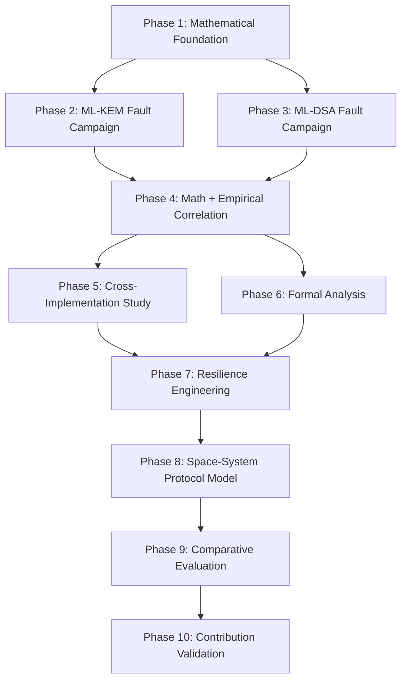

# Post-Quantum Cryptography Space Systems Research Roadmap

**Project Title:** Fault Resilience Analysis of Post-Quantum Cryptographic Implementations for Space Systems  
**Standards:** NIST FIPS 203 (ML-KEM), NIST FIPS 204 (ML-DSA)  
**Document Version:** 1.0.0-ROADMAP  
**Date:** October 1, 2026  
**Status:** ACTIVE RESEARCH PLAN  

---

## Roadmap Overview

This machine-readable roadmap structures the ten subsequent phases of research. Each phase defines specific inputs, core objectives, experimental targets, formal verification boundaries, and exit criteria.

---

## Phase Breakdown

### Phase 1 — Mathematical Foundation
- **Objective:** Construct the unified mathematical fault propagation and error-bounding model for NIST FIPS 203 and FIPS 204.
- **Key Modules:**
  - Polynomial ring arithmetic over $R_q = \mathbb{Z}_q[X]/(X^{256}+1)$ with $q=3329$ and $q=8380417$.
  - Cooley-Tukey 7-layer NTT butterfly tree and twiddle factor arithmetic.
  - Linear error diffusion equations: $N_{\text{diffused}}(L) = 2^{7-L+1}$.
  - Non-linear lossy compression rounding boundaries: $\text{Compress}_d(x) = \lceil (2^d / q) \cdot x \rfloor \pmod{2^d}$.
  - Derivation of analytical bounds: closed-form maximum perturbation $|\delta|_{\max}$ absorbed by compression as a function of layer $L \in \{1 \dots 7\}$ for $d_u \in \{10, 11\}$ and $d_v \in \{4, 5\}$.
- **Exit Criteria:** Mathematical proofs documented in `docs/mathematics/quantization_bounds.md` with symbolic verification in Python/SymPy.

### Phase 2 — ML-KEM Fault Campaign
- **Objective:** Execute exhaustive parametric mid-operation fault campaigns across all FIPS 203 parameter sets.
- **Key Modules:**
  - Parameter sets: ML-KEM-512, ML-KEM-768, ML-KEM-1024.
  - Targets:
    - All 7 forward NTT layers and 128 butterfly coordinates.
    - Inverse NTT (iNTT) butterfly layers.
    - Intermediate 32-bit vector accumulators $t[0], t[1]$ across vector steps $k \in \{0 \dots K-1\}$.
    - Centered Binomial Distribution (CBD) SWAR popcount intermediates and sampled coefficients.
    - Fujisaki-Okamoto re-encryption comparison predicates and memory buffers.
    - Serialized secret key components ($\mathbf{s}, \mathbf{e}, \mathbf{t}, d, z$).
  - Fault dimensions: bit position ($0 \dots 15$), additive delta ($\Delta \in \{+1, +8, +15, +100\}$), timing, and location.
  - Statistical scale: $N \ge 1,000$ iterations per campaign with Wilson 95% confidence intervals.
- **Exit Criteria:** Raw JSON output in `results/mlkem_campaign_results.json` and sensitivity heatmaps.

### Phase 3 — ML-DSA Fault Campaign
- **Objective:** Instrument and execute comprehensive mid-operation fault campaigns on NIST FIPS 204.
- **Key Modules:**
  - Parameter sets: ML-DSA-44, ML-DSA-65, ML-DSA-87.
  - Targets:
    - Fiat-Shamir with Aborts rejection sampling loops (loop counter tampering, premature aborts).
    - Infinity-norm bounding checks ($\|z\|_\infty < \gamma_1 - \beta$ and $\|r_0\|_\infty < \gamma_2 - \beta$).
    - HighBits and LowBits decomposition (`Power2Round`, `Decompose`).
    - Hint bit generation and signature encoding.
    - Number Theoretic Transform (NTT) for $q=8380417$.
    - Deterministic vs. hedged (randomized) signing modes under identical faults.
  - Failure modes evaluated: signature invalidity, verification failure, rejection loop hang (SEFI), and potential bias leakage.
- **Exit Criteria:** Raw JSON output in `results/mldsa_campaign_results.json` and loop termination bounds.

### Phase 4 — Mathematical + Empirical Correlation
- **Objective:** Systematically connect theoretical error equations with observed implementation-level outcomes.
- **Key Pipeline:**
  $$\text{Mathematical Fault } (a \to a + \delta) \longrightarrow \text{Implementation Location } (\text{Line, Register, Buffer}) \longrightarrow \text{Fault Propagation } (\text{Diffusion / Reduction}) \longrightarrow \text{Observable Outcome } (\text{Correct, Rejection, Mismatch, Hang, Crash})$$
- **Deliverables:** Empirical validation of the Phase 1 closed-form bounds; proof of error absorption limits; sensitivity matrix mapping every intermediate stage to its categorical outcome distribution.
- **Exit Criteria:** Correlation report in `docs/mathematics_implementation_correlation.md`.

### Phase 5 — Cross-Implementation Study
- **Objective:** Determine whether fault sensitivity is algorithm-invariant or implementation-dependent.
- **Target Comparisons:**
  - `mlkem-native` (CBMC-verified C90) vs. `liboqs` ML-KEM (dynamically linked, SIMD-accelerated).
  - `mldsa-native` (CBMC-verified C90) vs. `liboqs` ML-DSA.
- **Methodology:** Subject both codebases to identical fault models at equivalent algorithmic stages under matched PRNG seeds.
- **Metrics:** Outcome distribution divergence, crash rates, compiler inlining/vectorization effects.
- **Exit Criteria:** Comparative report in `docs/cross_implementation_study.md`.

### Phase 6 — Formal Analysis
- **Objective:** Apply formal methods to evaluate fault resilience where mathematically and practically sound.
- **Evaluation Matrix:**
  - **CBMC (C Bounded Model Checker):** Formulate function contracts proving that proposed assertions catch single-bit corruptions in polynomial buffers.
  - **SMT/Z3:** Model the compression quantization threshold symbolically to verify absorption limits.
  - **Frama-C / KLEE / Static Analysis:** Evaluate feasibility for assertion verification.
- **Constraint:** Only adopt methods that materially strengthen the research; avoid introducing formal complexity for its own sake.
- **Exit Criteria:** Verified CBMC contracts or formal feasibility report in `docs/formal_fault_analysis.md`.

### Phase 7 — Resilience Engineering
- **Objective:** Engineer and evaluate lightweight, software-only resilience mechanisms for flight processors.
- **Mechanisms:**
  - Intermediate norm boundary assertions.
  - Modular polynomial checksums and NTT invariant checking.
  - Selective redundancy: protecting only sensitive stages (NTT Layers 4–7, accumulators, norm checks).
  - Rejection loop timeout watchdogs.
  - Autonomous retry and checkpoint recovery routines.
- **Metrics:**
  $$\text{Overhead} = \frac{T_{\text{protected}} - T_{\text{baseline}}}{T_{\text{baseline}}} \le 25\%, \quad \text{Fault Coverage} = \frac{\text{Detected Faults}}{\text{Total Faults}} \ge 95\%$$
- **Exit Criteria:** Functional C implementation in `resilience/` with zero empty stubs and complete benchmark suite.

### Phase 8 — Space-System Protocol Model
- **Objective:** Ground the cryptographic fault outcomes in an explicitly abstract spacecraft communication protocol.
- **Framework:**
  - Align with Consultative Committee for Space Data Systems (CCSDS) Space Data Link Security (SDLS) standard (CCSDS 355.0-B-1).
  - Explicit multi-stage telecommand receiver: Decryption $\to$ Magic Sync $\to$ Sequence Window $\to$ Opcode Dictionary $\to$ Semantic Validation / CRC $\to$ Execution.
  - Telemetry and telecommand framing models under simulated orbital bit error rates (BER).
  - State machine for autonomous session recovery upon cryptographic desynchronization.
- **Strict Guardrail:** Do NOT claim physical spacecraft qualification. State explicitly that this is an abstract communication protocol simulation.
- **Exit Criteria:** Protocol simulation harness and benchmark logs in `results/spacecraft_protocol_benchmarks.json`.

### Phase 9 — Comparative Evaluation
- **Objective:** Quantify trade-offs across all implemented mechanisms against standardized aerospace metrics.
- **Metrics Evaluated:**
  - Fault detection coverage (%).
  - Undetected Silent Data Corruption (SDC) rate (%).
  - Autonomous recovery rate (%).
  - Computational latency overhead (CPU cycles & milliseconds).
  - Memory footprint overhead (RAM / stack bytes).
  - Binary code size increase (bytes).
  - Communication link overhead (framing bytes & retransmissions).
  - False positive and false negative rates of assertions.
- **Exit Criteria:** Multi-dimensional trade-off matrix in `results/comparative_evaluation.csv`.

### Phase 10 — Research Contribution Validation
- **Objective:** Subject all experimental and mathematical findings to rigorous academic peer-review scrutiny.
- **Categorization of Findings:**
  - **Genuinely New:** High-novelty contributions (e.g., quantization absorption bounds, software-only selective resilience).
  - **Incremental:** Useful refinements to known phenomena.
  - **Confirmatory:** Independent replications of published results (e.g., FO predicate bypass).
  - **Engineering Contributions:** High-quality software implementations, test harnesses, and protocol models.
  - **Negative Results:** Hypotheses that were experimentally disproved.
  - **Future Work:** Open questions requiring physical particle accelerator beam testing.
- **Strict Guardrail:** Do NOT force novelty. Report negative results and confirmations with full academic honesty.
- **Exit Criteria:** Final research paper draft or comprehensive monograph in `docs/FINAL_RESEARCH_REPORT.md`.

---
*Roadmap approved and frozen for sequential phase execution.*
