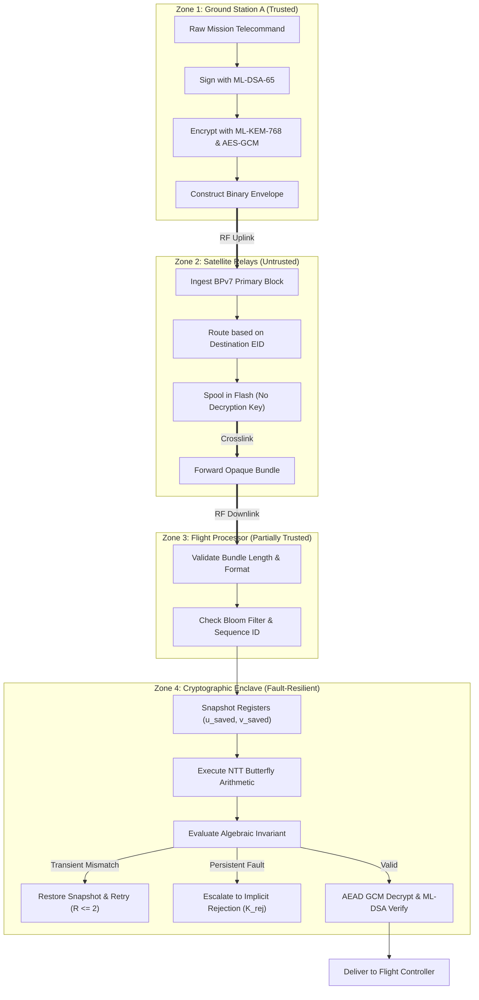

# ASTRA-Sec: Trust Boundaries & Enclave Specification
## Architectural Isolation, Zone Delineation, and Boundary Transition Contracts

**Author:** ASTRA-Sec Development Agent  
**Date:** November 2026  
**Status:** Complete  
**Standards:** NIST SP 800-207 (Zero Trust Architecture), ECSS-Q-ST-80C

---

## 1. Architectural Trust Zone Delineation

ASTRA-Sec establishes four strict security trust zones across terrestrial and spaceflight assets:

```
+----------------------------------------------------------------------------------------------------+
| ZONE 1: SECURE GROUND STATION ENCLAVE (TRUSTED)                                                    |
| Physically secured facilities, HSM key storage, mission telecommand generation, authoritative audit |
+----------------------------------------------------------------------------------------------------+
                                                  │
                                                  ▼ (Untrusted RF Space Uplink)
+----------------------------------------------------------------------------------------------------+
| ZONE 2: UNTRUSTED MULTI-HOP SPACE RELAYS (UNTRUSTED / PASS-THROUGH)                                |
| Commercial LEO satellites, crosslink constellations, store-carry-forward bundle queues             |
+----------------------------------------------------------------------------------------------------+
                                                  │
                                                  ▼ (Untrusted RF Space Downlink)
+----------------------------------------------------------------------------------------------------+
| ZONE 3: RADIATION-EXPOSED FLIGHT COMPUTING SILICON (PARTIALLY TRUSTED)                              |
| COTS flight microcontrollers, internal ALU registers, pipeline latches subject to cosmic SEUs     |
+----------------------------------------------------------------------------------------------------+
                                                  │
                                                  ▼ (Internal Invariant Guard Barrier)
+----------------------------------------------------------------------------------------------------+
| ZONE 4: CRYPTOGRAPHIC EXECUTION ENCLAVE (FAULT-RESILIENT TRUSTED BOUNDARY)                          |
| Isolated C99 routines, register snapshots (u_saved, v_saved), TFIB reference twiddle memory         |
+----------------------------------------------------------------------------------------------------+
```

---

## 2. Trust Zone Definitions

### Zone 1: Secure Ground Mission Control Enclave (Fully Trusted)
- **Entities:** Ground Station A (GSA), Ground Station B (GSB).
- **Physical Boundary:** Terrestrial control center with biometric access, air-gapped or VPN backhaul.
- **Key Materials Held:** Master ML-DSA-65 private signing keys ($sk_{sign}$), master ML-KEM-768 private decapsulation keys ($sk_{dec}$), historical audit ledgers.
- **Threat Exposure:** Terrestrial cyber attacks (mitigated by traditional IT hardening).

### Zone 2: Untrusted Multi-Hop Space Relays (Untrusted)
- **Entities:** Satellite 1 (SAT1), Satellite 2 (SAT2).
- **Physical Boundary:** In-orbit satellite avionics.
- **Trust Assumption:** **Zero trust.** Relays may be operated by third-party commercial vendors, compromised by hostile electronic warfare, or subject to memory leaks.
- **Operational Boundary:** Relays inspect only Layer 5 BPv7 primary routing blocks. **They possess zero cryptographic keys** for payload blocks.

### Zone 3: Radiation-Exposed Flight Computing Silicon (Partially Trusted)
- **Entities:** Onboard flight computer (OBC) CPU cores, ALU execution units, register files, and SRAM arrays.
- **Physical Boundary:** Satellite internal avionics bay in orbit (LEO/GEO/Deep Space).
- **Trust Assumption:** The CPU hardware is assumed honest (no malicious silicon backdoors), but **physically vulnerable to cosmic ray ionization**. Bit-flips in registers are treated as stochastic faults that must be trapped before corrupting cryptographic state.

### Zone 4: Cryptographic Execution Enclave (Fault-Resilient Trusted Boundary)
- **Entities:** Monitored C99 cryptographic routines (`mlkem-native`, `libtfib.a`).
- **Isolation Mechanism:**
  - Logic boundary: Bounded C stack frames; zero heap allocations.
  - Data boundary: Pre-computation register snapshotting (`u_saved = r[j]`, `v_saved = r[j+len]`).
  - Arithmetic boundary: Sub-word algebraic invariant verification ($(u'+v') \equiv 2u \pmod q$).
  - Storage boundary: Hardened read-only reference twiddle table (`tfib_zetas_ref[128]`).

---

## 3. Boundary Crossing Sequence & Sanitization Contracts

When data transitions across trust boundaries, strict cryptographic validation contracts are enforced:



---

## 4. Boundary Transition Invariants

Every transition between trust zones must satisfy explicit mathematical and structural invariants:

| Boundary Transition | Mandatory Validation Contract | Failure Action |
|---|---|---|
| **Zone 1 $\to$ Zone 2** | ML-DSA-65 signature generated over envelope bytes $0 \dots \text{End\_of\_GCM\_Tag}$. | Transmission aborted. |
| **Zone 2 $\to$ Zone 2** | Primary block parsing only; payload blocks remain opaque CBOR byte arrays. | Corrupted bundle dropped. |
| **Zone 2 $\to$ Zone 3** | Bundle size bounded to $\le 65{,}536$ bytes; EID format matches `dtn://...` syntax. | Malformed bundle discarded. |
| **Zone 3 $\to$ Zone 4** | Register snapshotting executed before butterfly instructions; twiddle verified against `tfib_zetas_ref`. | Arithmetic execution halted. |
| **Zone 4 $\to$ Zone 3** | Invariant check $\Delta_{\text{sum}} = 0$ and $\Delta_{\text{diff}} = 0 \pmod{3329}$; retry count $\le 2$. | Persistent fail-stop invoked. |
| **Zone 4 $\to$ Zone 1** | AES-256-GCM authentication tag verified; ML-DSA-65 signature verified. | Payload rejected; FDIR alerted. |

---

## 5. Principle of Least Privilege Enforcement

1. **Relay Privilege Minimization:** Relays require only network-layer permissions. They never receive symmetric payload keys, private KEM keys, or signing keys.
2. **Cryptographic Context Isolation:** The KEM decapsulation routine receives only ciphertext buffers; it has no access to telemetry reporting sockets or network interfaces.
3. **Telemetry-Only Export:** L4 invariant counters export strictly numerical statistics (`transient_count`, `persistent_count`); they never export raw register dumps or coefficient memory, preventing side-channel leakage.
