# Workstream 1: Transform Flow and Butterfly Arithmetic Audit

**Auditor:** Independent Cryptographic Implementation Auditor  
**Date:** October 2026  
**Target Repository:** `https://github.com/dhairyahuh/pqc-research`  
**Audited Commit:** `55dd937cbad66b24e5c2c0b89b78fa776801913c`  
**Target Branch:** `space-resilience-framework`  
**Evaluated Implementation:** `algorithms/source_ref/mlkem/` (FIPS 203 ML-KEM-768 C implementation)

---

## 1. Executive Summary

This audit independently traces every Number Theoretic Transform (NTT) and Inverse NTT (InvNTT) invocation in the execution path of ML-KEM-768 decapsulation (`mlk_kem_dec_monitored`).

### Key Audit Findings:
1. **Mathematical Count Corroboration:** The total number of polynomial transforms executed during decapsulation and Fujisaki-Okamoto (FO) re-encryption is **exactly 11** ($6 \times \text{Forward NTT} + 5 \times \text{Inverse NTT}$). Across these 11 transforms, exactly **9,856 butterfly operations** ($11 \times 896$) are executed.
2. **Material Narrative Discrepancy in Manuscript:** The manuscript draft (§3.1) and prior reports assert that decapsulation begins with an *"Inverse NTT of the received ciphertext polynomials $\mathbf{u}$"* and a *"Forward NTT on secret key vector $\mathbf{s}$"*. **Source-code inspection refutes this description:**
   - In NIST FIPS 203 and the underlying `mlkem-native` codebase, the private key $\mathbf{s}$ is deserialized from bytes directly into the NTT domain ($\hat{\mathbf{s}}$). **No NTT transform is ever executed on $\mathbf{s}$ during decapsulation.**
   - The received ciphertext polynomial vector $\mathbf{u}$ arrives in the standard polynomial domain and undergoes a **Forward NTT** (`mlk_polyvec_ntt(b)`), *not* an inverse NTT.
   - The only inverse transform in initial decryption is applied to the accumulated polynomial $\hat{\mathbf{s}}^T \hat{\mathbf{u}}$ (`mlk_poly_invntt_tomont(sb)`).
   - In re-encryption (`mlk_indcpa_enc`), 3 Forward NTTs are executed on sample vector $\mathbf{r}$, followed by 3 Inverse NTTs on the candidate ciphertext vector and 1 Inverse NTT on candidate polynomial $v$.

---

## 2. Exhaustive Transform Call Table

The table below catalogs every call to `mlk_poly_ntt` and `mlk_poly_invntt_tomont` during a full invocation of `mlk_kem_dec_monitored`:

| Seq # | Phase | Calling Function | Target Argument | Dimension / Polys | Input Domain | Transform Type | Butterfly Formulation | Butterflies Executed | Source Location | Research Monitor Invoked? |
|:---:|:---|:---|:---|:---:|:---|:---|:---|:---:|:---|:---:|
| **T01–T03** | IND-CPA Decryption | `mlk_indcpa_dec` | `b->vec[0..2]` (Ciphertext vector $\mathbf{u}$) | $k=3$ | Standard (Time) | **Forward NTT** | Cooley-Tukey (CT) | $3 \times 896 = 2{,}688$ | `indcpa.c:619` $\to$ `poly_k.c:124` | **YES** (`poly.c:408`) |
| **T04** | IND-CPA Decryption | `mlk_indcpa_dec` | `sb` (Inner product $\hat{\mathbf{s}}^T \hat{\mathbf{u}}$) | $1$ | NTT Domain | **Inverse NTT** | Gentleman-Sande (GS) | $1 \times 896 = 896$ | `indcpa.c:622` $\to$ `poly.c:645` | **YES** (`poly.c:589`) |
| **T05–T07** | FO Re-encryption | `mlk_indcpa_enc` | `sp->vec[0..2]` (Noise sample $\mathbf{r}$) | $k=3$ | Standard (Time) | **Forward NTT** | Cooley-Tukey (CT) | $3 \times 896 = 2{,}688$ | `indcpa.c:558` $\to$ `poly_k.c:124` | **YES** (`poly.c:408`) |
| **T08–T10** | FO Re-encryption | `mlk_indcpa_enc` | `b->vec[0..2]` (Candidate $\mathbf{u}'$) | $k=3$ | NTT Domain | **Inverse NTT** | Gentleman-Sande (GS) | $3 \times 896 = 2{,}688$ | `indcpa.c:564` $\to$ `poly_k.c:142` | **YES** (`poly.c:589`) |
| **T11** | FO Re-encryption | `mlk_indcpa_enc` | `v` (Candidate scalar $v'$) | $1$ | NTT Domain | **Inverse NTT** | Gentleman-Sande (GS) | $1 \times 896 = 896$ | `indcpa.c:565` $\to$ `poly.c:645` | **YES** (`poly.c:589`) |

### Summary by Transform Type:
- **Total Forward NTT Transforms:** $3 + 3 = 6$ polynomials ($5{,}376$ CT butterflies).
- **Total Inverse NTT Transforms:** $1 + 3 + 1 = 5$ polynomials ($4{,}480$ GS butterflies).
- **Total Transforms:** $6 + 5 = 11$ polynomials.
- **Total Butterfly Operations:** $5{,}376 + 4{,}480 = 9{,}856$ butterflies.

---

## 3. Grounded Call Graph for Decapsulation

```mermaid
graph TD
    A["mlk_kem_dec_monitored(ct, sk)"] --> B["mlk_indcpa_dec(buf, ct, sk)"]
    
    subgraph "IND-CPA Decryption Phase"
        B --> B1["mlk_unpack_ciphertext(b, v, c)"]
        B --> B2["mlk_unpack_sk(skpv, sk)<br/>(skpv unpacked directly as NTT-domain coefficients)"]
        B --> B3["mlk_polyvec_ntt(b)<br/>[3 Forward NTTs, 2,688 CT Butterflies]"]
        B3 --> B3_loop["native_ntt_monitor_butterfly()<br/>(Monitored in poly.c:408)"]
        B --> B4["mlk_polyvec_mulcache_compute(b_cache, b)"]
        B --> B5["mlk_polyvec_basemul_acc_montgomery_cached(sb, skpv, b, b_cache)"]
        B --> B6["mlk_poly_invntt_tomont(sb)<br/>[1 Inverse NTT, 896 GS Butterflies]"]
        B6 --> B6_loop["native_invntt_monitor_butterfly()<br/>(Monitored in poly.c:589)"]
        B --> B7["mlk_poly_sub(v, sb) & mlk_poly_tomsg(m, v)"]
    end

    A --> C["mlk_hash_g(kr, buf, 64)"]
    A --> D["mlk_indcpa_enc(tmp, buf, pk, coins)"]

    subgraph "Fujisaki-Okamoto Re-encryption Phase"
        D --> D1["mlk_unpack_pk(pkpv, seed, pk)"]
        D --> D2["mlk_enc_getnoise_eta1_eta2(sp, ep, epp, coins)"]
        D --> D3["mlk_polyvec_ntt(sp)<br/>[3 Forward NTTs, 2,688 CT Butterflies]"]
        D3 --> D3_loop["native_ntt_monitor_butterfly()<br/>(Monitored in poly.c:408)"]
        D --> D4["mlk_matvec_mul(b, at, sp, sp_cache)"]
        D --> D5["mlk_polyvec_basemul_acc_montgomery_cached(v, pkpv, sp, sp_cache)"]
        D --> D6["mlk_polyvec_invntt_tomont(b)<br/>[3 Inverse NTTs, 2,688 GS Butterflies]"]
        D6 --> D6_loop["native_invntt_monitor_butterfly()<br/>(Monitored in poly.c:589)"]
        D --> D7["mlk_poly_invntt_tomont(v)<br/>[1 Inverse NTT, 896 GS Butterflies]"]
        D7 --> D7_loop["native_invntt_monitor_butterfly()<br/>(Monitored in poly.c:589)"]
        D --> D8["mlk_pack_ciphertext(tmp, b, v)"]
    end

    A --> E["mlk_ct_memcmp(ct, tmp) & Dual-Rail fail_chk"]
    A --> F{"Persistent Count > 0<br/>or Comparison Mismatch?"}
    F -->|Yes| G["Fail-Stop: Emit K_rej = SHAKE256(z || c)"]
    F -->|No| H["Emit Authentic K_valid"]
```



---

## 4. Arithmetic Derivation and Butterfly Operation Verification

### 4.1. Single-Polynomial Butterfly Calculation
In ML-KEM, the polynomial ring is $R_q = \mathbb{Z}_q[X]/(X^{256} + 1)$ with $n = 256$:
- Number of layers in radix-2 Cooley-Tukey and Gentleman-Sande decimation:
  $$L = \log_2(256) - 1 = 7 \text{ layers}$$
  *(Layer 0 operates on degree-2 base polynomials, meaning 7 layers of 2-point butterflies split $X^{256}+1$ into 128 quadratic factors).*
- Butterflies per layer:
  $$B_{\text{layer}} = \frac{n}{2} = \frac{256}{2} = 128 \text{ butterflies}$$
- Total butterflies per polynomial transform:
  $$B_{\text{poly}} = 7 \times 128 = 896 \text{ butterflies}$$

### 4.2. Verification Against Source Code Loop Bounds
In `poly.c:mlk_ntt_butterfly_block`:
- `len` takes values $128, 64, 32, 16, 8, 4, 2$ across layers $1 \dots 7$.
- For each layer, `start` steps by $2 \times \text{len}$ up to $256$.
- Inner loop executes `j` from `start` to `start + len`.
- Total inner loop iterations per layer = $128$.
- Total inner loop iterations across 7 layers = $7 \times 128 = 896$.

### 4.3. Monitor Invocation Confirmation
In `poly.c`:
- Forward butterfly loop contains `native_ntt_monitor_butterfly()` at line 408.
- Inverse butterfly loop contains `native_invntt_monitor_butterfly()` at line 589.
When compiled with `-DMLKEM_RESEARCH_FAULT_HOOKS`, the monitors execute unconditionally on every butterfly pass.
Experimental execution confirms:
```
Section 1.4 Combined Dual NTT: Total Executed = 9,856 (5,376 Forward + 4,480 Inverse), Mismatches = 0
```
This is verified to machine-cycle precision.

---

## 5. Detailed Source Discrepancies with the Manuscript

| Feature | Manuscript Statement (`manuscript_draft.md:§3.1`) | Actual Source Code Reality | Discrepancy Severity | Required Manuscript Remedy |
|:---|:---|:---|:---:|:---|
| **Ciphertext Vector Transform** | *"1. Inverse NTT of the received ciphertext polynomials u (k=3)"* | `mlk_indcpa_dec` calls `mlk_polyvec_ntt(b)` (Forward NTT on ciphertext vector). | **MAJOR (Narrative Error)** | Correct text to state that received ciphertext polynomials undergo **Forward NTT**, as ciphertext is in standard coefficient domain. |
| **Secret Key Transform** | *"2. Forward NTT on secret key vector s (k=3)"* | `mlk_unpack_sk(skpv, sk)` unpacks private key directly into NTT domain. Secret key $\hat{\mathbf{s}}$ is **never transformed** during decapsulation. | **MAJOR (Narrative Error)** | Excise claim that secret key vector $\mathbf{s}$ undergoes forward NTT. State that $\hat{\mathbf{s}}$ is stored pre-transformed in NTT domain per FIPS 203. |
| **Decryption Inverse NTT** | Not specified clearly in §3.1 list | Single Inverse NTT executed on polynomial `sb` ($\hat{\mathbf{s}}^T \hat{\mathbf{u}}$) in `indcpa.c:622`. | **MINOR** | Explicitly list the 1 Inverse NTT in decryption as the message recovery polynomial. |
| **Re-encryption Transform Breakdown** | Lumped as *"3 InvNTT / NTT for candidate ciphertext reconstruction"* | 3 Forward NTTs on $\mathbf{r}$ (`sp`), 3 Inverse NTTs on candidate vector $\mathbf{u}'$ (`b`), and 1 Inverse NTT on candidate polynomial $v$. | **MINOR** | Clarify that re-encryption executes 3 Forward NTTs and 4 Inverse NTTs ($3+1$). |
| **Total Butterfly Count** | $9{,}856$ butterflies | Exactly $9{,}856$ butterflies ($6 \times 896 + 5 \times 896$). | **NONE (Exact Match)** | Retain $9{,}856$ total, but correct the constituent component labels. |
