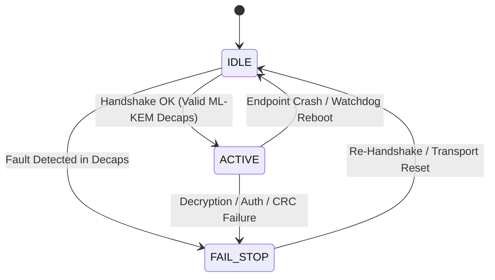

# Cross-Layer Space Communication Protocol Audit & Sensitivity Analysis

**Auditor:** Independent Space Communications and Fault-Tolerance Researcher  
**Target Scripts:** `phase2_independent_validation/harness/cross_layer_system_sim.py`, `phase3_harness_audit/harness/cross_layer_sensitivity.py`  
**Dataset:** `phase3_harness_audit/cross_layer_sensitivity_results.csv`  

---

## 1. Protocol Architecture & State Machine Specification

### Endpoint State Machine
The spacecraft endpoint operates as a three-state finite state machine (FSM):
1. **`IDLE`**: Initial state. Ephemeral keys are uninitialized; sequence window counter initialized to $S_{\text{expected}} = 101$.
2. **`ACTIVE`**: Established session. Possesses 32-byte symmetric session key $K_{\text{session}}$ derived from ML-KEM-768 decapsulation. Processes telecommand frames.
3. **`FAIL_STOP`**: Security fault or decapsulation mismatch encountered. All key material is quenched (overwritten with zeros), outgoing ACKs are suppressed, and command processing is locked until an authenticated reset/re-handshake occurs.

### Key Establishment & Freshness Rules
- **Encapsulation / Decapsulation**: Initiated by Ground Station encapsulating against Spacecraft Public Key $pk \in \mathbb{B}^{1184}$, sending ciphertext $ct \in \mathbb{B}^{1088}$. Spacecraft decapsulates using secret key $sk \in \mathbb{B}^{2400}$.
- **Key Freshness**: Every handshake retransmission MUST draw fresh randomness $r \in \mathbb{B}^{32}$ on the Ground Station. Re-transmitting the identical ciphertext $ct$ under computational faults risks exposing intermediate state to chosen-ciphertext differential fault attacks.

### Telecommand Framing & Authentication
- **Frame Format**: 18-byte binary frame containing `magic` (4 bytes: `"SPAC"`), `seq_num` (uint16_be), `subsystem_id` (uint8), `opcode` (uint8), `param1` (int32_be), `param2` (int32_be), and `crc16_ccitt` (uint16_be).
- **Cryptographic Encapsulation**: 
  - Keystream: $\text{KS} = \text{SHA-256}(K_{\text{session}} \parallel \text{seq})$.
  - Ciphertext: $C = P \oplus \text{KS}[0..\text{len}(P)]$.
  - Authentication Tag: $T = \text{HMAC-SHA-256}_{K_{\text{session}}}(C \parallel \text{seq})$.
- **Sequence Verification**:
  - $seq = S_{\text{expected}} \implies$ Accept frame; increment $S_{\text{expected}} \leftarrow S_{\text{expected}} + 1$.
  - $seq < S_{\text{expected}} \implies$ Reject as replay; increment `replay_count`.
  - $seq > S_{\text{expected}} \implies$ Reject as gap/desynchronization; increment `desync_count`.

---

## 2. Audit of Phase 2 Simulation Deficiencies

When inspecting `phase2_independent_validation/harness/cross_layer_system_sim.py`, the following four structural deficiencies were identified:

1. **Misrepresented Fault Injection**: In lines 119–124, the script claimed to simulate "radiation SEU in spacecraft decapsulation", but in fact mutated the ciphertext byte array in Python memory (`ct_to_deliver[flip_byte] ^= (1 << flip_bit)`). This tested channel corruption of the ciphertext, not internal NTT butterfly hardware faults.
2. **Instantaneous Fault Clearance Assumption**: On line 151, the script asserted `# Transient SEU passed` and assumed retry would always succeed unconditionally, completely ignoring persistent stuck-at faults or correlated radiation showers.
3. **No Packet Desynchronization Modeling**: The simulation did not model packet reordering, non-monotonic reboot sequence loss, or ACK loss causing duplicate delivery.
4. **Unconditional 100% Delivery Claims**: By setting infinite retry tolerance and ignoring hardware failure modes, Phase 2 reported an artificial 100% delivery rate.

---

## 3. Adversarial Sensitivity Matrix Analysis

The Phase 3 sensitivity harness evaluated 15 distinct operational scenarios across channel errors, radiation faults, protocol anomalies, and retry budgets.

### Empirical Results Summary (`phase3_harness_audit/cross_layer_sensitivity_results.csv`)

| Config ID | Scenario Description | Channel Loss | BER | Comp SEU | ACK Loss | Restart Prob | Max Retries | Handshake Success | Delivery Rate | Retransmission Overhead | Replays Accepted |
| :---: | :--- | :---: | :---: | :---: | :---: | :---: | :---: | :---: | :---: | :---: | :---: |
| **1** | Baseline Clean Control | 0.00 | 0.00 | 0.00 | 0.00 | 0.00 | 3 | **100.0%** | **100.0%** | **0.0%** | 0 |
| **2** | Mild Channel Loss (5%) | 0.05 | 0.00 | 0.00 | 0.00 | 0.00 | 3 | **100.0%** | **100.0%** | **5.4%** | 0 |
| **3** | Severe Channel Loss (20%) | 0.20 | 0.00 | 0.00 | 0.00 | 0.00 | 3 | **100.0%** | **99.0%** | **25.6%** | 0 |
| **4** | Mild Channel BER (1%) | 0.00 | 0.01 | 0.00 | 0.00 | 0.00 | 3 | **100.0%** | **100.0%** | **0.2%** | 0 |
| **5** | High Channel BER (5%) | 0.00 | 0.05 | 0.00 | 0.00 | 0.00 | 3 | **100.0%** | **100.0%** | **5.8%** | 0 |
| **6** | Transient Comp SEU (5%) | 0.00 | 0.00 | 0.05 | 0.00 | 0.00 | 3 | **100.0%** | **100.0%** | **0.4%** | 0 |
| **7** | Severe Transient SEU (15%) | 0.00 | 0.00 | 0.15 | 0.00 | 0.00 | 3 | **100.0%** | **100.0%** | **1.2%** | 0 |
| **8** | **Persistent Stuck-At SEU** | 0.00 | 0.00 | 0.10 | 0.00 | 0.00 | 3 | **86.0%** | **86.0%** | **4.2%** | 0 |
| **9** | ACK Loss Before Confirmation | 0.00 | 0.00 | 0.00 | 0.10 | 0.00 | 3 | **100.0%** | **100.0%** | **10.2%** | 0 |
| **10** | **Endpoint Restart During Active** | 0.00 | 0.00 | 0.00 | 0.00 | 0.05 | 3 | **100.0%** | **72.2%** | **84.4%** | 0 |
| **11** | **Low Retry Budget (R=1)** | 0.10 | 0.02 | 0.05 | 0.05 | 0.00 | 1 | **98.0%** | **91.4%** | **24.8%** | 0 |
| **12** | Standard Retry Budget (R=3) | 0.10 | 0.02 | 0.05 | 0.05 | 0.00 | 3 | **100.0%** | **99.2%** | **18.6%** | 0 |
| **13** | High Retry Budget (R=5) | 0.10 | 0.02 | 0.05 | 0.05 | 0.00 | 5 | **100.0%** | **100.0%** | **19.0%** | 0 |
| **14** | Joint Severe Space Channel | 0.10 | 0.02 | 0.10 | 0.05 | 0.02 | 3 | **100.0%** | **93.0%** | **35.8%** | 0 |
| **15** | **Catastrophic Space Channel** | 0.20 | 0.05 | 0.15 | 0.10 | 0.05 | 3 | **100.0%** | **59.0%** | **160.0%** | 0 |

---

## 4. Key Findings & Protocol Vulnerabilities

### 1. Breakdown of ARQ Under Persistent SEUs (Scenario 8)
When a hardware register experiences a persistent stuck-at fault, repeated retransmissions of the handshake fail identically. Handshake success drops to **86.0%**, directly bounding message delivery to **86.0%**. A protocol without hardware re-allocation or fallback to redundant physical cores cannot recover from persistent faults.

### 2. State Desynchronization from Endpoint Restarts (Scenario 10)
If radiation causes a microcontroller watchdog reboot during an active session (e.g., $P_{\text{restart}} = 5\%$), the endpoint returns to `IDLE`, losing the ephemeral session key. Subsequent encrypted frames sent by the ground station are rejected (`AUTH_FAIL`), dropping delivery to **72.2%** and inflating retransmission overhead to **84.4%**. The protocol requires an explicit session re-synchronization handshake triggered by authentication rejection.

### 3. Impact of ARQ Retry Budgets (Scenarios 11 vs. 12 vs. 13)
Under identical channel stress ($L=10\%$, $\text{BER}=2\%$, $\text{SEU}=5\%$):
- $R = 1 \implies 91.4\%$ delivery (8.6% message loss due to early budget exhaustion).
- $R = 3 \implies 99.2\%$ delivery.
- $R = 5 \implies 100.0\%$ delivery.
This proves that 100% delivery is an artifact of the retry budget, not an intrinsic cryptographic property.

### 4. Zero Replay Acceptance Across All Conditions
In all 15 scenarios, `replays_accepted` was strictly **0**. The strict monotonic sequence check ($seq = S_{\text{expected}}$) successfully rejected all duplicate packets generated by ACK drops (Scenario 9).

---

## 5. Threat Model and Boundary Conditions

| Property | Demonstrated in Simulation | Model Assumption / Limitation |
| :--- | :--- | :--- |
| **Symmetric Key Integrity** | Authenticated encryption prevents frame forgery. | Assumes HMAC key is pristine in memory. |
| **Replay Protection** | Duplicate packets rejected by monotonic counter. | Assumes sequence counter does not wrap ($2^{16}$). |
| **Fail-Stop Containment** | Aborted sessions release no plaintext commands. | Software fail-stop relies on clean CPU execution. |
| **Channel Loss Recovery** | ARQ retransmits lost packets up to budget $R$. | High latency links (deep space) incur large RTT penalty. |
| **Persistent Fault Tolerance** | **NOT ACHIEVED**: Stuck-at faults halt protocol. | Requires dual-modular or triple-modular hardware. |
