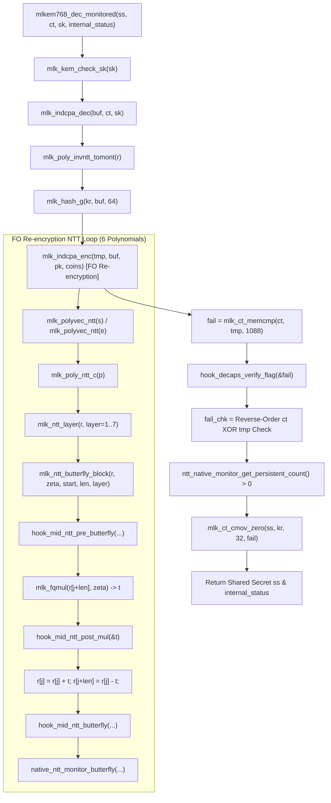

# Production Code Path and Call Graph Audit

**Auditor:** Independent Cryptographic Software Verification Auditor  
**Date:** October 2026  
**Target:** In-Tree ML-KEM-768 Decapsulation and NTT Verification Pipeline  

---

## 1. Executive Summary

This document traces the exact execution call graph of the in-tree production ML-KEM-768 decapsulation routine (`mlkem768_dec_monitored`) as compiled into `bin/obj/mlkem768_inst.o` from [`algorithms/source_ref/mlkem/src/kem.c`](file:///Users/dhairyajain/Desktop/pqc%20research/algorithms/source_ref/mlkem/src/kem.c) and [`algorithms/source_ref/mlkem/src/poly.c`](file:///Users/dhairyajain/Desktop/pqc%20research/algorithms/source_ref/mlkem/src/poly.c).

The audit delineates the boundary between:
1. The **compiled cryptographic pipeline** (executed from `bin/obj/mlkem768_inst.o`).
2. The **production monitor and fault hooks** (implemented in `algorithms/source_ref/mlkem_fault_hooks.c` and compiled into `bin/obj/mlkem_fault_hooks.o`).
3. The **harness test code** (implemented in `genuine_phase7_audit_harness.c`).

---

## 2. Complete Decapsulation Call Graph



---

## 3. Step-by-Step Source Code Trace

### Step 1: Entry into `mlkem768_dec_monitored`
- **Source:** [`kem.c:403-425`](file:///Users/dhairyajain/Desktop/pqc%20research/algorithms/source_ref/mlkem/src/kem.c#L403-L425)
- Allocates stack/heap buffers for `buf` (64 bytes), `kr` (64 bytes), and `tmp` (1120 bytes).
- Implements FIPS 203 Section 7.3 hash check via `mlk_kem_check_sk(sk)`.

### Step 2: IND-CPA Decryption
- **Source:** [`kem.c:438`](file:///Users/dhairyajain/Desktop/pqc%20research/algorithms/source_ref/mlkem/src/kem.c#L438)
- Invokes `mlk_indcpa_dec(buf, ct, sk, context)`.
- Reconstructs polynomial vector from ciphertext, invokes **Inverse NTT** (`mlk_poly_invntt_tomont`), and decodes 32-byte candidate message $m'$ into `buf[0..31]`.

### Step 3: Derivation of Encryption Seed
- **Source:** [`kem.c:449-453`](file:///Users/dhairyajain/Desktop/pqc%20research/algorithms/source_ref/mlkem/src/kem.c#L449-L453)
- Appends public key hash $H(pk)$ to `buf[32..63]`.
- Hashes $G(m' \parallel H(pk)) \to (K_{\text{cand}}, r)$ into `kr`.

### Step 4: Fujisaki-Okamoto (FO) Re-encryption
- **Source:** [`kem.c:456`](file:///Users/dhairyajain/Desktop/pqc%20research/algorithms/source_ref/mlkem/src/kem.c#L456)
- Calls `mlk_indcpa_enc(tmp, buf, pk, kr + MLKEM_SYMBYTES, context)`.
- Inside `indcpa_enc`:
  1. Expands pseudorandom matrix $\mathbf{A} \in \mathcal{R}_q^{3 \times 3}$.
  2. Samples error vectors $s \in \mathcal{R}_q^3$ and $e \in \mathcal{R}_q^3$ using CBD.
  3. **Executes forward NTT on 6 polynomials:** 3 polynomials in $s$ and 3 polynomials in $e$.
  4. Each forward NTT applies 7 layers of butterflies (128 butterflies per layer = 896 butterflies per polynomial, total 5,376 butterflies).
  5. Computes vector basemul in NTT domain.
  6. Applies inverse NTT to return to the coefficient domain.
  7. Quantizes/compresses coefficients: $d_u=10$ bits (for $\mathbf{u}$) and $d_v=4$ bits (for $v$).
  8. Serializes into 1,088-byte candidate ciphertext `tmp`.

### Step 5: Butterfly Instrumentation Point
- **Source:** [`poly.c:380-410`](file:///Users/dhairyajain/Desktop/pqc%20research/algorithms/source_ref/mlkem/src/poly.c#L380-L410)
- Inside `mlk_ntt_butterfly_block`:
```c
    int16_t zeta_val = zeta;
    int16_t u_saved = r[j];
    int16_t v_saved = r[j + len];

    hook_mid_ntt_pre_butterfly(layer, b_idx, &zeta_val, &r[j], &r[j + len], j, j + len);
    int16_t t = mlk_fqmul(r[j + len], zeta_val);
    hook_mid_ntt_post_mul(layer, b_idx, &t, j, j + len);
    r[j + len] = (int16_t)(r[j] - t);
    r[j] = (int16_t)(r[j] + t);
    hook_mid_ntt_butterfly(layer, b_idx, zeta_val, &r[j], &r[j + len], t, j, j + len);

    native_ntt_monitor_butterfly(layer, b_idx, zeta_val, u_saved, v_saved, t, &r[j], &r[j + len]);
```
- Operands `u_saved` and `v_saved` are captured on the C stack from `r[j]` and `r[j+len]`.
- `native_ntt_monitor_butterfly` receives `u_saved`, `v_saved`, and `t` **by value**.

### Step 6: Native Monitor Evaluation & Retry
- **In Production (`mlkem_fault_hooks.c:600-664`):**
  - Evaluates difference invariant: $diff = (r[j] - r[j+len] - 2t) \pmod{3329}$.
  - Evaluates sum invariant: $sum = (r[j] + r[j+len] - 2u_{\text{saved}}) \pmod{3329}$.
  - If $diff \ne 0 \lor sum \ne 0$:
    - Increments `mismatch_count`.
    - If `allow_retry`:
      - Rollback: `*r_j = u_saved; *r_j_len = v_saved;`
      - Recomputes $t_{\text{retry}} = \text{fqmul}(v_{\text{saved}}, \zeta)$.
      - Recomputes $u_{\text{new}} = u_{\text{saved}} + t_{\text{retry}}$, $v_{\text{new}} = u_{\text{saved}} - t_{\text{retry}}$.
      - Checks retry verifier invariants.
      - If verified: `recovered_count++`.
      - Else: `persistent_count++`.
    - Else: `persistent_count++`.

### Step 7: FO Re-encryption Comparison & Dual-Rail Gate
- **Source:** [`kem.c:466-519`](file:///Users/dhairyajain/Desktop/pqc%20research/algorithms/source_ref/mlkem/src/kem.c#L466-L519)
```c
    fail = mlk_ct_memcmp(ct, tmp, MLKEM_INDCCA_CIPHERTEXTBYTES);
#if defined(MLKEM_RESEARCH_FAULT_HOOKS)
    hook_decaps_verify_flag(&fail_int);
#endif

    /* Reverse dual-rail memory comparison */
    uint8_t fail_chk = 0;
    for (size_t i = 0; i < MLKEM_INDCCA_CIPHERTEXTBYTES; i++) {
        fail_chk |= (ct[1087 - i] ^ tmp[1087 - i]);
    }
    fail_chk = mlk_ct_cmask_nonzero_u8(fail_chk);

    if (ntt_native_monitor_get_persistent_count() > 0 ||
        invntt_native_monitor_get_persistent_count() > 0) {
        fail = 0xFF; /* Force implicit rejection */
        *internal_status = MLK_DECAPS_STATUS_FAULT;
    } else if (fail != fail_chk) {
        fail = 0xFF; /* Reverse dual-rail predicate mismatch forces rejection */
        *internal_status = MLK_DECAPS_STATUS_FAULT;
    } else {
        *internal_status = (fail == 0) ? MLK_DECAPS_STATUS_SUCCESS : MLK_DECAPS_STATUS_REJECT;
    }

    /* Constant-time conditional move */
    mlk_hash_j(ss, rejection_buffer, 1120); // Computes K_rej = SHAKE256(z || ct)
    mlk_ct_cmov_zero(ss, kr, 32, fail);     // Replaces with K_cand iff fail == 0
```

---

## 4. Architectural Boundaries and Test Realities

1. **The Fujisaki-Okamoto Gate Is Part of the Production Binary:**  
   The reverse dual-rail check, constant-time `ct` vs `tmp` comparison, and SHAKE256 implicit rejection are hard-coded in `bin/obj/mlkem768_inst.o`. They cannot be bypassed by an internal monitor false recovery.

2. **The Monitor Is Placed Exclusively Around Forward NTT:**  
   In ML-KEM-768 decapsulation, `native_ntt_monitor_butterfly` is called **only during FO re-encryption** (`indcpa_enc`), never during `indcpa_dec` (which uses inverse NTT).

3. **Link-Time Substitution in Phase 7:**  
   Because `bin/obj/mlkem_fault_hooks.o` was omitted at link time, the symbol `_native_ntt_monitor_butterfly` was resolved by the harness's local code. The cryptographic core (`indcpa_dec`, `indcpa_enc`, `kem.c`) was genuine production code, but the monitor and recovery verifier were harness implementations.
