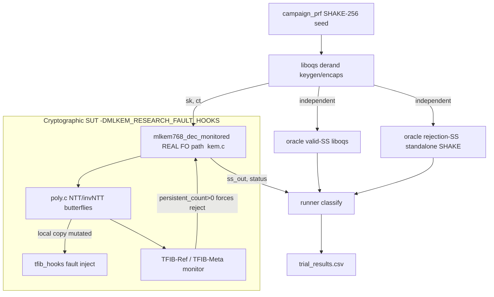

# Architecture (verified) — ML-KEM-768 / TFIB fault-resilience harness

All boundaries below were read from source this session (file:line). This describes the
**current** system, not the proposed extension.

## Modules & responsibilities
- **Cryptographic SUT** — `algorithms/source_ref/mlkem/` (mlkem_native reference ML-KEM-768).
  Real FO decapsulation in `src/kem.c` (`mlk_kem_dec_monitored`, lines ~402-519). NTT/invNTT
  butterflies in `src/poly.c`. Twiddle table `zetas` is **static**, `__TEXT,__const`.
- **Fault instrumentation** — compiled only under `-DMLKEM_RESEARCH_FAULT_HOOKS`. Hook call
  sites inlined into `poly.c` (`:379-408` fwd, `:589` inv). Hook bodies in
  `tfib_implementation/tfib_hooks.c`. Injection is **symbolic** (XOR of local/stack copies).
- **Monitors (countermeasures)** — `tfib_implementation/`:
  - TFIB-Ref (`tfib_ref.c`): compares operational twiddle vs independent `tfib_zetas_ref`
    (distinct symbol/storage) + arithmetic recheck; rollback+recompute-from-reference.
  - TFIB-Meta (`tfib_meta.c`): recompute tag vs precomputed `tfib_zetas_tag`; fail-stop only.
  - Monitor state/stats: `tfib_core.c`.
- **Deterministic input PRF** — `tfib_experiments/campaign_prf.h` (SHAKE-256 XOF over a 16-byte
  LE context seed; magic `0x1337C0DE`). No `rand()`/time/entropy in audited code.
- **Independent oracle** — `tfib_experiments/phase11_oracle/`: liboqs 0.16.0 +
  standalone `fips202_ref.c` SHAKE-256 for the FO rejection key.
- **Campaign runner** — `tfib_experiments/tfib_experiment_runner.c`: drives 900 trials, calls
  the real `mlkem768_dec_monitored`, classifies outcomes vs the two oracles, writes trial CSV.
- **Conformance** — `tests/test_fips_kats.c` (+ `tests/kat_*.c`), built via top-level `Makefile`.
- **Pre-existing protocol sim (unaudited)** — `experiments/system_model/spacecraft_protocol_sim.py`.

## Data flow (primary decapsulation trial)

## Trust boundaries & shared state
- **Oracle vs SUT**: SEPARATE (liboqs + standalone SHAKE vs in-tree mlkem). Good independence.
  BUT the valid-SS oracle and SUT both implement ML-KEM; SDC = "disagrees with both oracles".
- **Monitor ↔ FO decision**: NOT a clean boundary — the monitor's persistent counter feeds back
  into `kem.c` and can force rejection (`kem.c:486-494`). Record this when attributing fail-stop.
- **Fault vs storage**: faults hit **local copies only**; the `const` tables are never written,
  so "recovery" re-reads pristine data (tautological) and no state leaks across trials
  (`runner` resets fault+stats each trial; fresh keypair/ct per trial).
- **Research hooks vs production**: gated by `-DMLKEM_RESEARCH_FAULT_HOOKS`; must stay excluded
  from ordinary builds (property to formally check later).

## Known limits of the current architecture (for the extension)
1. Injection is symbolic, not memory-address based → cannot test real memory-layout hypotheses
   (Step 2C-B). Real read-only mutation is feasible only in `__DATA_CONST`, not `__TEXT,__const`
   (see EVIDENCE_LEDGER L12/L13).
2. Recovery and fail-stop outcomes are partly structural (snapshot + persistence flag + monitor
   feedback), not emergent from genuine persistent corruption.
3. No channel/protocol layer is integrated with the crypto harness yet (only a standalone,
   unaudited Python sim).
4. No formal-verification harness; only KATs + the campaign exist.

## Phase 1 addition — canonical fault contract (`research/fault_contract/`)
A standalone, header-only contract that all new experiments must use, kept OUTSIDE the SUT and
outside any monitor decision path:
- `fault_contract.h` — versioned fault-event schema (`FC_SCHEMA_VERSION=1`), injection-status
  derivation, independent-oracle verdict, terminal outcome taxonomy, pure classifier, trial
  ledger. Flags are `uint8_t` (byte-serializable without UB).
- Trust rule encoded in code: the countermeasure's `monitor.*` claims are **untrusted**;
  `RECOVERED` requires an independent `oracle==VALID`; correctness is never taken from the SUT.
- Tests: `test_fault_contract.c` (invariants), `test_hook_gate.c` (production hooks-off guard),
  `fuzz_fault_contract.c` (ASAN/UBSAN robustness). Driver: `run_phase1_tests.sh`.
- Spec: `research/FAULT_MODEL_SPECIFICATION.md`; status: `research/EVIDENCE_LEDGER.md` L19–L23.

This module does not yet wire into the real decapsulation runner — Phase 2 will adapt
`tfib_experiment_runner` to emit v1 records and classify via `fc_classify()`, preserving the
historical CSV via the documented migration table.
