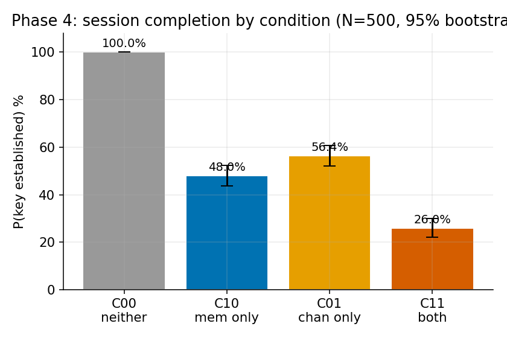
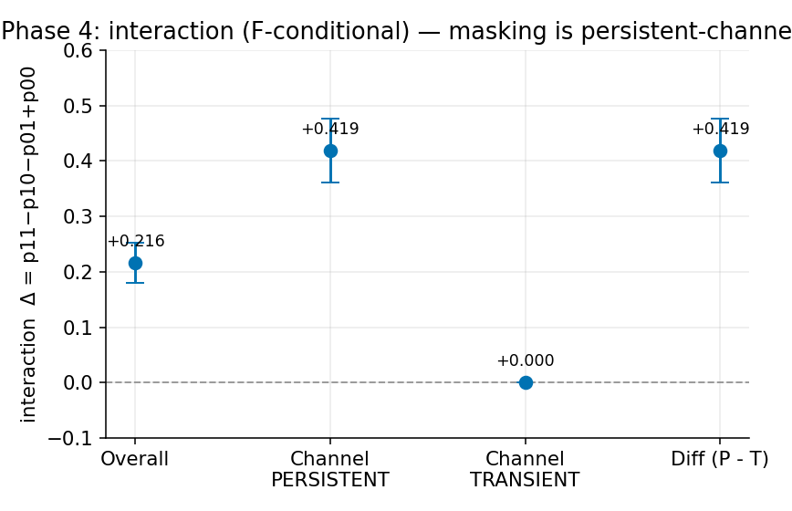
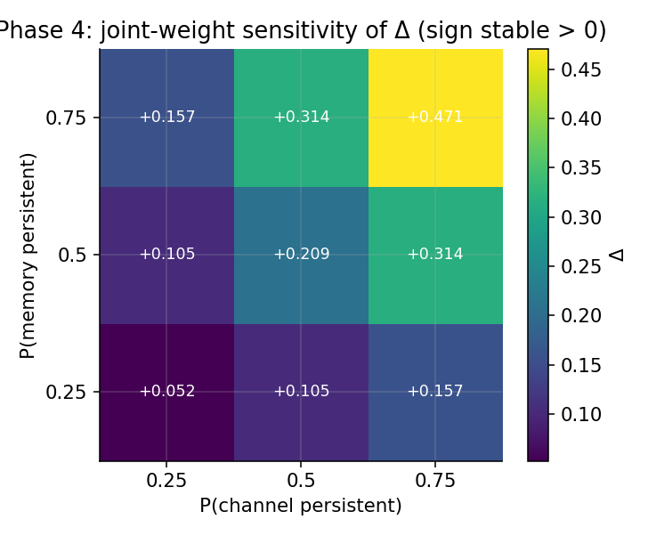
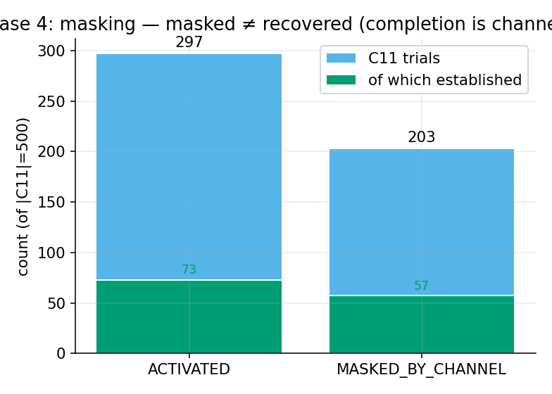
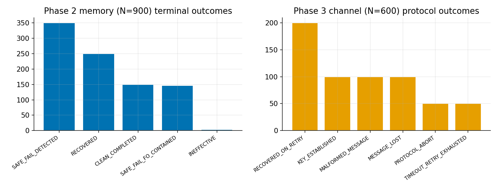

# Cross-Layer Fault Resilience of ML-KEM-768 under Software Fault Models — Consolidated Report (Phases 2–4)

**Scope.** Software-only fault *simulation* on ML-KEM-768 (FIPS 203). This report makes **no**
claim of physical radiation tolerance, electromagnetic/RF-link performance, persistent-storage
resilience, spacecraft qualification, or general causal effect. All probabilistic statements are
**frame-relative** — properties of an explicitly defined, researcher-chosen fault distribution F,
not of physical fault rates. Memory faults studied here are **logical-value** only (the
persistent-storage arm is BLOCKED; see §9).

**Platform.** Apple Silicon arm64, Darwin 27, Apple clang 21, liboqs 0.16.0, Python 3.9.6
(numpy/scipy/matplotlib). All results reproduce deterministically from the recorded drivers.

## 1. Summary of findings
- **Methodology (verified).** A versioned fault contract separates injection status, detection,
  independent-oracle verdict, and terminal outcome, and refuses to classify "recovered" without an
  independent VALID verdict. An independent oracle (liboqs + standalone SHAKE-256, cross-checked
  against `hashlib`) supplies ground truth separate from the system under test.
- **Phase 2 — memory (logical-value), N=900 (reproduced).** Re-expressing the Step 2C-A campaign
  under the contract reproduces it **byte-for-byte** (0/900 crypto mismatches) with **0 silent data
  corruption / 750 activated** and local detection 600/750. "Recovery" is shown to be *structural*
  (pristine-snapshot + untouched reference), not persistent-memory recovery.
- **Phase 3 — channel, N=600 (reproduced).** A deterministic protocol/channel emulator with a
  *meaningful* retry (retries redraw the channel) replaces the prior simulator's tautological
  retry (which had reported SESSION_RECOVERED 1000/1000). Protocol outcome and crypto verdict are
  kept strictly separate.
- **Phase 4 — combined, 500 paired seeds × 4 conditions (reproduced + independently audited).**
  **Primary finding: a delivery-blocking channel fault *masks* the memory fault (prevents its
  activation) in 40.6% (203/500) of both-fault trials**, producing sub-additive combined failure.
  Masked trials are **not** recoveries — their completion is channel-retry-driven. The interaction
  is **concentrated in persistent/blocking channels** (conditional Δ=+0.419 [+0.360,+0.477]) and is
  a **per-seed structural identity of exactly zero** for transient channels; the persistent-vs-
  transient difference is supported by a two-stratum bootstrap (CI excludes 0). The F-conditional
  average interaction is Δ=+0.216 [+0.180,+0.252], positive across the tested joint-weight family
  but magnitude-sensitive (~9×) to the persistence weights.

<!-- REPORT-APPEND -->
## 2. Methods
- **System under test.** mlkem_native reference ML-KEM-768; real FO decapsulation (`kem.c`), NTT
  in `poly.c`; research fault hooks compiled only under `-DMLKEM_RESEARCH_FAULT_HOOKS` (clean/KAT
  builds are hook-free, Makefile-verified). FIPS-203/204 KATs pass.
- **Independent oracle.** liboqs 0.16.0 (keygen/encaps/decaps via `*_derand`) + a standalone
  SHAKE-256 implementing the FIPS-203 rejection key J(z‖c); the SHAKE matches Python `hashlib` on
  empty/"abc"/multi-block-absorb/multi-block-squeeze vectors. The oracle never consults the SUT's
  monitor.
- **Fault contract (v1).** `fault_contract.h`: a byte-serializable schema distinguishing
  logical-value vs persistent-storage faults; injection status (NOT_ARMED/INELIGIBLE/FAILED/
  ACTIVATED) derived from recorded evidence; a classifier where RECOVERED is reachable only with
  oracle==VALID; a ledger that detects dropped trials. Validated by negative tests + an ASAN/UBSAN
  fuzz driver (which caught and fixed a `bool`-load UB).
- **Determinism.** All inputs derive from SHAKE-256 PRFs; distinct seeds = independent draws;
  replays are byte-identical (verified) and add no information.

## 3. Experimental design
- **Phase 2 (memory).** 18 suites × 50 = 900 trials across BASELINE/TFIB-REF/TFIB-META and
  op/ref/meta/checker loci, transient/persistent; fault = logical-value XOR of a local NTT value.
- **Phase 3 (channel).** 12 suites × 50 = 600 sessions; seven fault classes (bit, truncation, loss,
  delay→timeout, duplication, reorder, interruption) × transient/persistent + a clean (non-fault)
  baseline — eight distinct `channel_class` values in total;
  explicit state machine, 18-byte frame, SHAKE-keyed tag, retry budget 2, logical delivery deadline.
- **Phase 4 (combined).** One real decapsulation path carries both faults: the channel acts on the
  wire ciphertext *before* decapsulation; the memory fault acts *during* it. 500 seeds, each
  evaluated under four **paired** conditions C00/C10/C01/C11 (faults toggled on the same draw).
  Primary endpoint: key established within the retry budget. Distribution **F** = uniform over
  memory (config/locus/duration) × channel (class/persistence); seed = independent sampling unit.

## 4. Results
Per-condition completion (Fig. 1, `tables/table_phase4_conditions`): C00 100.0%, C10 48.0%
[43.6,52.4], C01 56.4% [52.0,60.8], C11 26.0% [22.2,30.0] (N=500, bootstrap 95% CI).
Interaction (Fig. 2, `tables/table_interaction`): Δ=+0.216 [+0.180,+0.252]; conditional
Δ_persistent=+0.419 [+0.360,+0.477] vs Δ_transient=+0.000 [0,0]; difference +0.419 [+0.360,+0.477].
Masking (Fig. 4): 203/500 = 40.6% of C11; established-among-masked 57/203 vs activated 73/297.
Joint-weight sensitivity (Fig. 3, `tables/table_sensitivity`): Δ∈[+0.052,+0.471], sign stable >0.
Isolated arms (Fig. 5): Phase 2 outcomes (0 SDC) and Phase 3 protocol outcomes.

## 5. Statistical analysis
- **Estimand.** Δ = p11−p10−p01+p00 under F; the p's are Monte-Carlo probabilities over F.
- **Unit & pairing.** The seed is the i.i.d. unit; the four conditions share one matched scenario,
  so inference uses a **paired bootstrap over seeds** (resample seeds, recompute all four means
  together). Ordinary binomial CIs over condition-trials are NOT used.
- **Difference test (#3).** Δ_persistent − Δ_transient via a two-stratum bootstrap excludes 0
  ([+0.360,+0.477]); moreover the per-seed interaction d_i is **identically 0** for every
  transient-channel seed (max|d_i|=0) — a structural identity (a transient channel clears on retry,
  leaving the memory-only outcome), not a noisy near-zero. So the difference is supported, not
  inferred from "one positive, one zero."
- **Sensitivity.** The sign is stable across the joint-weight family tested; magnitude depends
  strongly on the persistence weights. Reported as F-conditional throughout.

## 6. Reproducibility & independent audit
Drivers: `run_phase2.sh`, `run_phase3.sh`, `run_phase4_confirmatory.sh` (hashes recorded in each
`manifest*.json`). An **independent** auditor (`audit/independent_audit.py`, freshly written, not
importing the campaign stats) re-verified all three dataset hashes and **recomputed every key
metric from the raw records**, reconstructed all 500 four-condition groups, reproduced the bootstrap
CI, the difference test, and the joint grid: **AUDIT PASSED (0 discrepancies)**.

## 7. Threats to validity
Determinism means CIs are Monte-Carlo over F, not physical uncertainty; F's weights are a modeling
choice (sensitivity reported). liboqs serves as both the channel/combined KEM and the oracle, so
there is no second independent KEM in those arms (the independent check is the SHAKE rejection
recomputation + the protocol spec). The protocol is abstract (not CCSDS/ECSS); "time" is logical.
Memory "recovery" is structural (logical-value). p00 is degenerate (=1).

## 8. Limitations
Persistent-storage/spatial arm BLOCKED (vm_protect on `__TEXT,__const` SIGBUSes on this platform;
feasible only after a reviewed `__DATA_CONST` relocation). libFuzzer runtime absent (deterministic
ASAN/UBSAN driver used). Step 2C-A timing/overhead not reproduced. Single platform/compiler.

## 9. Publication-readiness assessment
- **Ready (as a software-methodology + case-study contribution, honestly scoped):** the fault
  contract + oracle-independence methodology; the reproducible isolated memory and channel arms;
  the single-path combined harness; and the **masking mechanism** finding with its paired-bootstrap
  uncertainty, structural transient-channel identity, and joint-weight sensitivity.
- **Needs more work before any stronger claim:** a physically-motivated F (current F is uniform/
  arbitrary) if population-level rates are desired; the persistent-storage arm (needs the separate
  design review); a second independent KEM for the channel/combined arms; cross-platform/compiler
  replication; and any hardware validation (out of scope here).
- **Not publishable (and not claimed):** physical radiation/RF/qualification or causal/general
  significance claims.

## 10. Artifact index (hashes)
Raw datasets (sha256): Phase 2 `55ab1f57…`, Phase 3 `2cf7c29b…`, Phase 4 `d20c0ef5…` (full hashes +
input provenance in each `research/results/*/manifest*.json`). This report's figures/tables are
regenerated by `make_figures.py`; the audit by `audit/independent_audit.py`. Design/pre-registration:
`research/PHASE4_PREREGISTRATION.md` (v1) + `…_AMENDMENT_v2.md`; evidence ledger
`research/EVIDENCE_LEDGER.md`; claim matrix `claim_evidence_matrix.csv`.
