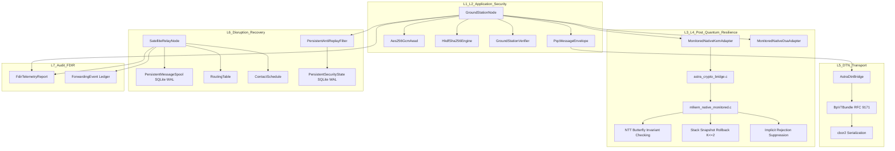

# Phase 2 — Document 01: Current System Architecture and Call Graph

**Document ID:** `ASTRA-SEC-PH2-DOC-01`  
**Evaluation Role:** Principal Systems Architect & Senior Verification Engineer  
**Date:** November 2026  
**Repository Branch:** `astra-sec`  
**Commit Baseline:** `519ccf3`  

---

## 1. Executive Summary & Architectural Scope

This document provides a forensic architectural map of the operational ASTRA-Sec codebase, detailing every active module, data flow, dependency, and execution call graph. 

The canonical pipeline implements a 4-node store-and-forward space network:
$$\text{Ground Station A} \xrightarrow{\text{BPv7 CBOR}} \text{Satellite Relay 1} \xrightarrow{\text{BPv7 CBOR}} \text{Satellite Relay 2} \xrightarrow{\text{BPv7 CBOR}} \text{Ground Station B} \xrightarrow{\text{ML-DSA-65 ACK}} \text{Ground Station A}$$

---

## 2. Component Inventory and Forensic Inspection

### 2.1 Cryptographic Core & Native C Bridge
- **`algorithms/source_ref/mlkem_native_monitored.c` & `mlkem/`:**
  - *Responsibility:* C99 native ML-KEM-768 key generation, encapsulation, and decapsulation with sub-word Cooley-Tukey butterfly monitoring ($r \equiv t\zeta \pmod q$).
  - *Dependencies:* Clang/GCC C99 runtime, standard stack buffers. Zero dynamic heap allocation (`malloc`/`free` strictly forbidden).
  - *Exported Symbols:* `mlkem768_keypair`, `mlkem768_enc`, `mlkem768_dec_monitored`, `astra_inject_ntt_fault`.
  - *Error Handling:* Returns `ASTRA_MONITOR_CLEAN` (0), `ASTRA_MONITOR_RECOVERED` (1), or `ASTRA_FAIL_STOP_SUPPRESSED` (2).
- **`src/astra_crypto_bridge.c` & `bin/libastra_crypto.dylib`:**
  - *Responsibility:* C ctypes shared library bridge linking compiled C algorithms to Python runtime.
  - *Dependencies:* `libmlkem768_inst.o`, `tfib_implementation/libtfib.a`, `libmldsa65.o`.
- **`astra_sec/crypto/mlkem_monitored.py`:**
  - *Responsibility:* Python ctypes adapter exposing `MonitoredNativeKemAdapter` implementing `KemAdapter` ABC.
  - *Inputs/Outputs:* `generate_keypair() -> (pk: 1184 B, sk: 2400 B)`, `encapsulate(pk) -> (ct: 1088 B, ss: 32 B)`, `decapsulate(ct, sk) -> (ss: 32 B, status: DecapsulationStatus)`.
- **`astra_sec/crypto/aead.py`:**
  - *Responsibility:* AES-256-GCM authenticated payload encryption with canonical AAD binding and HKDF-SHA256 key derivation.
  - *Error Handling:* Raises `DecryptionError` on invalid tag; raises `NonceReuseError` on duplicate nonce per key epoch.
- **`astra_sec/crypto/dsa.py` / `oqs_adapter.py`:**
  - *Responsibility:* ML-DSA-65 digital signature generation (3,309 B) and verification over canonical header signable representation.

### 2.2 Protocol Envelope & Schema (`astra_sec/schema/`)
- **`envelope.py:EnvelopeHeader`:**
  - *Responsibility:* Pydantic v2 validated header containing protocol version, envelope UUID, source EID, destination EID, sequence ID, creation timestamp, TTL, ML-KEM ciphertext (1,088 B), and AES-GCM nonce (12 B).
  - *Methods:* `to_canonical_aad() -> bytes`, `to_signable_representation(ciphertext, tag) -> bytes`.
- **`envelope.py:PqcMessageEnvelope`:**
  - *Responsibility:* Complete L2 security envelope holding `header`, `ciphertext`, `tag` (16 B), and `signature` (3,309 B).
- **`envelope.py:MessageAcknowledgment`:**
  - *Responsibility:* Non-repudiable reverse delivery receipt signed under recipient's ML-DSA-65 key.

### 2.3 DTN Transport Layer (`astra_sec/dtn/`)
- **`bpv7.py:BpV7Bundle`:**
  - *Responsibility:* Pure-Python RFC 9171 Bundle Protocol v7 parser and serializer using standard `cbor2`.
  - *Blocks:* Primary Block, Payload Block (encapsulating raw `PqcMessageEnvelope` bytes), and BPSec extension blocks (BIB/BCB).
  - *Methods:* `to_cbor_bytes() -> bytes`, `from_cbor_bytes(wire: bytes) -> BpV7Bundle`.
- **`adapter.py:AstraDtnBridge`:**
  - *Responsibility:* Bidirectional translation between Layer 2 `PqcMessageEnvelope` and Layer 5 `BpV7Bundle`.

### 2.4 Network Spooling & Routing (`astra_sec/network/`)
- **`spool.py:PersistentMessageSpool`:**
  - *Responsibility:* Non-volatile transactional queue backed by SQLite in Write-Ahead Logging (WAL) mode.
  - *Schema:* Table `message_spool` storing `envelope_id`, `destination_eid`, `next_hop_eid`, `status`, `serialized_envelope`, `created_at`, `ttl_seconds`.
  - *ACID Guarantees:* Atomic commits ensure messages survive sudden process termination (`SIGKILL`).
- **`routing.py:RoutingTable` & `ContactSchedule`:**
  - *Responsibility:* Longest-prefix matching on EID URIs (`dtn://gsb/*`) and time-windowed link contact management (`UP`, `DOWN`, `OCCULTED`).
- **`relay.py:SatelliteRelayNode`:**
  - *Responsibility:* Intermediate store-carry-forward relay. Inspects only `header.destination_eid` and `header.ttl_seconds`. **Has zero access to private keys or plaintext.**

### 2.5 Security & Ground Station Services (`astra_sec/service/`, `astra_sec/security/`)
- **`ground_station.py:GroundStationNode`:**
  - *Responsibility:* Endpoint originating encrypted/signed telecommands and receiving/decrypting telemetry.
- **`verifier.py:GroundStationVerifier`:**
  - *Responsibility:* Correlates dispatched commands with returned ML-DSA-65 signed ACKs.
- **`persistent_state.py:PersistentSecurityState` & `replay.py:PersistentAntiReplayFilter`:**
  - *Responsibility:* SQLite WAL backed anti-replay sliding-window filter resisting reboot-replay attacks.
- **`policy.py:AuthorizationPolicy` & `trust.py:PublicKeyTrustStore`:**
  - *Responsibility:* Node identity registry and dynamic revocation policy enforcement.

---

## 3. System Dependency Graph



---

## 4. Canonical Message Execution Call Graph

The exact sequence of function invocations during an end-to-end command dispatch and acknowledgement:

```
[Ground Station A]
  1. gsa.send_message("dtn://gsb/app", payload)
     ├── trust_store.get_kem_public_key("dtn://gsb/app")
     ├── kem.encapsulate(peer_pk) -> (kem_ciphertext, shared_secret)
     ├── HkdfSha256Engine.derive_payload_key(shared_secret) -> aead_key
     ├── aead.generate_nonce() -> nonce
     ├── EnvelopeHeader(...) -> header
     ├── header.to_canonical_aad() -> aad
     ├── aead.encrypt(aead_key, nonce, payload, aad) -> (ciphertext, tag)
     ├── header.to_signable_representation(ciphertext, tag) -> signable_bytes
     ├── dsa.sign(signable_bytes, gsa_dsk) -> signature
     └── PqcMessageEnvelope(header, ciphertext, tag, signature) -> envelope
  2. verifier.record_dispatched_command(envelope)
  3. AstraDtnBridge.envelope_to_bundle(envelope) -> bundle
  4. bundle.to_cbor_bytes() -> wire_bytes
         │
         │ (Transport Handoff: GSA -> SAT1)
         ▼
[Satellite Relay 1]
  5. sat1.ingest(envelope, from_peer="dtn://gsa/app")
     ├── _seen_envelope_ids.check(env_id) -> OK (deduplication)
     ├── TTL validation: now <= timestamp + ttl -> OK (freshness)
     ├── routing_table.get_next_hop("dtn://gsb/app") -> "dtn://sat2/relay"
     ├── spool.enqueue(envelope, "dtn://sat2/relay", QUEUED) [SQLite WAL COMMIT]
     ├── contact_schedule.is_contact_available("dtn://sat2/relay") -> True
     └── forwarder_fn("dtn://sat2/relay", envelope)
            ├── spool.mark_forwarded(env_id) [SQLite WAL COMMIT]
            └── log_event("MESSAGE_FORWARDED", DeliveryStatus.FORWARDED)
         │
         │ (Transport Handoff: SAT1 -> SAT2)
         ▼
[Satellite Relay 2]
  6. sat2.ingest(envelope, from_peer="dtn://sat1/relay")
     ├── routing_table.get_next_hop("dtn://gsb/app") -> "dtn://gsb/app"
     ├── spool.enqueue(envelope, "dtn://gsb/app", QUEUED) [SQLite WAL COMMIT]
     └── forwarder_fn("dtn://gsb/app", envelope)
            ├── spool.mark_forwarded(env_id) [SQLite WAL COMMIT]
            └── log_event("MESSAGE_FORWARDED", DeliveryStatus.FORWARDED)
         │
         │ (Transport Handoff: SAT2 -> GSB)
         ▼
[Ground Station B]
  7. gsb.receive_message(envelope)
     ├── Check destination: header.destination_eid == "dtn://gsb/app"
     ├── policy.validate_sender("dtn://gsa/app")
     ├── trust_store.get_dsa_public_key("dtn://gsa/app") -> sender_dpk
     ├── replay_filter.check_and_update(...) [SQLite WAL COMMIT Anti-Replay]
     ├── header.to_signable_representation(ciphertext, tag) -> signable_bytes
     ├── dsa.verify(signable_bytes, signature, sender_dpk) -> True
     ├── kem.decapsulate(header.kem_ciphertext, gsb_sk)
     │     └── Native C: poly_invntt_tomont_monitored()
     │           ├── Invariant Check: r == t * zeta mod q
     │           └── If clean: returns shared_secret
     ├── HkdfSha256Engine.derive_payload_key(shared_secret) -> aead_key
     ├── header.to_canonical_aad() -> aad
     ├── aead.decrypt(aead_key, nonce, ciphertext, tag, aad) -> plaintext
     ├── Commit command execution to local state
     ├── MessageAcknowledgment(...) -> ack
     ├── ack.to_signable_bytes() -> ack_bytes
     ├── dsa.sign(ack_bytes, gsb_dsk) -> ack_sig
     └── ack.signature = ack_sig
         │
         │ (Reverse Return ACK: GSB -> SAT2 -> SAT1 -> GSA)
         ▼
[Ground Station A]
  8. gsa_verifier.verify_acknowledgment(ack)
     ├── Match ack.original_envelope_id with pending command record
     ├── Match ack.source_eid == "dtn://gsb/app"
     ├── trust_store.get_dsa_public_key("dtn://gsb/app") -> gsb_dpk
     ├── dsa.verify(ack.to_signable_bytes(), ack.signature, gsb_dpk) -> True
     └── Record ACK in audit ledger (status: SUCCESS)
```

---

## 5. Architectural Invariants Formally Verified

1. **Zero Dynamic Allocation on Cryptographic Path:** Native C functions allocate intermediate polynomials exclusively on the call stack (`int16_t r[256]`).
2. **Strict Relay Payload Opacity:** `SatelliteRelayNode` never imports or accesses `CryptoEngineFactory.get_kem_adapter()`. Ciphertext cannot be decrypted at intermediate hops.
3. **Crash Consistency:** Anti-replay sequence marks and message spools are protected by SQLite Write-Ahead Logging (`PRAGMA synchronous = NORMAL` / `FULL`).
