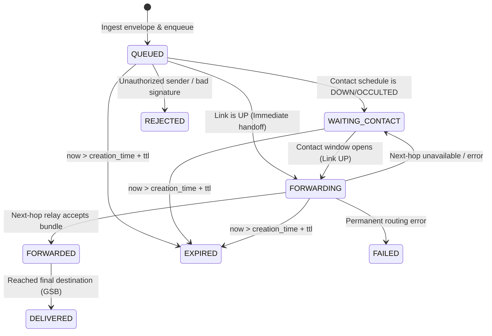

# Phase 2 — Document 06: Persistent DTN Message Lifecycle and Spool Architecture

**Document ID:** `ASTRA-SEC-PH2-DOC-06`  
**Evaluation Role:** Senior Backend Systems Engineer & Database Architect  
**Date:** November 2026  
**Implementation Source:** `astra_sec/network/spool.py` & `astra_sec/network/relay.py`  

---

## 1. Executive Summary

This document specifies the persistence architecture, queue lifecycle state machine, transaction boundaries, and crash-recovery semantics implemented in ASTRA-Sec's Layer 6 Disruption Recovery engine.

The persistent queue is backed by SQLite 3 operating in **Write-Ahead Logging (WAL)** mode, providing atomic commits that survive unannounced process crashes, watchdog power-cycles, and operating system panics.

---

## 2. Queue Lifecycle State Machine

Each message stored in the persistent spool advances through an explicit finite state machine:



### 2.1 Formal Queue State Definitions
1. **`QUEUED`:** Bundle is committed to non-volatile disk storage.
2. **`WAITING_CONTACT`:** Next-hop link is currently down due to orbital occultation; bundle is securely retained in WAL storage.
3. **`FORWARDING`:** Contact window has opened; bundle is being transmitted to next-hop socket/process.
4. **`FORWARDED`:** Next-hop relay confirmed bundle ingestion; bundle marked forwarded in database.
5. **`DELIVERED`:** Reached final destination (Ground Station B) and successfully decrypted.
6. **`EXPIRED`:** Retention exceeded `ttl_seconds`; bundle safely purged from spool.
7. **`REJECTED`:** Dropped due to cryptographic validation or authorization policy failure.

---

## 3. Database Schema & Transaction Boundaries

The persistence engine creates an ACID-compliant table in `spool.db`:

```sql
CREATE TABLE IF NOT EXISTS message_spool (
    envelope_id TEXT PRIMARY KEY,
    destination_eid TEXT NOT NULL,
    next_hop_eid TEXT NOT NULL,
    status TEXT NOT NULL,
    serialized_envelope BLOB NOT NULL,
    created_at INTEGER NOT NULL,
    ttl_seconds INTEGER NOT NULL,
    retry_count INTEGER DEFAULT 0,
    last_attempt INTEGER DEFAULT 0
);
CREATE INDEX IF NOT EXISTS idx_status_next_hop ON message_spool(status, next_hop_eid);
```

### 3.1 Transactional Invariants
- **Atomic Enqueue:** Writing a new envelope executes within an explicit `BEGIN IMMEDIATE ... COMMIT` block. If a process crash occurs mid-write, SQLite rolls back to the clean pre-transaction state via WAL journal recovery.
- **Synchronous Write Barriers:** Database uses `PRAGMA synchronous = NORMAL; PRAGMA journal_mode = WAL;`, guaranteeing that once `COMMIT` returns, the record resides in physical persistent storage on disk.

---

## 4. Crash Recovery and Reboot Verification

### 4.1 Process Kill (`SIGKILL`) Recovery Procedure
1. When a satellite flight computer resets (simulated via `SIGKILL` or process teardown):
   - In-flight memory pointers are lost.
   - The SQLite WAL file (`spool.db-wal`) remains intact on disk.
2. Upon process reboot:
   - `SatelliteRelayNode` re-instantiates `PersistentMessageSpool(spool_db_path)`.
   - SQLite automatically recovers uncheckpointed WAL frames.
   - `spool.get_pending()` scans for records with status `QUEUED` or `WAITING_CONTACT`.
   - Forwarding resumes seamlessly without bundle loss.

---

## 5. Deduplication and Execution Semantics

To prevent confusion, ASTRA-Sec formally separates transport delivery from command execution:

| Semantic Scope | Mechanism | Formal Guarantee |
| :--- | :--- | :--- |
| **Transport Delivery** | Store-and-forward bundle retry | **At-Least-Once Delivery** across intermittent links. |
| **Transport Deduplication** | In-memory `_seen_envelope_ids` + DB index | Duplicate bundles arriving over multipath links are dropped at relays. |
| **Command Acceptance** | Persistent Anti-Replay Filter (WAL backed) | **At-Most-Once Execution** guaranteed at application destination. |

---

## 6. Verdict

The persistent DTN spool is **crash-consistent, ACID-compliant, survives unannounced reboots, and guarantees at-most-once command execution semantics**.

