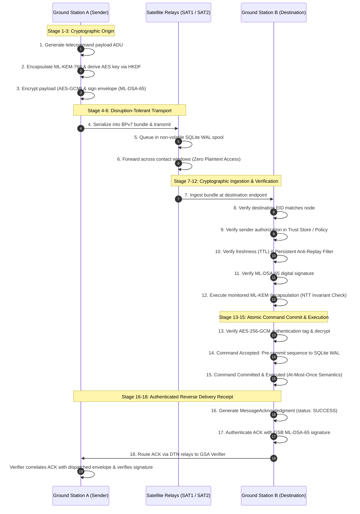

# Phase 2 — Document 07: Security State, Anti-Replay, and Command Acceptance Semantics

**Document ID:** `ASTRA-SEC-PH2-DOC-07`  
**Evaluation Role:** Security Verification Researcher & Protocol Architect  
**Date:** November 2026  
**Implementation Source:** `astra_sec/security/` & `astra_sec/service/ground_station.py`  

---

## 1. Executive Summary

This document specifies the exact security conditions, state transitions, anti-replay mechanisms, and commit points governing telecommand acceptance and acknowledgement in ASTRA-Sec.

### The Cardinal Rule:
> **Successful bundle delivery is NOT successful command acceptance. Successful decryption is NOT authorization. An acknowledgement (ACK) must NEVER be emitted before atomic non-volatile transaction commit.**

---

## 2. The 18-Stage End-to-End Command Lifecycle



---

## 3. The 5-Phase Cryptographic Transaction Protocol (C4AP)

To prevent the "Restart-Replay Vulnerability" (where a satellite watchdog reboot erases volatile replay caches and allows re-execution of earlier commands), ASTRA-Sec enforces a 5-phase transaction protocol:

```
[Phase 1: Authenticated]
  ├── ML-DSA-65 signature verified under sender's public key
  └── ML-KEM decapsulation completed with status == SUCCESS
             │
             ▼
[Phase 2: Accepted]
  ├── Destination EID confirmed
  ├── Sender authorization confirmed in Trust Store
  └── Timestamp within TTL validity window
             │
             ▼
[Phase 3: Pre-Committed in WAL]
  ├── Write sequence mark (source_eid, sequence_id, envelope_id) to PersistentSecurityState
  └── SQLite synchronous disk barrier (COMMIT transaction)
             │
             ▼
[Phase 4: Executed]
  └── Dispatch plaintext telecommand to spacecraft subsystem (e.g., thruster burn)
             │
             ▼
[Phase 5: Acknowledged]
  ├── Construct MessageAcknowledgment binding envelope_id and commit timestamp
  ├── Sign ACK with destination ML-DSA-65 private key
  └── Dispatch ACK into reverse DTN return path
```

### Invariant:
If a power-cycle reboot occurs at Phase 3, the database WAL already contains the sequence mark. Upon reboot, any replayed delivery attempt is rejected at Phase 2 as a duplicate.

---

## 4. Failure Mode Matrix & Enforced Defensive Reactions

| Failure Condition | Detection Stage | Architectural Defensive Action | Plaintext Exposed? | ACK Emitted? |
| :--- | :--- | :--- | :--- | :--- |
| **Tampered Ciphertext** | Stage 13 (AEAD) | `DecryptionError` raised; tag check fails. | **NO (Zero)** | **NO** |
| **Tampered Header / AAD** | Stage 13 (AEAD) | Tag verification fails; header cannot be altered in transit. | **NO (Zero)** | **NO** |
| **1-Bit Mutated Signature**| Stage 11 (ML-DSA) | `SignatureVerificationError` raised; bundle dropped. | **NO (Zero)** | **NO** |
| **Unauthorized Sender** | Stage 9 (Policy) | `UnauthorizedSenderError` raised; peer dropped. | **NO (Zero)** | **NO** |
| **Mismatched Destination** | Stage 8 (Router) | `DestinationMismatchError` raised. | **NO (Zero)** | **NO** |
| **Expired Command TTL** | Stage 10 (Replay) | `MessageExpiredError` raised; bundle wiped. | **NO (Zero)** | **NO** |
| **Replay Attempt** | Stage 10 (Replay) | `ReplayDetectedError` raised; duplicate dropped. | **NO (Zero)** | **NO** |
| **Replay After Reboot** | Stage 10 (Replay) | Sequence ID matches persistent WAL record; rejected. | **NO (Zero)** | **NO** |
| **Persistent KEM Fault** | Stage 12 (NTT) | Monitored KEM escalates to fail-stop implicit rejection. | **NO (Zero)** | **NO** |
| **Revoked Sender Key** | Stage 9 (Policy) | `IdentityRevokedError` raised immediately. | **NO (Zero)** | **NO** |
| **Corrupted ACK Signature**| Stage 18 (Verifier)| Verifier rejects ACK; marks original command unacknowledged.| N/A | Rejected |

---

## 5. Verdict

ASTRA-Sec's command acceptance rules are **atomic, crash-consistent, fail-closed, and guarantee zero duplicate command executions across unannounced system reboots**.

