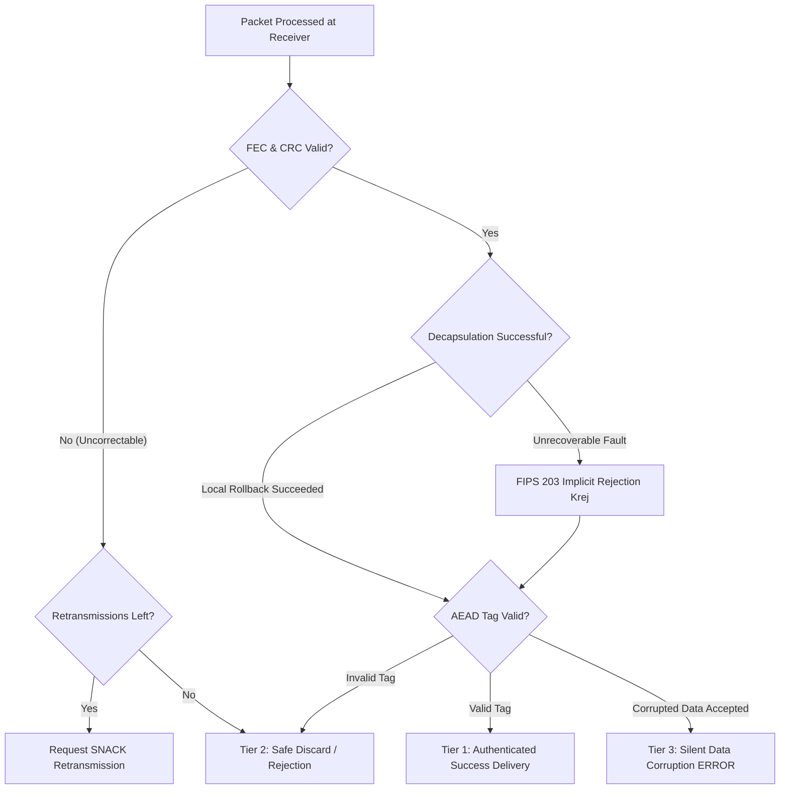

# Experimental Design and Comparative Evaluation Plan
**Project:** Adaptive, Resilient, Post-Quantum Space Communication Framework  
**Phase:** Phase 6 — Experimental Design Before Implementation  
**Date:** October 2026  
**Status:** Pre-Registration Experimental Design  

---

## 1. Experimental Objectives & Methodological Guardrails

The goal of this experimental campaign is to evaluate whether the proposed **joint, security-constrained adaptive framework** delivers measurable improvements in authenticated message delivery, goodput, and resource efficiency over established baseline architectures when subjected to concurrent space channel fades and endpoint radiation SEUs.

> **Pre-Registration Integrity Rule:** In accordance with rigorous scientific practices, **no hypothetical performance improvements are claimed as empirical facts prior to experiment execution.** This document specifies the experimental hypotheses, control variables, baseline definitions, statistical sample size determinations, and threat classifications that will govern all future test runs.

---

## 2. Benchmark Architecture Taxonomy (Baselines 1–6)

To rigorously isolate performance gains, the proposed framework is evaluated against five competing system configurations representing the progression of state-of-the-art architectures:

```
[System Configurations Evaluated]
  ├── Baseline 1: Conventional Unhardened (Fixed Code Rate R=0.90, No Interleaving, Unprotected PQC)
  ├── Baseline 2: Fixed Heavy Redundancy (Fixed Code Rate R=0.50, Interleaving D=16, Unprotected PQC)
  ├── Baseline 3: Channel-Adaptive Only (Adaptive FEC/ARQ, Unprotected PQC — El Bizri et al. 2026 model)
  ├── Baseline 4: Heavy Classical Redundancy (Fixed Code Rate R=0.75, Software DMR PQC — +150% CPU cost)
  ├── Baseline 5: Proposed Joint Framework (Adaptive FEC/ARQ + Monitored PQC + In-Place Rollback)
  └── Baseline 6: Ablation Configurations (A1: No Rollback, A2: No Interleaving, A3: No Cross-Layer Signaling)
```

### Detailed Baseline Specifications:
1. **Baseline 1 (Conventional Unhardened):** Static Reed-Solomon $RS(255, 239)$ ($R \approx 0.94$), no interleaving, standard unmonitored ML-KEM-768 C code. Models standard low-overhead terrestrial stacks deployed in space.
2. **Baseline 2 (Fixed Heavy Redundancy):** Static Reed-Solomon $RS(255, 127)$ ($R \approx 0.50$), fixed interleaving depth $D = 16$, unmonitored ML-KEM-768. Represents conservative satellite link over-provisioning.
3. **Baseline 3 (Channel-Adaptive Only — Literature State-of-the-Art):** Implements dynamic link adaptation (switching FEC rates between $0.50$ and $0.90$ based on channel loss estimates, analogous to El Bizri et al. IEEE ICC 2026), but treats the endpoint computer as a black box without arithmetic monitoring.
4. **Baseline 4 (Heavy Classical Redundancy):** Static FEC ($R = 0.75$) combined with full software-sequential Dual Modular Redundancy (DMR) on ML-KEM-768 decapsulation. Represents traditional high-reliability software.
5. **Baseline 5 (Proposed Joint Adaptive Framework):** Cross-layer controller dynamically optimizing FEC rate ($R \in \{0.50, 0.75, 0.90\}$) and interleaving depth ($D \in \{1, 4, 16\}$), coupled with native in-tree NTT butterfly monitoring and in-place register rollback.
6. **Baseline 6 (Ablation Configurations):**
   - *Ablation 6A (No Rollback):* Butterfly invariants active; detection triggers immediate fail-stop abort rather than in-place register recomputation.
   - *Ablation 6B (No Interleaving):* Joint controller active, but interleaving disabled ($D = 1$). Isolates the benefit of burst dispersion.
   - *Ablation 6C (No Cross-Layer Signaling):* Channel adaptation and endpoint rollback both active, but decoupled: the link layer receives no health tokens from the crypto engine.
   - *Ablation 6D (No Implicit Rejection):* Corrupted decapsulation outputs unverified plaintext directly to the AEAD decryptor (evaluates vulnerability to key recovery).

---

## 3. Test Scenarios & Stress Environments

Each configuration is subjected to nine distinct operational stress environments:

| Scenario ID | Test Environment Name | Channel State Conditions | Endpoint Fault Conditions | Primary Stress Target |
| :---: | :--- | :--- | :--- | :--- |
| **S01** | *Clean Nominal Baseline* | State $G$ ($P_{\text{loss}} \le 10^{-4}$, no delay jitter) | Zero injected faults (Clean) | Measures raw baseline throughput & latency overhead |
| **S02** | *Isolated Random Channel Loss* | State $G$ with Bernoulli loss ($P_{\text{loss}} = 0.05$) | Zero injected faults | Evaluates basic FEC erasure recovery without bursts |
| **S03** | *Bursty Fading Channel* | Gilbert-Elliott Markov ($P_{GB}=0.05, P_{BG}=0.20, \mu_B=5$) | Zero injected faults | Evaluates interleaving dispersion and adaptive FEC |
| **S04** | *Severe Deep-Space Outage* | State $O$ for $T_{\text{outage}} = 100$ packet intervals | Zero injected faults | Evaluates selective-repeat ARQ custody & queue overflow |
| **S05** | *Isolated Transient SEUs* | State $G$ (Nominal channel) | Transient NTT butterfly SEU ($P_{\text{SEU}} = 0.05$) | Evaluates Tier 1 in-place register rollback in software |
| **S06** | *Concurrent Burst & SEUs* | Gilbert-Elliott Markov ($P_{\text{loss}}=0.20$) | Concurrent transient SEUs in decapsulation | **The Critical Gap Test:** Evaluates joint cross-layer adaptation |
| **S07** | *Persistent Stuck-at Fault* | State $G$ (Nominal channel) | Permanent stuck-at-1 fault in butterfly register | Evaluates Tier 2 fail-stop implicit rejection containment |
| **S08** | *Adversarial Malformed Input* | State $G$ (Nominal channel) | Fuzzed ciphertext / tampered AEAD tag | Evaluates non-negotiable security invariant enforcement |
| **S09** | *Dynamic Orbit Pass* | Time-varying: $G \to B \to O \to B \to G$ transitions | Random Poisson SEU strikes during pass | Full end-to-end mission simulation |

---

## 4. Controlled Variables & Experimental Rigor

To prevent experimental bias, confounding factors are strictly controlled:
1. **Deterministic Random Seeds:** Every experiment run utilizes independent, cryptographically isolated pseudo-random number generator (PRNG) streams:
   - $\text{Seed}_{\text{traffic}}$: Controls application payload generation.
   - $\text{Seed}_{\text{channel}}$: Controls Markov state transitions and packet drops.
   - $\text{Seed}_{\text{fault}}$: Controls butterfly fault injection timing and bit positions.
2. **Fixed Traffic Profile:** Transmission of $N = 10{,}000$ standardized telemetry frames per trial (mix of Telecommand and Science Data).
3. **Execution Environment:** Single-core CPU execution pinned to an isolated high-performance core on Apple Silicon (AArch64) and cross-compiled to x86_64, compiled under `clang -O3` with constant-time flags.
4. **Sample Size Determination:** 
   - Using the **Clopper-Pearson exact binomial model**, observing zero SDC events over $N = 2{,}500$ trials bounds the true error rate to $P_{\text{SDC}} < 0.0012$ ($< 0.12\%$) at 95% confidence.
   - For goodput and latency metrics, 20 independent randomized runs ($20 \times 10{,}000 = 200{,}000$ packets) are executed to compute mean, median, standard deviation, and $p95/p99$ tail percentiles.

---

## 5. Failure Classification & Evaluation Metrics

Every packet processed across all trials is classified into the formal 4-tier outcome taxonomy:



### Primary Quantitative Metrics:
1. **Authenticated Goodput ($\mathcal{G}$):** Net application payload bytes verified and delivered per second (KB/s).
2. **Effective Delivery Ratio ($P_{\text{auth}}$):**
   $$P_{\text{auth}} = \frac{N_{\text{authenticated}}}{N_{\text{transmitted}}} \times 100\%$$
3. **Spurious Retransmission Ratio ($R_{\text{spurious}}$):**
   $$R_{\text{spurious}} = \frac{\text{Retransmissions triggered by crypto failure}}{\text{Total retransmissions}} \times 100\%$$
4. **Latency Tail Distributions:** End-to-end packet delivery time measured at the 50th, 95th, and 99th percentiles ($t_{\text{median}}, t_{p95}, t_{p99}$).
5. **Bandwidth Overhead Factor:** Ratio of total transmitted wire bytes to net payload bytes delivered.

---

## 6. Threats to Validity and Mitigation Plan

1. **Threat 1: Synthetic Channel Mismatch**
   - *Risk:* Markov discrete models may not capture fine-grained phase noise in physical satellite transceivers.
   - *Mitigation:* Explicitly document that channel models represent statistical packet erasure abstractions derived from published aerospace literature (Wondmagegn et al. 2025; Gilbert-Elliott), not physical RF wave propagation.
2. **Threat 2: SWIFI vs. Physical Radiation Mismatch**
   - *Risk:* Injected register bit-flips do not emulate sub-cycle analog latchup or clock race conditions.
   - *Mitigation:* Bound claims strictly to architectural Single-Event Upset (SEU) resilience at instruction boundaries; do not claim mission qualification under ECSS-Q-ST-60-15C.
3. **Threat 3: Artificial Baseline Degradation**
   - *Risk:* Tuning baselines poorly to make the proposed controller appear superior.
   - *Mitigation:* Implement standard, published parameter sets for all baselines (e.g., standard CCSDS Reed-Solomon rates and literature-derived adaptive rules from El Bizri et al. 2026).
