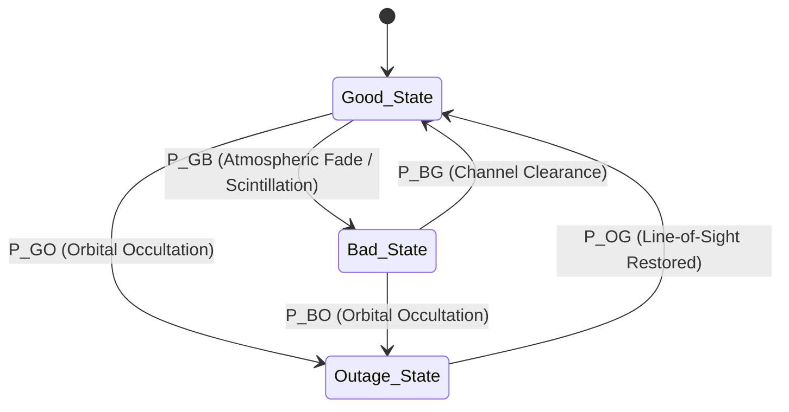

# Fault and Channel Model Specification
**Project:** Adaptive, Resilient, Post-Quantum Space Communication Framework  
**Phase:** Phase 4 — Define the System Scientifically  
**Date:** October 2026  
**Status:** Rigorous Fault & Channel Definitions  

---

## 1. Overview and Epistemological Boundaries

To ensure scientific defensibility, this specification establishes the mathematical and operational models governing the two independent sources of degradation in our simulated space framework:
1. **The External Communication Channel:** Modeling wireless link impairments (fading, packet loss, burst erasures, propagation latency, and outages).
2. **The Internal Processor Endpoint:** Modeling ionizing radiation-induced Single-Event Effects (transient bit-flips, stuck-at faults, and memory corruptions) in the microprocessor executing post-quantum decapsulation.

> **Crucial Methodological Caveat:** This framework is a **discrete-event software simulation**. It does not claim physical equivalence to orbital heavy-ion cyclotron beam testing (ECSS-Q-ST-60-15C) or analog RF channel propagation. All models represent well-defined mathematical abstractions executed on general-purpose software processors.

---

## 2. Simulated Space Communication Channel Model

The space communication channel is modeled as a discrete-time, packet-oriented stochastic process operating over discrete transmission slots $t \in \mathbb{N}$.



### 2.1 Three-State Discrete-Time Markov Channel
The channel state $S_t \in \{G, B, O\}$ evolves according to a stationary Markov chain with transition probability matrix:

$$\mathbf{P} = \begin{bmatrix} 
P_{GG} & P_{GB} & P_{GO} \\
P_{BG} & P_{BB} & P_{BO} \\
P_{OG} & P_{OB} & P_{OO} 
\end{bmatrix}$$

1. **State $G$ (Good Channel — Clear Sky / Nominal LEO Link):**
   - Packet Loss Probability: $P_{\text{loss}}(G) = \epsilon_G \le 10^{-4}$.
   - Random Bit Error Rate: $BER(G) = 10^{-7}$.
   - Typical Duration: $T_G = 1 / P_{GB} \in [100, 1000]$ packets.
2. **State $B$ (Bad Channel — Rain Fade / Plasma Scintillation / High Doppler):**
   - Packet Loss Probability: $P_{\text{loss}}(B) = \epsilon_B \in [0.10, 0.50]$.
   - Random Bit Error Rate: $BER(B) = 10^{-2}$.
   - Burst Error Characteristics: Burst length follows a geometric distribution with mean $\mu_B = 1 / P_{BG} \in [5, 50]$ consecutive packets.
3. **State $O$ (Outage State — Planetary Shadow / Ground Station Masking / Keyhole Fade):**
   - Packet Loss Probability: $P_{\text{loss}}(O) = 1.00$ (100% packet erasure).
   - Duration: $T_{\text{outage}} = 1 / P_{OG} \in [10, 500]$ transmission intervals.

### 2.2 Channel Delay and Reordering Model
For each transmitted packet $i$, the end-to-end delivery delay is modeled as:
$$D_i = d_{\text{prop}} + d_{\text{trans}} + d_{\text{queue}} + \delta_i$$
where:
- $d_{\text{prop}}$ is the deterministic One-Way Light Time (OWLT) (e.g., $10\,\text{ms}$ for LEO, $250\,\text{ms}$ for GEO).
- $d_{\text{trans}} = \text{PacketSize} / \text{LinkBandwidth}$ is transmission serialization time.
- $\delta_i \sim \mathcal{N}(0, \sigma_{\text{jitter}}^2)$ represents stochastic buffer queuing jitter.
- Out-of-order packet arrival is generated by independent random jitter variations exceeding inter-packet transmission intervals.

---

## 3. Endpoint Computational Fault Model

The endpoint computational fault module represents physical radiation disturbances occurring inside the satellite On-Board Computer (OBC) during the execution of **NIST FIPS 203 ML-KEM-768 decapsulation**.

### 3.1 Taxonomy of Modeled Computational Faults

| Fault Class ID | Fault Name | Architectural Target | Physical Mechanism Modeled | Persistence | Injection Timing |
| :---: | :--- | :--- | :--- | :---: | :--- |
| **F01** | *Transient Operand SEU* | Butterfly input registers ($u, v$) | Single-Event Upset in register flip-flop | 1 cycle (Transient) | Randomly selected butterfly $k \in [1, 9856]$ |
| **F02** | *Transient Twiddle Product SEU* | Butterfly intermediate accumulator ($t = v\zeta$) | Single-Event Transient in ALU multiplier latched at clock edge | 1 cycle (Transient) | Forward or Inverse butterfly execution |
| **F03** | *Transient Output SEU* | Butterfly result registers ($u', v'$) | Radiation strike on output register before memory write-back | 1 cycle (Transient) | Butterfly exit point |
| **F04** | *Multi-Bit Arithmetic Burst* | Multiple coefficient bits | High-LET ion depositing charge across adjacent register cells | 1 cycle (Transient) | Single butterfly stage |
| **F05** | *Persistent Stuck-at Fault* | Register / SRAM memory cell | Permanent gate oxide breakdown or stuck-at micro-latchup | Permanent ($\infty$) | Across multiple decapsulation retries |
| **F06** | *Twiddle Factor ROM Corruption* | Static twiddle lookup table (`zetas[128]`) | Hard SEU in unshielded static table storage | Semi-permanent | Stored constant memory |
| **F07** | *Checker Logic Perturbation* | Comparator branching instruction | Transient corruption of ALU status flags (`Z`-flag, `N`-flag) | 1 instruction | Invariant evaluation branch (`if (check != 0)`) |
| **F08** | *Malformed Ciphertext Injection* | Decapsulation input buffer | External channel corruption escaping link-layer CRC | N/A (Input data) | Pre-decapsulation entry point |

### 3.2 Resilience Capabilities and Subsystem Response Mapping

The endpoint fault module evaluates each fault against our established two-tier defense:

```
[Fault Event]
      │
      ▼
[Tier 1: Local Arithmetic Invariants (Forward & Inverse)]
      ├── Invariant Holds (Clean Execution or Benign Equivalent) ──► Normal Completion (Shared Secret K)
      └── Invariant Violation Detected
              │
              ▼
      [In-Place Shadow Register Rollback]
              ├── Retry 1: Recomputation Matches Invariant ───────► Autonomous Recovery (K Valid)
              └── Retry 1: Recomputation Fails (Persistent Fault)
                      │
                      ▼
              [Tier 2: Fail-Stop Escalation]
                      ├── Trigger FIPS 203 Section 7.3 Implicit Rejection
                      ├── Generate Deterministic Rejection Key Krej = SHAKE256(z || c)
                      └── Emit Internal Status Token (CRYPTO_STATUS_REJECTED)
```

### 3.3 Scope and Monitoring Boundaries

1. **Covered Fault Domain (100% Transient Recovery):**
   - Isolated transient faults (Classes F01, F02, F03, F04) striking during active butterfly arithmetic.
   - Restored autonomously with zero heap memory overhead and zero packet loss.
2. **Contained Fault Domain (100% Safe Implicit Rejection):**
   - Persistent faults (Class F05), corrupted shadow registers, and malformed ciphertexts (Class F08).
   - Unconditionally contained: unverified plaintexts are never output, and caller NULL-pointer omissions are safely trapped.
3. **Explicit Blind Spots (Documented Common-Mode Limitations):**
   - *Twiddle Table Corruption (Class F06):* Because both the butterfly calculation and the difference invariant read the same static table entry $\zeta$, a corrupted table entry passes the invariant check, corrupting output entropy without raising a local flag. Requires external table CRC validation.
   - *Correlated Checker Upset (Class F07):* Simultaneous fault inverting both arithmetic output and comparator branch outcome.
