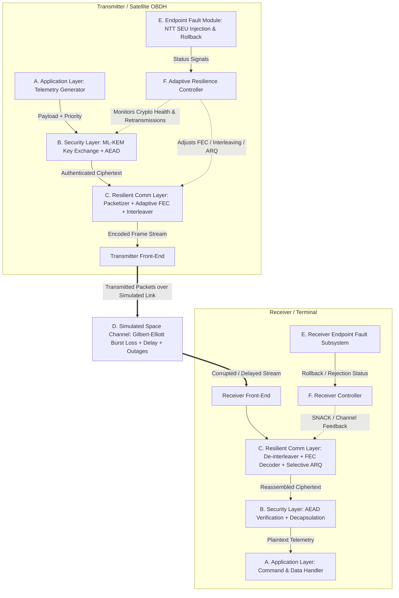

# System Architecture Specification: Adaptive, Resilient, Post-Quantum Space Communication Framework
**Project:** Adaptive, Resilient, Post-Quantum Space Communication Framework  
**Phase:** Phase 4 — Define the System Scientifically  
**Date:** October 2026  
**Status:** Complete Architectural Blueprint  

---

## 1. System Overview & Core Philosophy

The proposed system is a **purely software-implemented, modular, cross-layer communication architecture** designed to simulate secure satellite-to-ground and satellite-to-satellite links operating in hostile space radiation and fluctuating transmission environments.

### Inviolable Architectural Principles
1. **Security-Performance Decoupling:** Cryptographic authentication, key strength (NIST Category 3 / ML-KEM-768), and message integrity verification are **non-negotiable hard invariants**. The adaptation controller is strictly forbidden from lowering cryptographic parameters, skipping authentication checks, or accepting unverified plaintexts to improve throughput.
2. **Subsystem Traceability:** The existing validated PQC NTT butterfly monitoring and in-place rollback engine (`algorithms/source_ref/`) is retained intact as the **Endpoint Computational Fault Module**.
3. **Defense-in-Depth Outcome Taxonomy:** Every packet transaction terminates in one of four mutually exclusive, formally verifiable states:
   - **State 1 (Authenticated Success):** Validly decoded, integrity-verified payload delivered to application.
   - **State 2 (Safe Rejection):** Corrupted transmission, replayed frame, or unrecoverable processor fault safely contained via standard implicit rejection or fail-stop discard.
   - **State 3 (Undetected SDC):** Mathematically corrupted data delivered as valid (Target: 0.00%).
   - **State 4 (Security Failure):** Plaintext or private key material leaked to an adversary (Target: 0.00%).

---

## 2. End-to-End Architectural Decomposition

---

## 3. Subsystem Layer Specifications

### Subsystem A: Application Layer
* **Role:** Generates realistic spacecraft mission traffic with variable priorities and delivery semantics.
* **Message Profiles:**
  1. *Critical Telecommand (TC):* High priority, zero-loss tolerance, strict latency bound (< 500 ms), small payload (32–256 bytes).
  2. *Housekeeping Telemetry (HK-TM):* Periodic status packets (voltages, temperatures, attitude), medium priority, moderate loss tolerance (512–2,048 bytes).
  3. *Payload Science Data (SCI-TM):* Bulk science data (sensor imagery, spectra), low priority, delay-tolerant, high throughput (64 KB–1 MB).
* **Frame Metadata:** Monotonically increasing 64-bit Message Identifier (`msg_id`), 8-bit Traffic Class (`traffic_class`), 16-bit Payload Length (`payload_len`).

---

### Subsystem B: Security Layer
* **Role:** Establishes post-quantum confidentiality, mutual integrity, and replay protection without compromising standard cryptographic guarantees.
* **Cryptographic Primitives:**
  1. *Key Establishment:* **NIST FIPS 203 (ML-KEM-768)**.
     - Ephemeral session key negotiation producing a 256-bit shared secret $K$.
     - Periodic rekeying triggered by time intervals or packet count thresholds ($N_{\text{packets}} \ge 10^4$).
  2. *Authenticated Encryption with Associated Data (AEAD):* **ChaCha20-Poly1305** (RFC 8439) or **AES-256-GCM** (NIST SP 800-38D).
     - Encrypts application telemetry payloads.
     - Generates a 128-bit authentication tag ($\tau$) over ciphertext and associated header data (message ID, sender ID, epoch).
  3. *Replay Protection:* Monotonic 64-bit packet sequence window tracking and rejecting duplicate or out-of-order counter values.
* **Failure Handling:**
  - If AEAD authentication fails, the packet is immediately dropped, logged as a potential transmission error or tamper attempt, and routed to `Safe Rejection`. Under no circumstances is unverified plaintext passed to the application.

---

### Subsystem C: Resilient Communication Layer
* **Role:** Formats, encodes, and reassembles cryptographic payloads to overcome burst packet loss and channel noise without conversational chattiness.
* **Components:**
  1. *Packetization & Framing:*
     - Splits large ciphertexts into fixed-size Link Protocol Data Units (LPDUs, e.g., 256–1,024 bytes).
     - Prepends framing headers containing packet sequence numbers, fragment offset, and total fragment count.
  2. *Forward Error Correction (FEC):*
     - Software implementation of **Reed-Solomon Erasure Coding** ($RS(N, K)$) or systematic parity block coding.
     - Tunable code rate ($R = K/N \in [0.50, 0.95]$) selected dynamically by the Adaptive Controller.
  3. *Matrix Interleaving:*
     - Block interleaver with configurable depth ($D \in [1, 32]$ frames) that disperses contiguous channel burst erasures across multiple FEC blocks, ensuring burst errors do not overwhelm local FEC decoding thresholds.
  4. *Selective Repeat ARQ (LTP-Inspired):*
     - Non-blocking selective negative acknowledgment (SNACK) mechanism.
     - Transmitters issue periodic checkpoints; receivers reply with SNACK bitmaps requesting only missing fragments, avoiding full window retransmissions.

---

### Subsystem D: Simulated Space Communication Channel
* **Role:** Models real-world space link phenomena mathematically without physical RF/optical hardware.
* **Channel Phenotypes Modeled:**
  1. *Independent Random Bit Errors (BSC):* Background cosmic noise ($BER \in [10^{-6}, 10^{-2}]$).
  2. *Gilbert-Elliott Two-State Markov Burst Model:*
     - State $G$ (Good): Link operational, $P_{\text{loss}} \le 10^{-4}$.
     - State $B$ (Bad): Link degraded by atmospheric fade, plasma, or scintillation; $P_{\text{loss}} \in [0.10, 0.60]$.
     - Transition probabilities $P_{GB}$ and $P_{BG}$ govern mean burst duration.
  3. *Orbital Outages & Disconnects:* Deterministic or Poisson-distributed line-of-sight occultations (0% throughput for $T_{\text{outage}} \in [1, 60]$ seconds).
  4. *Variable Link Latency:* Configurable one-way propagation delay modeling LEO (5–25 ms), GEO (~250 ms), or deep space (> 60 s).

---

### Subsystem E: Endpoint Computational Fault Subsystem
* **Role:** Integrates the repository's preserved ML-KEM-768 fault resilience implementation as a monitored crypto coprocessor.
* **Implementation Linkage:** Direct software invocation of `algorithms/source_ref/mlkem_fault_hooks.c`.
* **Monitored Primitives:**
  - Evaluates all **9,856 NTT butterflies** across decapsulation.
  - Intercepts simulated register bit-flips and arithmetic corruptions.
  - Implements **Tier 1 (In-Place Register Rollback)**: Detects arithmetic faults via complementary dual invariants and recomputes locally using shadow registers.
  - Implements **Tier 2 (Hardened Implicit Rejection)**: If a fault is persistent or uncorrectable, triggers deterministic FIPS 203 implicit rejection ($K_{\text{rej}} = \text{SHAKE256}(z \parallel c)$), emitting a standardized internal fault token.
* **Signal Interface to Controller:**
  - `CRYPTO_STATUS_HEALTHY`: Clean execution.
  - `CRYPTO_STATUS_RECOVERED`: Transient fault detected and autonomously repaired locally via rollback (latency penalty paid, key valid).
  - `CRYPTO_STATUS_REJECTED`: Persistent fault or corrupted ciphertext safely rejected ($K_{\text{rej}}$ generated).

---

### Subsystem F: Adaptive Resilience Controller
* **Role:** The decision brain optimizing link parameters based on joint channel and endpoint state observations.
* **State Inputs Observed:**
  - Estimated Channel Packet Loss Rate ($\hat{P}_{\text{loss}}$ over sliding window $W_C$).
  - Mean Burst Length ($\hat{L}_{\text{burst}}$).
  - Endpoint Cryptographic Health Signal (from Subsystem E).
  - Retransmission Queue Occupancy ($Q_{\text{len}}$) and Delivery Deadline Expiration.
* **Permitted Action Space:**
  - **FEC Configuration:** Adjust code rate $R \in \{R_{\text{low}}=0.50, R_{\text{med}}=0.75, R_{\text{high}}=0.90\}$.
  - **Interleaving Depth:** Adjust $D \in \{1, 4, 16, 32\}$.
  - **Retransmission Aggressiveness:** Select immediate SNACK retransmission, deferred batch retransmission, or drop expired low-priority frames.
  - **Endpoint Coordination:** When the endpoint reports `CRYPTO_STATUS_REJECTED` due to persistent hardware faults, the controller suspends session key retransmissions, avoiding futile bandwidth consumption until an onboard warm-restart or rekeying sequence executes.
* **Inviolable Constraints (Hard Guards):**
  - $\text{Guard 1: } \text{DisableAuthentication} == \text{FALSE}$.
  - $\text{Guard 2: } \text{AcceptUnverifiedPlaintext} == \text{FALSE}$.
  - $\text{Guard 3: } \text{SecurityLevel} \ge \text{ML-KEM-768}$.
